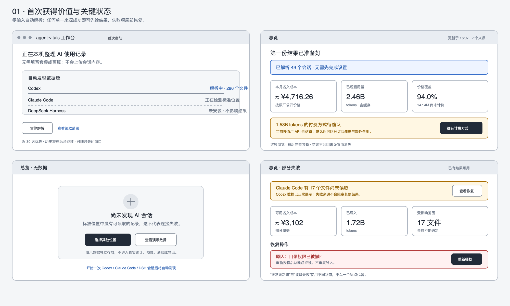
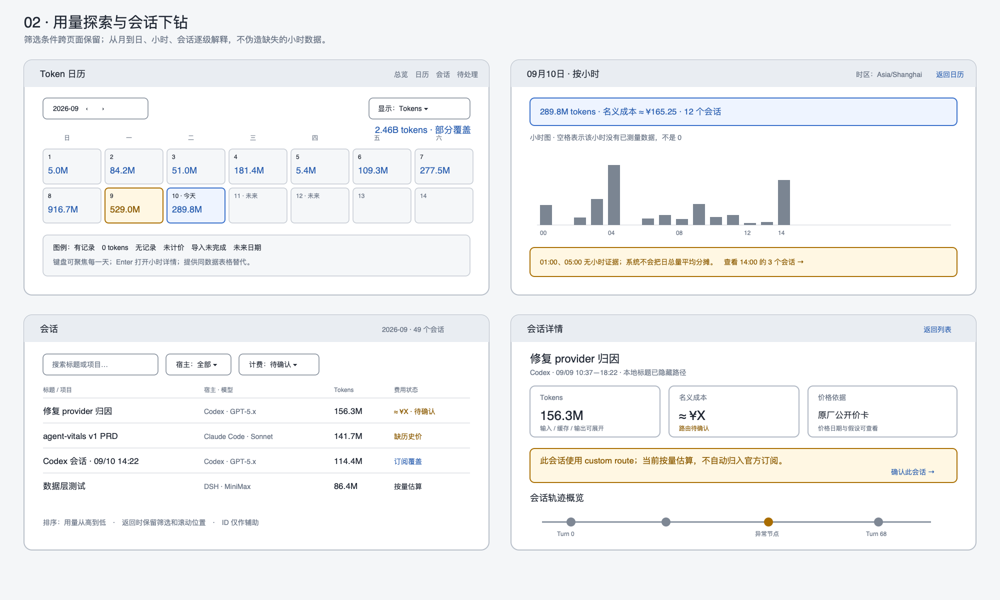
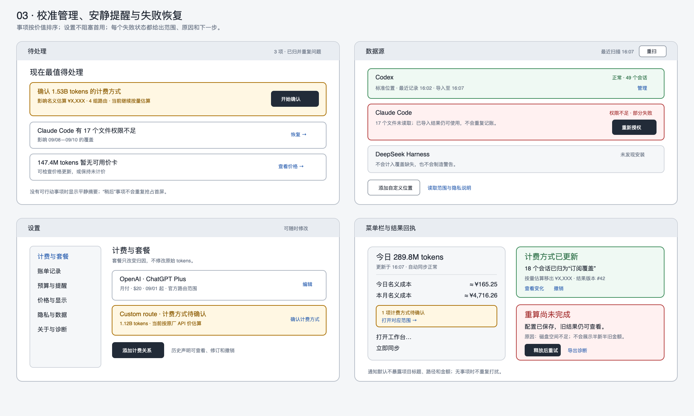
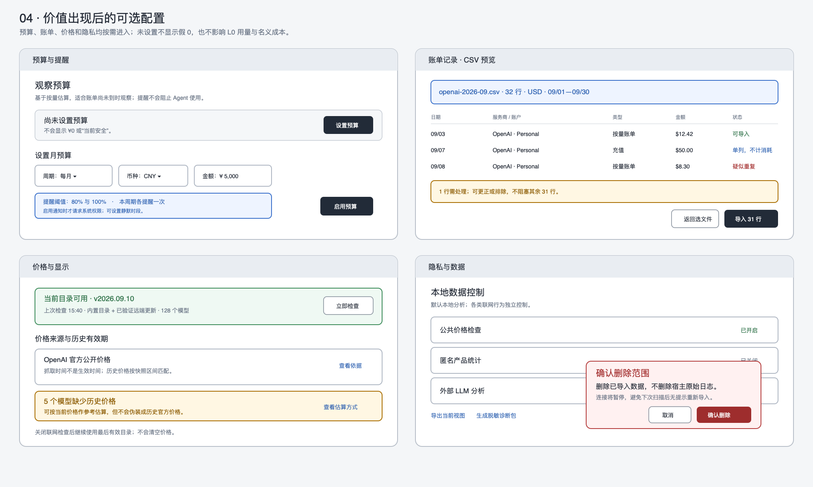
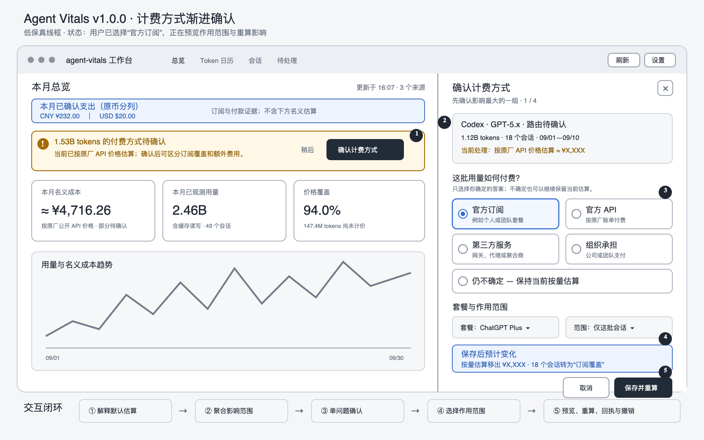

# Agent Vitals App v1.0.0 产品需求文档

> 状态：完整 PRD R5，已嵌入并核对核心线框原型，待产品/设计/研发评审；本文不是实现完成声明。  
> 日期：2026-09-10；产品发布版本：1.0.0；建议发布标签：app-v1.0.0。  
> 前置：v0.12 计费与数据基线，以及本文列出的历史缺口修复。  
> 目标平台：macOS；首发宿主：Codex、Claude Code、DeepSeek Harness（DSH）。  
> 产品原则：零输入先看到有用结果，再按需完善套餐与预算；所有金额可解释；所有异常有下一步；后台安静可靠。

## 1. 产品定义与交付承诺

Agent Vitals 是本地优先的 AI 编程用量与支出助手。它把不同工具、订阅和 API 的使用记录整理为用户能理解的答案：今天用了多少、哪些需要额外付费、什么任务值得检查，以及下一步如何改善。

v1.0.0 的交付承诺：普通用户安装并打开后，系统自动发现和解析本机已有会话，无需先填写套餐或预算即可看到第一份用量与名义成本总览；用户在理解结果后按需完善套餐、路由和账单，结果随证据逐步变得准确。全程无需终端或编辑配置文件。

“使用后不愿卸载”是待验证的产品目标。留存来自持续有用、低干扰和数据可信，不采用强制登录、通知轰炸、隐藏退出或阻碍导出等方式。用户即使一周不打开工作台，也能从菜单栏和必要提醒中获得价值。

### 1.1 版本边界

- 原 v0.13 规划并入 App v1.0.0，不另外发布同范围的 v0.13。
- 仓库历史 v1.0.1 是 ClawHub Skill 发布；保留历史，App 标签使用独立命名空间。
- 内部 crate、CLI、数据库 schema、价格目录版本分别管理，不强制改成 1.0.0。诊断页列出对应关系。
- 首发不承诺 Windows/Linux 桌面版，不以三宿主全部安装作为使用前提。

## 2. 背景、证据与问题

依据 2026-09-10 的七张真实截图及本地代码检查，现状如下。截图数字仅作缺陷复现样例，不是新用户默认值或正式指标基线。

| 现状证据 | 用户痛点 | 产品判断 |
|---|---|---|
| 总览已有大量 tokens，数据源页仍显示无可用状态 | 我不知道是不是没连上 | 数据源接口契约已漂移，不能承担连接验收 |
| 菜单栏与总览出现不同金额，标签包括名义、实付、按量等 | 到底哪个是我要付的钱 | 金额口径、时间窗和来源必须统一，并支持解释差异 |
| 本机预算配置为 ¥1，App 没有修改入口 | 这个预算谁设置的，怎么改 | 需要可见来源和设置入口；¥1 是本机已有配置，不能据此推断全体用户默认 |
| 静态价格资产包含个人订阅声明 | 别人的套餐是否算进我的账 | 公共价目与个人合同必须分离；干净安装不得继承个人声明 |
| 大量历史会话缺覆盖事件时间的价格快照 | 导入历史后仍算不出成本 | 必须区分历史价格缺失和路由未知，并支持透明的参考估算 |
| Issues 显示 3900 次命中、405 个 critical | 我无法判断先处理什么 | 命中次数不能直接当作待办数量或已发生损害 |
| 会话标题以 ID 为主，详情暴露 envelope、synthetic 等术语 | 我找不到自己的工作，也看不懂结果 | 展示任务上下文和人话解释，技术信息按需展开 |
| 首次使用先要求理解数据源、provider、套餐和预算 | 我还没看到价值，为什么先填这么多 | 首次解析默认自动进行，计费设置放在首份结果之后渐进披露 |

现有资产可复用：SQL 用量事实、计费与价格快照、会话查询、MCP、轨迹与问题模型。现有缺口不能靠新增引导页绕过，须纳入正式版本验收。

## 3. 用户分层与核心任务

| 用户 | 高频问题 | 首次价值 | 持续价值 |
|---|---|---|---|
| 仅官方订阅的个人开发者 | 我用了多少？是否触发额外收费？ | 订阅用量与额外按量分开 | 可用时展示配额窗口；回顾使用情况 |
| 多订阅与 API 混用的重度用户（核心用户） | 钱付给谁？哪些走了中转？ | 跨工具整理计费关系和用量 | 额外支出观察、路由变化提示、异常会话追查 |
| 主要使用 API 的用户 | 今天烧了多少？什么任务最贵？ | 自动估算、设置观察预算 | 异常增长提醒、成本来源定位 |
| 已有历史数据的升级用户 | 新规则会不会把旧账改坏？ | 保留数据、明确迁移与待确认项 | 可追溯的修订记录和一致结果 |
| 新装且没有日志的用户 | 怎么开始？为什么没有数据？ | 找到连接方法或理解样例 | 第一条真实记录到来后自动进入正常视图 |

首发不服务完整企业财务报销、多人配额分配或网关强制限额。团队代付用户可标注“组织承担”，但无账单时不能据此产生个人实付金额。

### 3.1 优先回答的四个问题

1. 我用了多少 AI？——已观测用量、时间范围、宿主覆盖。
2. 这些使用按原厂标价相当于多少？——先给名义成本；套餐完善后再区分订阅、按量估算与已确认支出。
3. 哪一项值得我现在处理？——有依据、可执行的少量事项。
4. 改完有效吗？——配置变更后的归因覆盖变化，或可比较的用量变化。

## 4. 成功指标与测量纪律

以下为首轮试用目标，须经验证调整，不代表已达成。

| 指标 | 定义 | 目标/门槛 |
|---|---|---|
| 首次价值达成率 | 有受支持有效日志的首次用户中，未填写表单即看到至少一宿主真实用量、名义成本状态及来源者比例 | ≥85% |
| 首份结果前强制输入 | 出现首份真实摘要前，要求用户填写、选择或确认的字段数 | 0；仅遇系统权限阻塞时允许一次授权动作 |
| 首次真实摘要耗时 | App打开到出现真实摘要；标准基准：1GB以内日志、近30天优先、Apple Silicon 16GB | P50 ≤90秒，P95 ≤5分钟 |
| 套餐完善人工耗时 | 用户看过首份总览后，主动进入并完成一条套餐关系所需时间 | P50 ≤90秒，P95 ≤3分钟 |
| 上下文确认成功率 | 点击总览“确认计费方式”的用户中，无指导完成一组归因、理解作用范围并看到重算回执者比例 | ≥80%；误把名义估算理解为实际账单者为0 |
| 痛点任务成功率 | 试用者无指导完成“找额外费用、找高消耗会话、改套餐并确认影响” | 每项 ≥80% |
| 七日有效留存 | 激活后第7天±1天查看菜单摘要/工作台/完成一次事项的用户比例 | 试用目标 ≥40%；与被动后台运行分开 |
| 两周持续使用意愿 | 两周试用后选择继续保留，且能说出一项实际价值 | 目标 ≥70%，同时报告样本数 |
| 核心口径一致性 | 同时间窗、筛选、计费与价格版本下各消费面的结果一致 | 自动验收100% |
| 假零/假空/个人配置串用 | 缺数据显示为0、契约错误显示为空、新用户继承他人套餐 | 0例，发布阻断 |

本地记录最小事件：auto_parse_started、first_summary_ready、source_changed、billing_prompt_shown、billing_prompt_opened、billing_prompt_deferred、billing_scope_selected、billing_confirmed、recalculation_completed、budget_enabled、issue_opened、correction_applied、export_completed。只记录耗时、计数、结果码与版本；不记录正文、路径、账户标识、密钥。联网产品分析须单独自愿开启；未同意不影响功能。统计留存只针对可测样本，披露偏差；卸载原因通过自愿访谈获取，不后台追踪卸载。

## 5. 用户旅程与首次启动

```text
安装并打开 → 自动发现标准数据源 → 自动解析近期会话 → 首份用量/名义成本总览
                                                        ↓
                                浏览结果 → 按需完善套餐/路由 → 结果重新归因
                                                        ↓
                                          可选预算/账单 → 更完整的支出视图
                                                        ↓
菜单栏观察 → 有价值的提醒 → 查看原因 → 校准/处理 → 查看结果 → 继续观察
```

首次体验采用渐进式成熟模型，而不是一次性设置完成状态：

| 层级 | 用户输入 | 可获得结果 |
|---|---|---|
| L0 自动解析 | 无 | 已观测用量、模型/宿主分布、按原厂价计算的名义成本、覆盖缺口 |
| L1 套餐完善 | 确认订阅/API/第三方关系 | 订阅覆盖、按量估算、待确认路由分开 |
| L2 支出完善 | 录入付款或账单 | 已确认支出及账单覆盖 |
| L3 管理完善 | 设置预算与提醒 | 预算进度、阈值提醒与周期回顾 |

任何层级都可长期使用；App不以“配置未完成”遮挡已有结果。

### 5.1 v1.0.0 线框原型与场景覆盖

以下原型使用演示数字，只定义信息层级、状态语义和交互关系，不是本机数据、测试fixture或视觉终稿。可编辑源文件、页面映射和验收索引见[完整原型索引](design/v1-wireframes/README.md)。

#### 首次获得价值：自动解析、首份结果、无数据与部分失败



#### 用量探索：Token日历、小时详情、会话列表与会话详情



#### 校准管理：待处理、数据源、设置、菜单栏及重算回执



#### 可选配置：预算、账单导入、价格更新及隐私删除



#### 计费方式渐进确认：从兜底估算到用户声明



一致性审查结论：五组原型覆盖本PRD的首次价值、日常探索、计费校准、持续观察、可选设置和失败恢复主链路；状态与金额口径一致。原型中的“价格覆盖”仅代表可匹配计价规则的token比例，来源采集、路由归因和账单覆盖仍分别报告。用户确认只能作为有范围的附加证据，不能覆盖明确冲突的路由事实。完整核对表见[原型索引](design/v1-wireframes/README.md#一致性核对)。

### FR-01 零输入启动与本地解析（必须）

- 首次打开App立即显示工作台加载态，并在后台扫描三个宿主的标准本地目录；发现可读日志后自动解析近30天记录，无需先进入向导或提交表单。
- 加载态同时用一小段常驻说明告知：“正在本机整理AI使用记录，不会上传会话内容。”用户可展开查看读取范围，也可暂停解析或进入数据源设置。
- 标准目录可读时不弹确认框；只有macOS权限阻塞时才请求对应授权。自定义目录、额外来源和排除项留到设置。
- 不要求注册、姓名、邮箱、API Key、套餐、预算或统计偏好。语言与统计时区先使用系统值。
- 导出、联网价格更新、产品统计和外部分析分别说明并按各自规则授权；自动解析本地标准目录不触发这些联网行为。
- 无记录时显示“尚未发现AI会话”，提供“选择其他位置”和“查看样例”。样例明确为演示数据，独立于真实库、预算、通知和导出。

### FR-02 自动检测与可选调整（必须）

- 总览加载态和设置页按宿主展示检测结果、读取位置简写、最近记录日期、连接状态；展开可查看完整本地路径。
- 标准位置发现且可读的来源默认启用并解析。用户可在设置中暂停、排除或删除本App导入数据；自定义位置通过目录选择器添加。
- 任意一个来源发现记录即可生成首份结果；未安装宿主不计入缺失覆盖，不制造警告。
- 状态必须区分：未选择、未发现、权限不足、已连接无记录、导入中、部分失败、正常、暂停。
- 失败提供对应操作：“选择目录”“重新授权”“重试失败文件”“查看说明”。同一宿主失败不阻塞其他宿主。
- 默认优先处理近30天，历史后台继续；用户可修改范围、暂停、恢复。进度显示文件数/阶段，无法预估总量时不用假百分比。

### FR-03 首份总览后的套餐渐进完善（必须，可长期跳过）

交互线框：[v1.0.0完整原型索引](design/v1-wireframes/README.md)；重点流程：[计费方式渐进确认](design/agent-vitals-v1-billing-confirmation-wireframe.svg)。

- 首份用量与名义成本总览先出现，套餐表单不得阻塞它。总览使用一条低压力提示：“完善套餐后，可区分订阅用量和额外按量费用”，用户可关闭或稍后处理。
- 系统解析时同步提取计费关系；存在明确官方订阅/路由证据时自动应用并展示依据。没有明确信号时保留未知，先使用名义成本视图。
- provider或付费方式不明确、但已按原厂价纳入估算时，这不是纯数据警告，而是最有上下文的用户补充入口。提示必须同时说清三件事：受影响用量、当前默认处理、确认后的收益。例如：“1.53B tokens 的付费方式待确认；当前已按原厂API价格估算。确认后可区分订阅覆盖和额外费用。”
- 提示主操作使用任务语言“确认计费方式”，不能使用含义模糊的“编辑”；次操作为“稍后”。“查看数据状态”仅用于技术证据和覆盖问题，不能代替计费确认入口。
- 先问“这部分使用如何付费？”：官方订阅、官方API、第三方服务、组织承担、不确定。同一宿主支持多条关系。
- 用户点击提示或设置后才展示问题；机器能确认的字段预填，每次只确认一条会改变结果的关系。支持“稍后再说”，不反复弹窗。
- 点击“确认计费方式”打开侧边面板，不离开总览。面板按“宿主 × 推测服务商/模型 × 路由证据”聚合同类未确认用量，默认先展示影响金额最大的组；每组展示tokens、名义成本、日期范围、会话数、当前依据和置信状态。
- 单组只先回答一个问题：“这批用量如何付费？”选择官方订阅、官方API、第三方服务、组织承担或仍不确定。仅当选择结果需要时，再渐进询问套餐名称、金额、账户、路由和有效期；不一次铺开完整表单。
- 支持“仅这批会话”“所选日期范围”“以后同类记录”三种作用范围。系统可推荐最窄的可靠范围，但不得默认把当前判断覆盖全部历史。
- 保存前即时预览：“预计从按量估算中移出 X / 保持估算 X / 仍待确认 X”；保存后在原位置给出回执和“撤销”，并刷新总览、日历、会话及MCP的一致结果。
- 官方订阅分两层记录：拥有该套餐；哪些使用记录属于套餐。拥有套餐不能证明该模型的全部历史用量受其覆盖。
- 订阅记录必要字段：服务商、套餐/自定义名称、币种、金额或“金额暂不清楚”、账期频率、生效日期。终止日期、超额付费状态可补充。
- 官方API默认匹配原厂价格；第三方服务可选目录模板、倍率或自定义价卡。配置报价只产生估算，实际支出仍需要账单或付款声明。
- 组织承担仅改变费用承担者标签；未知价格仍标未知，不等于免费。
- 不确定路径默认按原厂按量估算，保留provider未知及原因；不能为了去掉黄色状态强迫用户猜测。
- 无模型识别或无可靠价卡时保留未计价用量。系统负责价格查询与失败提示，用户无需学习JSON或内部ID。

### FR-04 价值出现后的偏好与可选预算（必须）

- 语言、统计时区从系统预填，首份总览直接使用；用户在设置中修改。统计日界与价格策略时区分开。例如用户换时区不应改变供应商峰谷定价规则。
- 预算默认“未设置”；不用预设金额冒充用户选择。
- 首发提供两种明确预算：按量估算观察预算、已确认按量支出预算。默认推荐前者，以便账单未到时仍能观察；后者保持已确认金额口径。
- 两种预算独立命名、独立统计；订阅费单列，不混入按量预算。允许分别设置币种，USD不得默默计入CNY预算。
- 必填仅周期、币种、金额（正数）；日预算可选，默认月预算；告警阈值默认80%和100%，启用前可见。
- 未计价/缺失用量存在时显示“至少已用 X，仍有未覆盖用量”，不可显示绿色安全结论；总额无法判断时隐藏确定性比例。
- 说明“提醒不会阻止 Agent 继续使用”。通知权限在用户启用提醒时申请。

### FR-05 首次名义成本总览与恢复（必须）

- 首份总览展示已发现来源、导入范围、真实会话数、用量、名义成本、可估价覆盖以及最多3项可选完善事项，不设置“完成向导”门槛。
- 名义成本定义为：对可识别模型的已观测token，按其原厂公开API价格规则计算的参考消耗。它不依赖用户是否购买订阅，也不等于账单或实际支出。
- provider/路由未知时，模型可识别且有原厂价卡的用量仍进入名义成本，同时标记“按原厂价参考估算 · 路由待确认”；模型或关键计费维度无法匹配时进入未计价用量。
- 未录入套餐/付款时，“已确认支出”显示“尚未设置套餐或账单”，不能显示¥0。首屏主数字使用“名义成本”，不把它命名为实际支出或已经发生的按量账单。
- 用户完善套餐后，同一批用量重新分为订阅覆盖、按量估算、未知/冲突和未计价；首份名义成本保留为可展开的原厂API等价参考，便于理解量级。
- 中断/关闭后保存导入进度；重启继续，不重复导入，不重复索取已经授予的权限。用户未填写任何设置不视为中断。
- 无日志：提供“选择其他位置”和“查看样例”；说明开始一次受支持工具会话后会自动发现记录，不生成测试调用和费用。
- 升级用户直接进入自动解析后的工作台，通过非阻塞提示核对旧套餐和预算，不强迫重走流程。

## 6. 日常体验与信息架构

主导航：总览、用量（日历）、会话、待处理；设置为固定辅助入口。轨迹属于会话详情；诊断信息放设置，不额外增加面向所有人的技术页面。

### FR-06 菜单栏：十秒知道是否需要关注（必须）

- 首次解析完成后默认显示今日已观测tokens；展开显示今日/本月名义成本、已观测用量和数据更新时间。用户完善套餐后可切换为额外按量估算或预算进度。
- 本月订阅费用和已确认支出在有用户证据后单列；订阅用户不强制把API等价金额作为主数字。
- 最多显示一条当前最值得处理的事项，点击进入对应对象；提供“打开工作台”“同步”“设置”“退出”。
- 同步中显示阶段；有结果但未填套餐时显示“按原厂价估算 · 可完善套餐”；部分失败显示受影响来源；无记录、金额未知与数值0分别显示。
- 同步成功只代表作业成功；数据是否新鲜、是否完整、是否可计价分别判断，不能以一个绿点表示全部正常。
- 无任何提醒时保持安静；后台同步不抢焦点。

### FR-07 总览：回答钱、用量、下一步（必须）

默认本月，可切今天、最近7天、自定义范围；统一时间窗带到下钻页。首屏顺序：

1. 时间与状态：“本月 · 更新于15:40 · 2个来源正常，1个需检查”。
2. L0三张主卡：“名义成本”“已观测用量”“价格覆盖”。来源采集与路由待确认在紧邻的状态区分别展示；L1以后加入“额外按量估算”“订阅覆盖”，L2以后加入“已确认支出”；未成熟的卡不占首屏制造空值。
3. 一项高价值提示及最多两项次要事项；已看过但未解决的低影响问题折叠。
4. 趋势与服务商分布；按量、订阅与未计价用量分别可下钻。

示意（占位内容，不是本机数据）：

```text
本月 ▾                         更新于 HH:mm · 查看数据状态
名义成本                   已观测用量            价格覆盖
≈ $X（按原厂价，部分覆盖） N tokens              94% · 仍有未计价用量
查看价格依据               查看会话              查看未计价范围

1.53B tokens 付费方式待确认；当前按原厂API价格估算
确认后可区分订阅覆盖和额外费用            [确认计费方式] [稍后]
用量趋势 / 名义成本趋势                  [查看日历]
```

- 已确认支出不等于完整月账单；覆盖不足时标“已记录部分”。
- 不能将已确认支出与可能包含同一用量的估算直接相加。确需总览时分别展示，不生成虚假的“预计总账单”。
- “原厂API等价价值”置于展开分析，说明“如果按此价卡计费的参考值”；不使用“赚回月费”“已省X元”断言。
- L0首屏允许以同一口径的“名义成本”回答量级问题；L1以后名称和位置保持稳定，套餐完善只增加拆分，不让主数字无解释地跳成另一个口径。
- 每个金额点击可查看组成、币种、计费依据、价格日期、未覆盖部分；不要求悬停才能理解。
- 数据质量警告限定到当前窗口；全库健康问题另外标注范围，避免用全历史未知tokens解释今天金额。
- 待确认提示按“可行动性”分级：能够通过用户选择改变归因的显示“确认计费方式”；缺价格、解析失败等用户无法回答的问题显示“查看数据状态”。两类问题不得混在同一句黄色警告中。
- 当未确认用量已进入按量估算时，卡片金额和提示共享同一影响范围；不能出现提示写1.53B tokens、卡片却无法解释其中多少金额来自该范围的情况。
- “待确认”使用中性琥珀状态，不使用故障/危险语气；只有数据丢失、解析失败或明确超预算才进入警告/危险层级。用户选择“仍不确定”后，当前估算继续有效，提示降级进入“待处理”列表并在30天内不重复占据首屏。

### FR-08 用量与会话：从异常找到具体工作（必须）

- 日历支持tokens/按量估算切换；图例明确0、无记录、未计价、未完成导入、未来日期。
- 点击日→小时→会话保留时间、宿主、provider筛选；返回恢复滚动位置与筛选。
- 所有小时图明确单位和时区；无小时证据不通过均摊日总量补造。
- 会话列表展示本地可用的标题或项目简称、工具、日期、用量、费用状态。无标题时使用“Codex 会话 · 日期时间”，ID作为辅助信息。
- 支持日期、宿主、provider、模型、计费状态筛选及按用量/估算排序；搜索仅覆盖已索引标题与项目，不能宣称全文检索。
- 项目名/标题含敏感信息时支持隐藏；MCP继续保持现有脱敏边界，不因本地可见而扩大输出权限。
- 详情先给摘要和可解释异常，再展示token四桶、provider/模型分项和价格依据；轨迹与原始证据按需展开。
- 同币同basis的多个分桶可汇总，并保留部分覆盖标记；混币显示多行，不因单一金额字段装不下而把所有费用标不可用。
- 将“无价格快照覆盖事件时间”翻译为“这段历史缺少当时价格”，按钮“查看可用估算方式”。
- 将synthetic记录标“汇总记录”；不伪造具体任务标题、原始调用或准确执行轨迹。

### FR-09 待处理：把命中变成可完成的任务（必须）

- 按问题族、对象、时间范围和证据归并；保留原始命中供展开，不以3900次命中冒充3900件待办。
- 首发优先覆盖：数据连接失败、路由待确认、价格缺失、预算阈值、异常用量增长、可解释的重复/失败事件。
- 每项包含：发生了什么、影响范围、依据与置信限制、建议动作、处理状态。未知影响金额不填0。
- 默认按影响、证据充分程度、可操作性排序。规则严重度与“已确认发生损害”分开，不直接把critical翻译成已造成危险。
- 状态：待处理、稍后提醒、已确认、已解决、不适用。用户说“知道了”不能自动当作客观问题已修复。
- 可自动验证的事项在下一次检查后关闭；确认信息类事项在声明成功应用后完成；需要持续观察的事项显示验证中。
- 首发自动动作限本App配置、重新扫描、重新估算。宿主配置优化提供证据和操作建议，自动改文件及执行Shell不纳入首发。
- 安全/隐私事件证据默认脱敏，正文需用户主动查看；哈希本身不能作为用户可理解的证据说明。

### FR-10 设置与校准（必须）

| 分区 | 必需能力 |
|---|---|
| 数据源 | 添加、改目录、暂停、重试、查看覆盖区间；删除连接与删除已导入数据分开 |
| 计费与套餐 | 多账户/多路由关系、订阅、API模板、自定义价格、生效期、结束订阅、历史确认记录 |
| 账单记录 | 手工录入或模板CSV导入；币种、期间、服务商/账户、费用类型、来源；重复检测、预览、更正 |
| 预算与提醒 | 分币预算、观察/已确认口径、阈值、静默时间、通知授权状态 |
| 价格与显示 | 更新状态、目录来源、历史有效期、参考汇率来源；显示币种不改变原币账本 |
| 隐私与数据 | 读取范围、排除来源、保留期限、导出、删除、外部分析授权状态 |
| 关于与诊断 | App/引擎/schema/价表版本、同步阶段、脱敏诊断包、更新与帮助 |

账单导入不要求完整财务系统。CSV必须提供模板、字段校验、币种与期间预览；错误行可单独更正。充值记录与消耗账单分开，不能把充值全额当作使用成本。声明订阅价格是合同金额，不自动证明每期已付款；只有付款记录或明确的用户付款声明计入已确认支出，并显示“用户记录”来源。

### FR-11 配置修改与历史重算（必须）

```text
编辑 → 校验 → 预览影响范围 → 保存版本化声明 → 重算受影响数据
     → 校验守恒与覆盖 → 发布新结果版本 → 刷新各页面/MCP → 显示变更回执
```

- 归因粒度至少覆盖账户/路由、宿主、模型范围、有效起止时间。用户可以只确认选中会话或日期段。
- 当前路由只能支持当前或明确有效范围的推断，不覆盖全部历史。
- 原始事实保留；用户声明作为附加证据。与明确观测冲突时提示冲突，预览受影响记录，不静默抹掉证据。
- “我买了Plus”不能将第三方端点请求归入官方订阅；订阅判定仍要求适用官方路由及订阅覆盖证据。
- 保存幂等；失败保留旧版可用结果，显示“配置已保存，重算待重试”。其他界面不能混用新声明与旧汇总后宣称更新完成。
- 回执展示作用时间、受影响会话数、已估价/未计价变化、金额口径变化。重算导致金额下降不能宣称实际省钱。
- 可撤销声明；撤销生成修订并重算，不删除原始用量。
- 从总览提示进入的快速确认与设置页使用同一份版本化声明、作用范围和重算链路，不得维护两套配置或仅修改前端展示。

## 7. 成本与证据口径（全产品强制）

| 名称 | 成立条件 | 不可推导的结论 |
|---|---|---|
| 已观测用量 | 日志事实通过归一与去重 | 不代表账户所有设备总用量 |
| 已确认支出 | 账单/付款记录或明确用户付款声明，有范围和来源 | 不代表尚未出账部分为0 |
| 订阅合同费用 | 已录入有效合同金额与周期 | 不证明已支付，也不证明每次调用在订阅内 |
| 按量估算 | 用量与适用价卡/声明可匹配 | 不等于实际结算金额 |
| 原厂API等价价值 | 统一原厂价卡对可估价用量作参考测算 | 不等于已实现节省或订阅剩余额度 |
| 未计价用量 | 模型/价卡/计费所需维度缺失 | 不等于免费，不可拿近似型号强行定价 |

- unknown/custom/冲突路由默认metered_estimate、has_unresolved=true；原厂价卡只用于价格基准，不改变未知provider的事实身份。
- 缓存读、缓存写、未缓存输入、输出分别计价；阶梯、上下文长度、峰谷、缓存TTL按适用原厂规则处理。缺维度时标明假设或不可估算，不能全产品强制采用同一缓存写时长。
- tokens守恒、事实去重、会话跨日切分和币种精度由公共服务负责，前端不重写公式。
- 至少分别报告已选择来源的采集状态、路由归因覆盖、价格覆盖、账单覆盖。彼此可能重叠，不相加成单一“可信百分比”。
- 价格覆盖分母为窗口内需要估价的用量，分子为规则足够且匹配价卡的用量；token加权覆盖不代表金额加权准确度。无法估出未知费用的比例。
- source扫描成功、最近日志时间、最后同步成功时间分开显示。用户数日未使用工具属于可能正常的“暂无新记录”，不能仅凭旧日志时间认定连接坏了。
- 订阅共享配额不得按会话tokens反推剩余百分比；配额仅使用有时间戳的明确来源，过期后标过期。
- 用户修改统计时区后重新划分统计窗口，底层事件时间不变，供应商计价时区不变。

## 8. 价格更新与历史估算

### FR-12 公共价格目录（必须）

- 首发必须交付至少一条真实可运行的公共目录更新链路，设置中显示上次成功检查、源版本、模型覆盖、失败原因。
- 获取经过规范化与校验的目录；来源优先官方公开材料。第三方聚合仅作发现/交叉验证，不能未经验证直接标“官方”。维护者核验或自动校验规则须可追溯。
- 首次联网检查价格前说明只会访问公共价格服务、不上传本地日志，并允许关闭；L0可先使用内置已验证目录。开启后每日最多后台检查一次，提供手动更新，失败指数退避。
- 内置已验证目录保证离线基础使用；远端不可用时保留最后有效版本并说明状态，不能清空价格。
- 保存抓取时间、发布/生效时间（可未知）、来源链接、内容指纹、币种、模型ID与计费维度。抓取时间不能充当真实价格生效时间。
- 新目录校验币种、负数、重复模型、计费维度、异常变动；不合法版本拒收并继续使用旧目录。
- 目录不包含任何用户订阅、付款、路由身份或预算信息。

### FR-13 历史缺价的可解释退路（必须）

- 已知历史有效价：按对应价卡估算，显示版本与有效区间。
- 缺历史价但有当前已验证原厂价：提供“按当前价格参考估算历史用量”，明确时间假设，单独basis；默认可展示参考结果，但不伪称历史准确费用。
- 参考估算不写成历史官方快照，不覆盖已有历史结果，不进入已确认支出；预算是否包含此口径必须在预算规则中明确，首发历史参考结果不用于实时预算告警。
- 完全缺卡/关键计费维度缺失：保留未计价tokens，提供检查价格更新或录入自定义报价；自定义报价显示用户提供来源。
- 最新价格变化不自动改写过去账单。对历史重估须生成新结果版本并解释变化。

## 9. 留存机制与提醒策略

### FR-14 安静但有用的持续观察（必须）

- 菜单栏提供持续摘要，无需每日打开工作台。首发自动刷新周期目标5分钟，支持暂停；无变动时不重复全量解析。
- 预算提醒只在阈值首次跨越时发送；同预算/周期/阈值最多一次，重算不重复轰炸。支持稍后提醒和本周期静默。
- 用量异常提示必须说明比较范围、基线和覆盖。历史不足7个可比有效日时不推送“异常增长”；不同计费口径或采集范围不可直接对比。
- 新路由变化在App内形成待确认事项；只有用户开启相关提醒才系统通知，且同一关系去重。
- 系统通知默认不暴露任务标题、项目路径和金额，可由用户选择显示。
- 每周在本地生成简短回顾：“使用变化、主要来源、值得检查的任务、数据缺口”。不强制推送，订阅用户优先呈现用量与可观测配额情况。
- 完成校准后反馈“更多用量已能解释”，不要用虚假节省庆祝。没有可行动事项时显示平静摘要，不硬造建议。

首发不承诺自动选择最优模型、自动切换供应商、准确预测月末账单或保证节省金额。这些结论依赖额外证据与实验，应在后续版本单独验收。

## 10. 视觉、交互与文案要求

- 保留现有深色方向并支持跟随系统明暗；统一间距、字号、数字对齐和状态组件，不以重新装饰替代路径修复。
- 普通用户页面使用“工具”“服务商”“按量估算”“缺少当时价格”；provider、SQL、envelope、fingerprint置于高级诊断。
- 每个页面一个明确主要动作；每个空态/错误态包含原因和下一步。查询失败不能降级为正常空列表。
- 金额、覆盖、时间范围标签紧邻数值；绿色不用于尚缺价格/来源的“安全”结论。
- 列表状态用短标签，点击展开原因；长错误文本不塞满费用列。表格支持排序、键盘访问和可读的无障碍名称。
- 图表有单位、图例、键盘可访问详情及表格替代。状态不只靠红绿区分。
- 字体缩放200%、最小支持窗口1024×700下核心操作可用；弹窗和固定底栏不遮焦点；支持Tab、Escape、返回及系统减少动态效果。
- 点击反馈目标100ms内；后台操作即时显示进行中，超过10秒给阶段说明与取消/后台继续入口。

## 11. 隐私、性能与可靠性

### FR-15 本地数据控制（必须）

- 默认本地分析，联网价格请求与产品统计、LLM分析分别控制；LLM分析首发保持关闭，不作为核心路径依赖。
- 不收集API密钥；若未来增加受权账单连接，再独立定义凭据安全存储，本版本不预留索取密钥的表单。
- 导出支持当前视图CSV及脱敏诊断包，明确时间、币种、basis、版本与覆盖。导出前预览会包含哪些字段。
- 数据保留期可见可修改；初始建议13个月，首次说明。到期清理只影响本App导入数据，不删除宿主原始日志。
- 删除连接默认保留已导入记录并说明；删除本App数据需明确范围与确认，防止下次扫描无提示重新导入。退出和卸载说明始终可发现。

### FR-16 性能与失败恢复（必须）

- 标准验收机：Apple Silicon、16GB内存、10万会话/100万事实性能数据集；首次导入另用1GB日志集测量。
- 启动可交互P95≤3秒；已有数据总览查询P95≤1秒、会话首页P95≤2秒。统计注明冷/热缓存，不能仅报最佳值。
- 初始资源预算：无变动稳定运行时平均CPU≤1%、内存≤250MB；导入过程可超出但不得冻结UI。发布前记录实测与偏差处置。
- 同步单实例、增量、可取消；崩溃恢复后不重复记账。并发改配置与导入时结果版本一致。
- 数据库不可读时显示恢复页，允许导出诊断/选择备份；禁止静默删库重建。
- 来源失败逐项记录；磁盘满、目录失效、权限撤回、睡眠唤醒、系统时区变化均有明确恢复路径。

## 12. 交付、升级与支持

### FR-17 安装与迁移（必须）

- 首发macOS安装包经Developer ID签名与notarization；发布前确定并公开最低系统版本及Apple Silicon/Intel支持矩阵，未测试架构不得列为支持。
- 不依赖开发者目录、Python环境、用户shell PATH或手工安装CLI；随包依赖版本可查。
- 从已有v0.11/v0.12数据升级前备份，迁移保留事实、用户配置和来源；失败回到可恢复状态。
- 静态资产中的个人套餐禁止播种给全新用户。旧机器迁移时仅带入可确认属于该用户的数据；来源不足的旧声明呈现“待确认”，不能自动成为已付款证据。
- 旧预算带入且标“从旧版本导入”，金额可一键修改；不将现有用户的¥1重置为新默认，也不传播给其他安装。
- 设置可检查新版本并打开可信下载入口。首发可采用用户确认安装的更新流程；无感自动安装不作为发布前提。
- 提供安装说明、两分钟上手、金额术语、常见故障、升级恢复和卸载/数据删除说明。
- 帮助入口生成脱敏诊断包，用户自行选择是否提交；不得自动上传正文或打开他人消息通道。

## 13. 数据与服务实现约束

本节定义行为契约，具体schema/API由研发设计评审确定。

- 公共价格目录、用户计费声明、实际付款/账单、预算配置、原始事实、派生估算分别建模；避免同一金额多处维护。
- 数据源状态使用独立契约，至少包含source_id、宿主、授权/连接状态、扫描时间、日志时间、导入范围、失败范围、可执行恢复动作。由宿主注册表驱动，不硬编码两个宿主。
- 查询统一接收时间窗、时区、来源/宿主/provider筛选、计费口径；输出金额列表、覆盖、原因码、版本与来源。
- 同一结果版本供菜单栏、工作台、CLI、MCP读取。MCP保持查询和脱敏边界；新增写能力须另行设计，不能为了UI配置开放任意写SQL。
- 配置更新使用校验、幂等写入、影响预览、重算任务及状态查询；UI不得直接拼SQL或自行算价。
- 价格版本与用户声明版本分别追溯；修订不覆盖原始事实，不把用户选择变成日志观测。
- 发布结果应原子切换或附一致版本，防止摘要新而会话旧。失败能继续读取上个成功版本并清楚显示重算状态。

## 14. 范围与优先级

| 优先级 | 内容 | 取舍 |
|---|---|---|
| P0：可信交付基础 | 数据源假空修复、金额一致性、unknown估算、个人配置隔离、价格更新退路、迁移安全 | 任一未达标阻断正式发布 |
| P0：独立上手 | 零输入自动解析、渐进式成熟状态、最小权限、设置中心、可选计费、可选预算、导入恢复 | 首份结果前无需填写表单或开发者协助 |
| P0：日常核心 | 菜单栏、总览、会话下钻、配置重算、明确错误恢复 | 支撑安装后持续使用 |
| P1：完整首发体验 | 问题归并、异常观察、周回顾、CSV账单、导出、无障碍与帮助 | 纳入本PRD首发；延期须改范围和验收，不能假装完成 |
| 后续 | 云同步、团队治理、自动切路由、自动宿主修复、LLM语义评估、已实现节省实验、移动端 | 不进入首发关键路径 |

## 15. 开发阶段与评审产物

| 阶段 | 产物 | 出阶段条件 |
|---|---|---|
| A：可信基线 | 缺陷清单、统一口径/状态契约、干净用户隔离、迁移方案 | 截图问题能用真实fixture复现且修复 |
| B：可独立上手 | 可交互原型、自动检测/首次导入/名义总览/渐进设置 | 新用户不填表得到L0结果；L1-L3可跳过、可恢复 |
| C：持续使用 | 总览/菜单/下钻/预算/事项/价格更新/重算回执 | 一条真实异常从发现到处理验证闭环 |
| D：交付候选 | 安装包、签名、公证、迁移演练、文档与诊断 | 干净机和升级机验收通过；无阻断项 |
| E：试用与正式发布 | 试用报告、缺陷修复、最终版本清单 | 下列发布门槛通过；留存指标不足有明确归因和迭代结论 |

每阶段按分析→实施→测试→独立审查→修复→提交推进。估时由代码盘点和阶段A确定，本文不预设未经评估的交付日期。

## 16. 端到端验收矩阵

| 编号 | 场景 | 必须结果 |
|---|---|---|
| AC01 | 干净机器，无宿主日志 | 没有别人的订阅/预算；清晰无数据引导；样例不污染真实库 |
| AC02 | 仅Codex，标准目录有可读日志，用户不操作 | 自动开始解析；无需表单或终端；出现真实用量与名义成本摘要 |
| AC03 | 仅Claude或仅DSH | 与Codex同等可连接、可见状态和恢复入口 |
| AC04 | 拒绝目录权限后重新授权 | 明确失败原因；授权后继续；不重复导入 |
| AC05 | 官方订阅与自定义路由混用 | 按证据分开；购买订阅不覆盖自定义路由 |
| AC06 | provider未知但模型及原厂价已知 | L0进入带依据的名义成本；计费投影产生带不确定标记的按量估算；tokens不丢、不变成0 |
| AC07 | 历史缺价/当前价可用/完全无卡 | 三种状态区别明确；参考估算不伪造历史价格 |
| AC08 | 缺缓存TTL、上下文阶梯或模型身份 | 显示假设/缺失，不套错计费规则 |
| AC09 | 订阅金额未知、年付、终止、超额付费 | 合同费用与付款独立；有效期正确；未知不补挂牌价 |
| AC10 | CNY和USD共存 | 原币分列；预算分币；显示折算不污染账本 |
| AC11 | 没有预算、旧版¥1预算 | 分别显示未设置和迁移值；均可修改；无假安全提示 |
| AC12 | 录入充值与月账单、重复CSV | 类型分离；预览与重复检测；不重复计入费用 |
| AC13 | 修改过去一段路由声明 | 预览范围；事实不变；受影响结果重算；可撤销 |
| AC14 | 重算失败或处理中退出 | 旧结果仍可读；状态可恢复；无半新半旧金额 |
| AC15 | 来源无新增与来源读取失败 | 正常无使用和连接故障不混淆；失败有重试入口 |
| AC16 | 价格服务离线/坏目录/突变价格 | 回退旧版本、可诊断，不清空卡、不覆盖历史 |
| AC17 | 同时间窗对照菜单、总览、日历、会话、MCP | 按相同basis/provider/币种汇总一致；分页不误当全量 |
| AC18 | 多条相同Issue、用户稍后处理 | 归并数量正确、证据可查、提醒去重、可恢复 |
| AC19 | 仅看到预算提醒后点击 | 直达对应范围与原因；无需寻找设置；可静默 |
| AC20 | 升级、崩溃、磁盘满、旧库不兼容 | 有备份与恢复，不丢数据、不静默清库 |
| AC21 | 时区切换、跨日会话、夏令时 | 统计边界正确，原始时间和供应商计价规则不变 |
| AC22 | 键盘、200%字号、最小窗口、读屏 | 核心路径可完成；状态有文本；图表有替代 |
| AC23 | 暂停来源、删除连接、删除导入数据 | 行为与说明一致；不删原日志，不无提示重新导入 |
| AC24 | 正式包在无开发环境机器安装 | 签名公证有效、依赖完整、退出重开与升级正常 |
| AC25 | 用户看完L0结果，始终不配置套餐、账单和预算 | 所有用量与名义视图持续可用；低压力提示可关闭；不反复弹表单、不制造实际支出 |
| AC26 | 总览存在provider/付费方式待确认、且已按原厂价估算的用量 | 提示同时显示影响tokens、当前默认按量估算和确认收益；主按钮为“确认计费方式”，不显示模糊“编辑” |
| AC27 | 用户从总览将一组用量确认成官方订阅 | 保存前展示作用范围与金额变化；保存后相关按量估算移入订阅覆盖，总览/日历/会话/MCP一致，原始事实不变且可撤销 |
| AC28 | 用户选择“仍不确定”或“稍后” | 继续保留按量估算与不确定标记；不归零、不退出成本项目；提示降级且30天内不重复抢占首屏 |

## 17. 发布门槛与产品验证

正式发布前必须满足：所有P0验收通过；无已知数据丢失、错误计费、跨用户配置污染或无提示外发缺陷；首发范围的P1验收完成；安装、升级、恢复、核心性能与无障碍检查通过。缺少签名/公证条件只能标记测试构建，不宣传为完整正式交付。

至少邀请12名目标试用者，覆盖订阅、API、混合付费以及升级用户。第一轮要求用户安装后先不操作，观察能否直接理解L0名义总览，再记录其是否愿意主动完善套餐、每次停顿、金额误解和找不到入口；第二轮连续两周观察是否确实依赖摘要/提醒，访谈保留与卸载原因。小样本报告使用人数和原始分布，不夸大统计显著性。

每位试用者完成三个任务：不填写套餐时解释“名义成本”代表什么；找到一个高消耗会话；主动完善一项计费信息并指出结果变化。不能完成时优先修产品路径，而不是补一份长教程要求用户学习。

留存不足时区分原因：首次无价值、金额不可信、维护成本高、通知打扰、耗资源、目标人群没有频繁需求。分别对应修复，不用提高通知频率代替价值。

## 18. 依赖、风险与待研发确认事项

| 事项 | 处理要求 |
|---|---|
| 公共价目来源和分发维护 | 阶段A确定维护责任、验证规则和至少一条可运行更新链路；联网失败已有离线退路 |
| 官方价格/历史价缺失 | 不阻塞用量使用；受影响模型公开标未计价或参考价，不能承诺100%模型计价 |
| 历史路由无法归因 | 用户可限定范围确认；未知默认估算；无法恢复的证据保留不确定性 |
| 旧资产含个人声明 | 发布前清理公共分发内容；迁移保护已有用户，但不推断不明身份 |
| macOS签名和公证凭据 | 发布负责人提供环境，阶段D验收；PRD不假定已有凭据 |
| 平台/架构支持 | 阶段A锁定支持矩阵，以真实构建测试决定，不宣称未测平台支持 |
| 预算新口径兼容 | 旧按量实付预算保留；新增估算观察预算使用独立契约和迁移说明 |
| 用户对收益的误解 | 禁用未经验证的“节省”“值回月费”结论，以观察与证据说明价值 |

## 19. 设计依据与关联文档

- 本PRD使用pm-xiongshu的用户分层、场景和指标方法；交互采用ui-ux-pro-max的渐进披露、明确错误恢复、状态区分和可访问性原则。
- [v0.10价值闭环规格](AGENT_VITALS_V0_10_VALUE_LOOP_ARCHITECTURE_SPEC.md)：复用问题、回执与结果概念；本文明确首发范围。
- [v0.10规格审查](SPEC_REVIEW_V0_10_VALUE_LOOP.md)：收益口径与证据约束。
- [v0.11收尾规格](AGENT_VITALS_V0_11_FINAL_SPEC.md)：unknown估算、SQL一致性及历史缺口。
- [Provider与Billing归因草案](AGENT_VITALS_DATA_LAYER_PROVIDER_BILLING_ATTRIBUTION_SPEC.md)：模板、证据和版本化基础；当前该文件在本地尚未纳入版本控制，PRD自身已写全强制规则，不依赖其被发布。

竞品研究不作为本轮已完成证据。后续可按“安装到首次摘要、计费校准、错误恢复、提醒干扰”四条路径做实测；不以未核实的竞品能力决定首发承诺。


## 20. 开发与验收 Checklist

- [ ] DETAIL-01 · FR-07 默认本月，支持今天、最近7天及自定义范围，并将统一时间窗传到下钻页；首屏四项顺序完整实现。
- [ ] DETAIL-02 · FR-10 CSV模板、字段校验、币种/期间预览、错误行更正；充值与消耗分离；订阅合同不自动证明已付款。
- [ ] DETAIL-03 · 第17节至少12名用户的首用与两周试用、三个指定任务、卸载原因及留存归因均有记录。
- [ ] TABLE-01 · 4. 成功指标与测量纪律：指标  /  定义  /  目标/门槛
- [ ] TABLE-02 · 4. 成功指标与测量纪律：首次价值达成率  /  有受支持有效日志的首次用户中，未填写表单即看到至少一宿主真实用量、名义成本状态及来源者比例  /  ≥85%
- [ ] TABLE-03 · 4. 成功指标与测量纪律：首份结果前强制输入  /  出现首份真实摘要前，要求用户填写、选择或确认的字段数  /  0；仅遇系统权限阻塞时允许一次授权动作
- [ ] TABLE-04 · 4. 成功指标与测量纪律：首次真实摘要耗时  /  App打开到出现真实摘要；标准基准：1GB以内日志、近30天优先、Apple Silicon 16GB  /  P50 ≤90秒，P95 ≤5分钟
- [ ] TABLE-05 · 4. 成功指标与测量纪律：套餐完善人工耗时  /  用户看过首份总览后，主动进入并完成一条套餐关系所需时间  /  P50 ≤90秒，P95 ≤3分钟
- [ ] TABLE-06 · 4. 成功指标与测量纪律：上下文确认成功率  /  点击总览“确认计费方式”的用户中，无指导完成一组归因、理解作用范围并看到重算回执者比例  /  ≥80%；误把名义估算理解为实际账单者为0
- [ ] TABLE-07 · 4. 成功指标与测量纪律：痛点任务成功率  /  试用者无指导完成“找额外费用、找高消耗会话、改套餐并确认影响”  /  每项 ≥80%
- [ ] TABLE-08 · 4. 成功指标与测量纪律：七日有效留存  /  激活后第7天±1天查看菜单摘要/工作台/完成一次事项的用户比例  /  试用目标 ≥40%；与被动后台运行分开
- [ ] TABLE-09 · 4. 成功指标与测量纪律：两周持续使用意愿  /  两周试用后选择继续保留，且能说出一项实际价值  /  目标 ≥70%，同时报告样本数
- [ ] TABLE-10 · 4. 成功指标与测量纪律：核心口径一致性  /  同时间窗、筛选、计费与价格版本下各消费面的结果一致  /  自动验收100%
- [ ] TABLE-11 · 4. 成功指标与测量纪律：假零/假空/个人配置串用  /  缺数据显示为0、契约错误显示为空、新用户继承他人套餐  /  0例，发布阻断
- [ ] TABLE-12 · 5. 用户旅程与首次启动：层级  /  用户输入  /  可获得结果
- [ ] TABLE-13 · 5. 用户旅程与首次启动：L0 自动解析  /  无  /  已观测用量、模型/宿主分布、按原厂价计算的名义成本、覆盖缺口
- [ ] TABLE-14 · 5. 用户旅程与首次启动：L1 套餐完善  /  确认订阅/API/第三方关系  /  订阅覆盖、按量估算、待确认路由分开
- [ ] TABLE-15 · 5. 用户旅程与首次启动：L2 支出完善  /  录入付款或账单  /  已确认支出及账单覆盖
- [ ] TABLE-16 · 5. 用户旅程与首次启动：L3 管理完善  /  设置预算与提醒  /  预算进度、阈值提醒与周期回顾
- [ ] TABLE-17 · FR-10 设置与校准（必须）：分区  /  必需能力
- [ ] TABLE-18 · FR-10 设置与校准（必须）：数据源  /  添加、改目录、暂停、重试、查看覆盖区间；删除连接与删除已导入数据分开
- [ ] TABLE-19 · FR-10 设置与校准（必须）：计费与套餐  /  多账户/多路由关系、订阅、API模板、自定义价格、生效期、结束订阅、历史确认记录
- [ ] TABLE-20 · FR-10 设置与校准（必须）：账单记录  /  手工录入或模板CSV导入；币种、期间、服务商/账户、费用类型、来源；重复检测、预览、更正
- [ ] TABLE-21 · FR-10 设置与校准（必须）：预算与提醒  /  分币预算、观察/已确认口径、阈值、静默时间、通知授权状态
- [ ] TABLE-22 · FR-10 设置与校准（必须）：价格与显示  /  更新状态、目录来源、历史有效期、参考汇率来源；显示币种不改变原币账本
- [ ] TABLE-23 · FR-10 设置与校准（必须）：隐私与数据  /  读取范围、排除来源、保留期限、导出、删除、外部分析授权状态
- [ ] TABLE-24 · FR-10 设置与校准（必须）：关于与诊断  /  App/引擎/schema/价表版本、同步阶段、脱敏诊断包、更新与帮助
- [ ] TABLE-25 · 7. 成本与证据口径（全产品强制）：名称  /  成立条件  /  不可推导的结论
- [ ] TABLE-26 · 7. 成本与证据口径（全产品强制）：已观测用量  /  日志事实通过归一与去重  /  不代表账户所有设备总用量
- [ ] TABLE-27 · 7. 成本与证据口径（全产品强制）：已确认支出  /  账单/付款记录或明确用户付款声明，有范围和来源  /  不代表尚未出账部分为0
- [ ] TABLE-28 · 7. 成本与证据口径（全产品强制）：订阅合同费用  /  已录入有效合同金额与周期  /  不证明已支付，也不证明每次调用在订阅内
- [ ] TABLE-29 · 7. 成本与证据口径（全产品强制）：按量估算  /  用量与适用价卡/声明可匹配  /  不等于实际结算金额
- [ ] TABLE-30 · 7. 成本与证据口径（全产品强制）：原厂API等价价值  /  统一原厂价卡对可估价用量作参考测算  /  不等于已实现节省或订阅剩余额度
- [ ] TABLE-31 · 7. 成本与证据口径（全产品强制）：未计价用量  /  模型/价卡/计费所需维度缺失  /  不等于免费，不可拿近似型号强行定价
- [ ] TABLE-32 · 14. 范围与优先级：优先级  /  内容  /  取舍
- [ ] TABLE-33 · 14. 范围与优先级：P0：可信交付基础  /  数据源假空修复、金额一致性、unknown估算、个人配置隔离、价格更新退路、迁移安全  /  任一未达标阻断正式发布
- [ ] TABLE-34 · 14. 范围与优先级：P0：独立上手  /  零输入自动解析、渐进式成熟状态、最小权限、设置中心、可选计费、可选预算、导入恢复  /  首份结果前无需填写表单或开发者协助
- [ ] TABLE-35 · 14. 范围与优先级：P0：日常核心  /  菜单栏、总览、会话下钻、配置重算、明确错误恢复  /  支撑安装后持续使用
- [ ] TABLE-36 · 14. 范围与优先级：P1：完整首发体验  /  问题归并、异常观察、周回顾、CSV账单、导出、无障碍与帮助  /  纳入本PRD首发；延期须改范围和验收，不能假装完成
- [ ] TABLE-37 · 14. 范围与优先级：后续  /  云同步、团队治理、自动切路由、自动宿主修复、LLM语义评估、已实现节省实验、移动端  /  不进入首发关键路径
- [ ] TABLE-38 · 15. 开发阶段与评审产物：阶段  /  产物  /  出阶段条件
- [ ] TABLE-39 · 15. 开发阶段与评审产物：A：可信基线  /  缺陷清单、统一口径/状态契约、干净用户隔离、迁移方案  /  截图问题能用真实fixture复现且修复
- [ ] TABLE-40 · 15. 开发阶段与评审产物：B：可独立上手  /  可交互原型、自动检测/首次导入/名义总览/渐进设置  /  新用户不填表得到L0结果；L1-L3可跳过、可恢复
- [ ] TABLE-41 · 15. 开发阶段与评审产物：C：持续使用  /  总览/菜单/下钻/预算/事项/价格更新/重算回执  /  一条真实异常从发现到处理验证闭环
- [ ] TABLE-42 · 15. 开发阶段与评审产物：D：交付候选  /  安装包、签名、公证、迁移演练、文档与诊断  /  干净机和升级机验收通过；无阻断项
- [ ] TABLE-43 · 15. 开发阶段与评审产物：E：试用与正式发布  /  试用报告、缺陷修复、最终版本清单  /  下列发布门槛通过；留存指标不足有明确归因和迭代结论
- [ ] TABLE-44 · 18. 依赖、风险与待研发确认事项：事项  /  处理要求
- [ ] TABLE-45 · 18. 依赖、风险与待研发确认事项：公共价目来源和分发维护  /  阶段A确定维护责任、验证规则和至少一条可运行更新链路；联网失败已有离线退路
- [ ] TABLE-46 · 18. 依赖、风险与待研发确认事项：官方价格/历史价缺失  /  不阻塞用量使用；受影响模型公开标未计价或参考价，不能承诺100%模型计价
- [ ] TABLE-47 · 18. 依赖、风险与待研发确认事项：历史路由无法归因  /  用户可限定范围确认；未知默认估算；无法恢复的证据保留不确定性
- [ ] TABLE-48 · 18. 依赖、风险与待研发确认事项：旧资产含个人声明  /  发布前清理公共分发内容；迁移保护已有用户，但不推断不明身份
- [ ] TABLE-49 · 18. 依赖、风险与待研发确认事项：macOS签名和公证凭据  /  发布负责人提供环境，阶段D验收；PRD不假定已有凭据
- [ ] TABLE-50 · 18. 依赖、风险与待研发确认事项：平台/架构支持  /  阶段A锁定支持矩阵，以真实构建测试决定，不宣称未测平台支持
- [ ] TABLE-51 · 18. 依赖、风险与待研发确认事项：预算新口径兼容  /  旧按量实付预算保留；新增估算观察预算使用独立契约和迁移说明
- [ ] TABLE-52 · 18. 依赖、风险与待研发确认事项：用户对收益的误解  /  禁用未经验证的“节省”“值回月费”结论，以观察与证据说明价值

所有项目初始为未验收。只有实现、适用测试和独立 subAgent 验收均有证据后才勾选；段落、表格、图片与发布门槛仍全部有效，清单不缩减原始范围。证据与每轮时间/失败次数记录在 [迭代日志](V1_0_0_LOOP_LOG.md)。

- [ ] REQ-001 · 1.1 版本边界：原 v0.13 规划并入 App v1.0.0，不另外发布同范围的 v0.13。
- [ ] REQ-002 · 1.1 版本边界：仓库历史 v1.0.1 是 ClawHub Skill 发布；保留历史，App 标签使用独立命名空间。
- [ ] REQ-003 · 1.1 版本边界：内部 crate、CLI、数据库 schema、价格目录版本分别管理，不强制改成 1.0.0。诊断页列出对应关系。
- [ ] REQ-004 · 1.1 版本边界：首发不承诺 Windows/Linux 桌面版，不以三宿主全部安装作为使用前提。
- [ ] REQ-005 · FR-01 零输入启动与本地解析（必须）：首次打开App立即显示工作台加载态，并在后台扫描三个宿主的标准本地目录；发现可读日志后自动解析近30天记录，无需先进入向导或提交表单。
- [ ] REQ-006 · FR-01 零输入启动与本地解析（必须）：加载态同时用一小段常驻说明告知：“正在本机整理AI使用记录，不会上传会话内容。”用户可展开查看读取范围，也可暂停解析或进入数据源设置。
- [ ] REQ-007 · FR-01 零输入启动与本地解析（必须）：标准目录可读时不弹确认框；只有macOS权限阻塞时才请求对应授权。自定义目录、额外来源和排除项留到设置。
- [ ] REQ-008 · FR-01 零输入启动与本地解析（必须）：不要求注册、姓名、邮箱、API Key、套餐、预算或统计偏好。语言与统计时区先使用系统值。
- [ ] REQ-009 · FR-01 零输入启动与本地解析（必须）：导出、联网价格更新、产品统计和外部分析分别说明并按各自规则授权；自动解析本地标准目录不触发这些联网行为。
- [ ] REQ-010 · FR-01 零输入启动与本地解析（必须）：无记录时显示“尚未发现AI会话”，提供“选择其他位置”和“查看样例”。样例明确为演示数据，独立于真实库、预算、通知和导出。
- [ ] REQ-011 · FR-02 自动检测与可选调整（必须）：总览加载态和设置页按宿主展示检测结果、读取位置简写、最近记录日期、连接状态；展开可查看完整本地路径。
- [ ] REQ-012 · FR-02 自动检测与可选调整（必须）：标准位置发现且可读的来源默认启用并解析。用户可在设置中暂停、排除或删除本App导入数据；自定义位置通过目录选择器添加。
- [ ] REQ-013 · FR-02 自动检测与可选调整（必须）：任意一个来源发现记录即可生成首份结果；未安装宿主不计入缺失覆盖，不制造警告。
- [ ] REQ-014 · FR-02 自动检测与可选调整（必须）：状态必须区分：未选择、未发现、权限不足、已连接无记录、导入中、部分失败、正常、暂停。
- [ ] REQ-015 · FR-02 自动检测与可选调整（必须）：失败提供对应操作：“选择目录”“重新授权”“重试失败文件”“查看说明”。同一宿主失败不阻塞其他宿主。
- [ ] REQ-016 · FR-02 自动检测与可选调整（必须）：默认优先处理近30天，历史后台继续；用户可修改范围、暂停、恢复。进度显示文件数/阶段，无法预估总量时不用假百分比。
- [ ] REQ-017 · FR-03 首份总览后的套餐渐进完善（必须，可长期跳过）：首份用量与名义成本总览先出现，套餐表单不得阻塞它。总览使用一条低压力提示：“完善套餐后，可区分订阅用量和额外按量费用”，用户可关闭或稍后处理。
- [ ] REQ-018 · FR-03 首份总览后的套餐渐进完善（必须，可长期跳过）：系统解析时同步提取计费关系；存在明确官方订阅/路由证据时自动应用并展示依据。没有明确信号时保留未知，先使用名义成本视图。
- [ ] REQ-019 · FR-03 首份总览后的套餐渐进完善（必须，可长期跳过）：provider或付费方式不明确、但已按原厂价纳入估算时，这不是纯数据警告，而是最有上下文的用户补充入口。提示必须同时说清三件事：受影响用量、当前默认处理、确认后的收益。例如：“1.53B tokens 的付费方式待确认；当前已按原厂API价格估算。确认后可区分订阅覆盖和额外费用。”
- [ ] REQ-020 · FR-03 首份总览后的套餐渐进完善（必须，可长期跳过）：提示主操作使用任务语言“确认计费方式”，不能使用含义模糊的“编辑”；次操作为“稍后”。“查看数据状态”仅用于技术证据和覆盖问题，不能代替计费确认入口。
- [ ] REQ-021 · FR-03 首份总览后的套餐渐进完善（必须，可长期跳过）：先问“这部分使用如何付费？”：官方订阅、官方API、第三方服务、组织承担、不确定。同一宿主支持多条关系。
- [ ] REQ-022 · FR-03 首份总览后的套餐渐进完善（必须，可长期跳过）：用户点击提示或设置后才展示问题；机器能确认的字段预填，每次只确认一条会改变结果的关系。支持“稍后再说”，不反复弹窗。
- [ ] REQ-023 · FR-03 首份总览后的套餐渐进完善（必须，可长期跳过）：点击“确认计费方式”打开侧边面板，不离开总览。面板按“宿主 × 推测服务商/模型 × 路由证据”聚合同类未确认用量，默认先展示影响金额最大的组；每组展示tokens、名义成本、日期范围、会话数、当前依据和置信状态。
- [ ] REQ-024 · FR-03 首份总览后的套餐渐进完善（必须，可长期跳过）：单组只先回答一个问题：“这批用量如何付费？”选择官方订阅、官方API、第三方服务、组织承担或仍不确定。仅当选择结果需要时，再渐进询问套餐名称、金额、账户、路由和有效期；不一次铺开完整表单。
- [ ] REQ-025 · FR-03 首份总览后的套餐渐进完善（必须，可长期跳过）：支持“仅这批会话”“所选日期范围”“以后同类记录”三种作用范围。系统可推荐最窄的可靠范围，但不得默认把当前判断覆盖全部历史。
- [ ] REQ-026 · FR-03 首份总览后的套餐渐进完善（必须，可长期跳过）：保存前即时预览：“预计从按量估算中移出 X / 保持估算 X / 仍待确认 X”；保存后在原位置给出回执和“撤销”，并刷新总览、日历、会话及MCP的一致结果。
- [ ] REQ-027 · FR-03 首份总览后的套餐渐进完善（必须，可长期跳过）：官方订阅分两层记录：拥有该套餐；哪些使用记录属于套餐。拥有套餐不能证明该模型的全部历史用量受其覆盖。
- [ ] REQ-028 · FR-03 首份总览后的套餐渐进完善（必须，可长期跳过）：订阅记录必要字段：服务商、套餐/自定义名称、币种、金额或“金额暂不清楚”、账期频率、生效日期。终止日期、超额付费状态可补充。
- [ ] REQ-029 · FR-03 首份总览后的套餐渐进完善（必须，可长期跳过）：官方API默认匹配原厂价格；第三方服务可选目录模板、倍率或自定义价卡。配置报价只产生估算，实际支出仍需要账单或付款声明。
- [ ] REQ-030 · FR-03 首份总览后的套餐渐进完善（必须，可长期跳过）：组织承担仅改变费用承担者标签；未知价格仍标未知，不等于免费。
- [ ] REQ-031 · FR-03 首份总览后的套餐渐进完善（必须，可长期跳过）：不确定路径默认按原厂按量估算，保留provider未知及原因；不能为了去掉黄色状态强迫用户猜测。
- [ ] REQ-032 · FR-03 首份总览后的套餐渐进完善（必须，可长期跳过）：无模型识别或无可靠价卡时保留未计价用量。系统负责价格查询与失败提示，用户无需学习JSON或内部ID。
- [ ] REQ-033 · FR-04 价值出现后的偏好与可选预算（必须）：语言、统计时区从系统预填，首份总览直接使用；用户在设置中修改。统计日界与价格策略时区分开。例如用户换时区不应改变供应商峰谷定价规则。
- [ ] REQ-034 · FR-04 价值出现后的偏好与可选预算（必须）：预算默认“未设置”；不用预设金额冒充用户选择。
- [ ] REQ-035 · FR-04 价值出现后的偏好与可选预算（必须）：首发提供两种明确预算：按量估算观察预算、已确认按量支出预算。默认推荐前者，以便账单未到时仍能观察；后者保持已确认金额口径。
- [ ] REQ-036 · FR-04 价值出现后的偏好与可选预算（必须）：两种预算独立命名、独立统计；订阅费单列，不混入按量预算。允许分别设置币种，USD不得默默计入CNY预算。
- [ ] REQ-037 · FR-04 价值出现后的偏好与可选预算（必须）：必填仅周期、币种、金额（正数）；日预算可选，默认月预算；告警阈值默认80%和100%，启用前可见。
- [ ] REQ-038 · FR-04 价值出现后的偏好与可选预算（必须）：未计价/缺失用量存在时显示“至少已用 X，仍有未覆盖用量”，不可显示绿色安全结论；总额无法判断时隐藏确定性比例。
- [ ] REQ-039 · FR-04 价值出现后的偏好与可选预算（必须）：说明“提醒不会阻止 Agent 继续使用”。通知权限在用户启用提醒时申请。
- [ ] REQ-040 · FR-05 首次名义成本总览与恢复（必须）：首份总览展示已发现来源、导入范围、真实会话数、用量、名义成本、可估价覆盖以及最多3项可选完善事项，不设置“完成向导”门槛。
- [ ] REQ-041 · FR-05 首次名义成本总览与恢复（必须）：名义成本定义为：对可识别模型的已观测token，按其原厂公开API价格规则计算的参考消耗。它不依赖用户是否购买订阅，也不等于账单或实际支出。
- [ ] REQ-042 · FR-05 首次名义成本总览与恢复（必须）：provider/路由未知时，模型可识别且有原厂价卡的用量仍进入名义成本，同时标记“按原厂价参考估算 · 路由待确认”；模型或关键计费维度无法匹配时进入未计价用量。
- [ ] REQ-043 · FR-05 首次名义成本总览与恢复（必须）：未录入套餐/付款时，“已确认支出”显示“尚未设置套餐或账单”，不能显示¥0。首屏主数字使用“名义成本”，不把它命名为实际支出或已经发生的按量账单。
- [ ] REQ-044 · FR-05 首次名义成本总览与恢复（必须）：用户完善套餐后，同一批用量重新分为订阅覆盖、按量估算、未知/冲突和未计价；首份名义成本保留为可展开的原厂API等价参考，便于理解量级。
- [ ] REQ-045 · FR-05 首次名义成本总览与恢复（必须）：中断/关闭后保存导入进度；重启继续，不重复导入，不重复索取已经授予的权限。用户未填写任何设置不视为中断。
- [ ] REQ-046 · FR-05 首次名义成本总览与恢复（必须）：无日志：提供“选择其他位置”和“查看样例”；说明开始一次受支持工具会话后会自动发现记录，不生成测试调用和费用。
- [ ] REQ-047 · FR-05 首次名义成本总览与恢复（必须）：升级用户直接进入自动解析后的工作台，通过非阻塞提示核对旧套餐和预算，不强迫重走流程。
- [ ] REQ-048 · FR-06 菜单栏：十秒知道是否需要关注（必须）：首次解析完成后默认显示今日已观测tokens；展开显示今日/本月名义成本、已观测用量和数据更新时间。用户完善套餐后可切换为额外按量估算或预算进度。
- [ ] REQ-049 · FR-06 菜单栏：十秒知道是否需要关注（必须）：本月订阅费用和已确认支出在有用户证据后单列；订阅用户不强制把API等价金额作为主数字。
- [ ] REQ-050 · FR-06 菜单栏：十秒知道是否需要关注（必须）：最多显示一条当前最值得处理的事项，点击进入对应对象；提供“打开工作台”“同步”“设置”“退出”。
- [ ] REQ-051 · FR-06 菜单栏：十秒知道是否需要关注（必须）：同步中显示阶段；有结果但未填套餐时显示“按原厂价估算 · 可完善套餐”；部分失败显示受影响来源；无记录、金额未知与数值0分别显示。
- [ ] REQ-052 · FR-06 菜单栏：十秒知道是否需要关注（必须）：同步成功只代表作业成功；数据是否新鲜、是否完整、是否可计价分别判断，不能以一个绿点表示全部正常。
- [ ] REQ-053 · FR-06 菜单栏：十秒知道是否需要关注（必须）：无任何提醒时保持安静；后台同步不抢焦点。
- [ ] REQ-054 · FR-07 总览：回答钱、用量、下一步（必须）：已确认支出不等于完整月账单；覆盖不足时标“已记录部分”。
- [ ] REQ-055 · FR-07 总览：回答钱、用量、下一步（必须）：不能将已确认支出与可能包含同一用量的估算直接相加。确需总览时分别展示，不生成虚假的“预计总账单”。
- [ ] REQ-056 · FR-07 总览：回答钱、用量、下一步（必须）：“原厂API等价价值”置于展开分析，说明“如果按此价卡计费的参考值”；不使用“赚回月费”“已省X元”断言。
- [ ] REQ-057 · FR-07 总览：回答钱、用量、下一步（必须）：L0首屏允许以同一口径的“名义成本”回答量级问题；L1以后名称和位置保持稳定，套餐完善只增加拆分，不让主数字无解释地跳成另一个口径。
- [ ] REQ-058 · FR-07 总览：回答钱、用量、下一步（必须）：每个金额点击可查看组成、币种、计费依据、价格日期、未覆盖部分；不要求悬停才能理解。
- [ ] REQ-059 · FR-07 总览：回答钱、用量、下一步（必须）：数据质量警告限定到当前窗口；全库健康问题另外标注范围，避免用全历史未知tokens解释今天金额。
- [ ] REQ-060 · FR-07 总览：回答钱、用量、下一步（必须）：待确认提示按“可行动性”分级：能够通过用户选择改变归因的显示“确认计费方式”；缺价格、解析失败等用户无法回答的问题显示“查看数据状态”。两类问题不得混在同一句黄色警告中。
- [ ] REQ-061 · FR-07 总览：回答钱、用量、下一步（必须）：当未确认用量已进入按量估算时，卡片金额和提示共享同一影响范围；不能出现提示写1.53B tokens、卡片却无法解释其中多少金额来自该范围的情况。
- [ ] REQ-062 · FR-07 总览：回答钱、用量、下一步（必须）：“待确认”使用中性琥珀状态，不使用故障/危险语气；只有数据丢失、解析失败或明确超预算才进入警告/危险层级。用户选择“仍不确定”后，当前估算继续有效，提示降级进入“待处理”列表并在30天内不重复占据首屏。
- [ ] REQ-063 · FR-08 用量与会话：从异常找到具体工作（必须）：日历支持tokens/按量估算切换；图例明确0、无记录、未计价、未完成导入、未来日期。
- [ ] REQ-064 · FR-08 用量与会话：从异常找到具体工作（必须）：点击日→小时→会话保留时间、宿主、provider筛选；返回恢复滚动位置与筛选。
- [ ] REQ-065 · FR-08 用量与会话：从异常找到具体工作（必须）：所有小时图明确单位和时区；无小时证据不通过均摊日总量补造。
- [ ] REQ-066 · FR-08 用量与会话：从异常找到具体工作（必须）：会话列表展示本地可用的标题或项目简称、工具、日期、用量、费用状态。无标题时使用“Codex 会话 · 日期时间”，ID作为辅助信息。
- [ ] REQ-067 · FR-08 用量与会话：从异常找到具体工作（必须）：支持日期、宿主、provider、模型、计费状态筛选及按用量/估算排序；搜索仅覆盖已索引标题与项目，不能宣称全文检索。
- [ ] REQ-068 · FR-08 用量与会话：从异常找到具体工作（必须）：项目名/标题含敏感信息时支持隐藏；MCP继续保持现有脱敏边界，不因本地可见而扩大输出权限。
- [ ] REQ-069 · FR-08 用量与会话：从异常找到具体工作（必须）：详情先给摘要和可解释异常，再展示token四桶、provider/模型分项和价格依据；轨迹与原始证据按需展开。
- [ ] REQ-070 · FR-08 用量与会话：从异常找到具体工作（必须）：同币同basis的多个分桶可汇总，并保留部分覆盖标记；混币显示多行，不因单一金额字段装不下而把所有费用标不可用。
- [ ] REQ-071 · FR-08 用量与会话：从异常找到具体工作（必须）：将“无价格快照覆盖事件时间”翻译为“这段历史缺少当时价格”，按钮“查看可用估算方式”。
- [ ] REQ-072 · FR-08 用量与会话：从异常找到具体工作（必须）：将synthetic记录标“汇总记录”；不伪造具体任务标题、原始调用或准确执行轨迹。
- [ ] REQ-073 · FR-09 待处理：把命中变成可完成的任务（必须）：按问题族、对象、时间范围和证据归并；保留原始命中供展开，不以3900次命中冒充3900件待办。
- [ ] REQ-074 · FR-09 待处理：把命中变成可完成的任务（必须）：首发优先覆盖：数据连接失败、路由待确认、价格缺失、预算阈值、异常用量增长、可解释的重复/失败事件。
- [ ] REQ-075 · FR-09 待处理：把命中变成可完成的任务（必须）：每项包含：发生了什么、影响范围、依据与置信限制、建议动作、处理状态。未知影响金额不填0。
- [ ] REQ-076 · FR-09 待处理：把命中变成可完成的任务（必须）：默认按影响、证据充分程度、可操作性排序。规则严重度与“已确认发生损害”分开，不直接把critical翻译成已造成危险。
- [ ] REQ-077 · FR-09 待处理：把命中变成可完成的任务（必须）：状态：待处理、稍后提醒、已确认、已解决、不适用。用户说“知道了”不能自动当作客观问题已修复。
- [ ] REQ-078 · FR-09 待处理：把命中变成可完成的任务（必须）：可自动验证的事项在下一次检查后关闭；确认信息类事项在声明成功应用后完成；需要持续观察的事项显示验证中。
- [ ] REQ-079 · FR-09 待处理：把命中变成可完成的任务（必须）：首发自动动作限本App配置、重新扫描、重新估算。宿主配置优化提供证据和操作建议，自动改文件及执行Shell不纳入首发。
- [ ] REQ-080 · FR-09 待处理：把命中变成可完成的任务（必须）：安全/隐私事件证据默认脱敏，正文需用户主动查看；哈希本身不能作为用户可理解的证据说明。
- [ ] REQ-081 · FR-11 配置修改与历史重算（必须）：归因粒度至少覆盖账户/路由、宿主、模型范围、有效起止时间。用户可以只确认选中会话或日期段。
- [ ] REQ-082 · FR-11 配置修改与历史重算（必须）：当前路由只能支持当前或明确有效范围的推断，不覆盖全部历史。
- [ ] REQ-083 · FR-11 配置修改与历史重算（必须）：原始事实保留；用户声明作为附加证据。与明确观测冲突时提示冲突，预览受影响记录，不静默抹掉证据。
- [ ] REQ-084 · FR-11 配置修改与历史重算（必须）：“我买了Plus”不能将第三方端点请求归入官方订阅；订阅判定仍要求适用官方路由及订阅覆盖证据。
- [ ] REQ-085 · FR-11 配置修改与历史重算（必须）：保存幂等；失败保留旧版可用结果，显示“配置已保存，重算待重试”。其他界面不能混用新声明与旧汇总后宣称更新完成。
- [ ] REQ-086 · FR-11 配置修改与历史重算（必须）：回执展示作用时间、受影响会话数、已估价/未计价变化、金额口径变化。重算导致金额下降不能宣称实际省钱。
- [ ] REQ-087 · FR-11 配置修改与历史重算（必须）：可撤销声明；撤销生成修订并重算，不删除原始用量。
- [ ] REQ-088 · FR-11 配置修改与历史重算（必须）：从总览提示进入的快速确认与设置页使用同一份版本化声明、作用范围和重算链路，不得维护两套配置或仅修改前端展示。
- [ ] REQ-089 · 7. 成本与证据口径（全产品强制）：unknown/custom/冲突路由默认metered_estimate、has_unresolved=true；原厂价卡只用于价格基准，不改变未知provider的事实身份。
- [ ] REQ-090 · 7. 成本与证据口径（全产品强制）：缓存读、缓存写、未缓存输入、输出分别计价；阶梯、上下文长度、峰谷、缓存TTL按适用原厂规则处理。缺维度时标明假设或不可估算，不能全产品强制采用同一缓存写时长。
- [ ] REQ-091 · 7. 成本与证据口径（全产品强制）：tokens守恒、事实去重、会话跨日切分和币种精度由公共服务负责，前端不重写公式。
- [ ] REQ-092 · 7. 成本与证据口径（全产品强制）：至少分别报告已选择来源的采集状态、路由归因覆盖、价格覆盖、账单覆盖。彼此可能重叠，不相加成单一“可信百分比”。
- [ ] REQ-093 · 7. 成本与证据口径（全产品强制）：价格覆盖分母为窗口内需要估价的用量，分子为规则足够且匹配价卡的用量；token加权覆盖不代表金额加权准确度。无法估出未知费用的比例。
- [ ] REQ-094 · 7. 成本与证据口径（全产品强制）：source扫描成功、最近日志时间、最后同步成功时间分开显示。用户数日未使用工具属于可能正常的“暂无新记录”，不能仅凭旧日志时间认定连接坏了。
- [ ] REQ-095 · 7. 成本与证据口径（全产品强制）：订阅共享配额不得按会话tokens反推剩余百分比；配额仅使用有时间戳的明确来源，过期后标过期。
- [ ] REQ-096 · 7. 成本与证据口径（全产品强制）：用户修改统计时区后重新划分统计窗口，底层事件时间不变，供应商计价时区不变。
- [ ] REQ-097 · FR-12 公共价格目录（必须）：首发必须交付至少一条真实可运行的公共目录更新链路，设置中显示上次成功检查、源版本、模型覆盖、失败原因。
- [ ] REQ-098 · FR-12 公共价格目录（必须）：获取经过规范化与校验的目录；来源优先官方公开材料。第三方聚合仅作发现/交叉验证，不能未经验证直接标“官方”。维护者核验或自动校验规则须可追溯。
- [ ] REQ-099 · FR-12 公共价格目录（必须）：首次联网检查价格前说明只会访问公共价格服务、不上传本地日志，并允许关闭；L0可先使用内置已验证目录。开启后每日最多后台检查一次，提供手动更新，失败指数退避。
- [ ] REQ-100 · FR-12 公共价格目录（必须）：内置已验证目录保证离线基础使用；远端不可用时保留最后有效版本并说明状态，不能清空价格。
- [ ] REQ-101 · FR-12 公共价格目录（必须）：保存抓取时间、发布/生效时间（可未知）、来源链接、内容指纹、币种、模型ID与计费维度。抓取时间不能充当真实价格生效时间。
- [ ] REQ-102 · FR-12 公共价格目录（必须）：新目录校验币种、负数、重复模型、计费维度、异常变动；不合法版本拒收并继续使用旧目录。
- [ ] REQ-103 · FR-12 公共价格目录（必须）：目录不包含任何用户订阅、付款、路由身份或预算信息。
- [ ] REQ-104 · FR-13 历史缺价的可解释退路（必须）：已知历史有效价：按对应价卡估算，显示版本与有效区间。
- [ ] REQ-105 · FR-13 历史缺价的可解释退路（必须）：缺历史价但有当前已验证原厂价：提供“按当前价格参考估算历史用量”，明确时间假设，单独basis；默认可展示参考结果，但不伪称历史准确费用。
- [ ] REQ-106 · FR-13 历史缺价的可解释退路（必须）：参考估算不写成历史官方快照，不覆盖已有历史结果，不进入已确认支出；预算是否包含此口径必须在预算规则中明确，首发历史参考结果不用于实时预算告警。
- [ ] REQ-107 · FR-13 历史缺价的可解释退路（必须）：完全缺卡/关键计费维度缺失：保留未计价tokens，提供检查价格更新或录入自定义报价；自定义报价显示用户提供来源。
- [ ] REQ-108 · FR-13 历史缺价的可解释退路（必须）：最新价格变化不自动改写过去账单。对历史重估须生成新结果版本并解释变化。
- [ ] REQ-109 · FR-14 安静但有用的持续观察（必须）：菜单栏提供持续摘要，无需每日打开工作台。首发自动刷新周期目标5分钟，支持暂停；无变动时不重复全量解析。
- [ ] REQ-110 · FR-14 安静但有用的持续观察（必须）：预算提醒只在阈值首次跨越时发送；同预算/周期/阈值最多一次，重算不重复轰炸。支持稍后提醒和本周期静默。
- [ ] REQ-111 · FR-14 安静但有用的持续观察（必须）：用量异常提示必须说明比较范围、基线和覆盖。历史不足7个可比有效日时不推送“异常增长”；不同计费口径或采集范围不可直接对比。
- [ ] REQ-112 · FR-14 安静但有用的持续观察（必须）：新路由变化在App内形成待确认事项；只有用户开启相关提醒才系统通知，且同一关系去重。
- [ ] REQ-113 · FR-14 安静但有用的持续观察（必须）：系统通知默认不暴露任务标题、项目路径和金额，可由用户选择显示。
- [ ] REQ-114 · FR-14 安静但有用的持续观察（必须）：每周在本地生成简短回顾：“使用变化、主要来源、值得检查的任务、数据缺口”。不强制推送，订阅用户优先呈现用量与可观测配额情况。
- [ ] REQ-115 · FR-14 安静但有用的持续观察（必须）：完成校准后反馈“更多用量已能解释”，不要用虚假节省庆祝。没有可行动事项时显示平静摘要，不硬造建议。
- [ ] REQ-116 · 10. 视觉、交互与文案要求：保留现有深色方向并支持跟随系统明暗；统一间距、字号、数字对齐和状态组件，不以重新装饰替代路径修复。
- [ ] REQ-117 · 10. 视觉、交互与文案要求：普通用户页面使用“工具”“服务商”“按量估算”“缺少当时价格”；provider、SQL、envelope、fingerprint置于高级诊断。
- [ ] REQ-118 · 10. 视觉、交互与文案要求：每个页面一个明确主要动作；每个空态/错误态包含原因和下一步。查询失败不能降级为正常空列表。
- [ ] REQ-119 · 10. 视觉、交互与文案要求：金额、覆盖、时间范围标签紧邻数值；绿色不用于尚缺价格/来源的“安全”结论。
- [ ] REQ-120 · 10. 视觉、交互与文案要求：列表状态用短标签，点击展开原因；长错误文本不塞满费用列。表格支持排序、键盘访问和可读的无障碍名称。
- [ ] REQ-121 · 10. 视觉、交互与文案要求：图表有单位、图例、键盘可访问详情及表格替代。状态不只靠红绿区分。
- [ ] REQ-122 · 10. 视觉、交互与文案要求：字体缩放200%、最小支持窗口1024×700下核心操作可用；弹窗和固定底栏不遮焦点；支持Tab、Escape、返回及系统减少动态效果。
- [ ] REQ-123 · 10. 视觉、交互与文案要求：点击反馈目标100ms内；后台操作即时显示进行中，超过10秒给阶段说明与取消/后台继续入口。
- [ ] REQ-124 · FR-15 本地数据控制（必须）：默认本地分析，联网价格请求与产品统计、LLM分析分别控制；LLM分析首发保持关闭，不作为核心路径依赖。
- [ ] REQ-125 · FR-15 本地数据控制（必须）：不收集API密钥；若未来增加受权账单连接，再独立定义凭据安全存储，本版本不预留索取密钥的表单。
- [ ] REQ-126 · FR-15 本地数据控制（必须）：导出支持当前视图CSV及脱敏诊断包，明确时间、币种、basis、版本与覆盖。导出前预览会包含哪些字段。
- [ ] REQ-127 · FR-15 本地数据控制（必须）：数据保留期可见可修改；初始建议13个月，首次说明。到期清理只影响本App导入数据，不删除宿主原始日志。
- [ ] REQ-128 · FR-15 本地数据控制（必须）：删除连接默认保留已导入记录并说明；删除本App数据需明确范围与确认，防止下次扫描无提示重新导入。退出和卸载说明始终可发现。
- [ ] REQ-129 · FR-16 性能与失败恢复（必须）：标准验收机：Apple Silicon、16GB内存、10万会话/100万事实性能数据集；首次导入另用1GB日志集测量。
- [ ] REQ-130 · FR-16 性能与失败恢复（必须）：启动可交互P95≤3秒；已有数据总览查询P95≤1秒、会话首页P95≤2秒。统计注明冷/热缓存，不能仅报最佳值。
- [ ] REQ-131 · FR-16 性能与失败恢复（必须）：初始资源预算：无变动稳定运行时平均CPU≤1%、内存≤250MB；导入过程可超出但不得冻结UI。发布前记录实测与偏差处置。
- [ ] REQ-132 · FR-16 性能与失败恢复（必须）：同步单实例、增量、可取消；崩溃恢复后不重复记账。并发改配置与导入时结果版本一致。
- [ ] REQ-133 · FR-16 性能与失败恢复（必须）：数据库不可读时显示恢复页，允许导出诊断/选择备份；禁止静默删库重建。
- [ ] REQ-134 · FR-16 性能与失败恢复（必须）：来源失败逐项记录；磁盘满、目录失效、权限撤回、睡眠唤醒、系统时区变化均有明确恢复路径。
- [ ] REQ-135 · FR-17 安装与迁移（必须）：首发macOS安装包经Developer ID签名与notarization；发布前确定并公开最低系统版本及Apple Silicon/Intel支持矩阵，未测试架构不得列为支持。
- [ ] REQ-136 · FR-17 安装与迁移（必须）：不依赖开发者目录、Python环境、用户shell PATH或手工安装CLI；随包依赖版本可查。
- [ ] REQ-137 · FR-17 安装与迁移（必须）：从已有v0.11/v0.12数据升级前备份，迁移保留事实、用户配置和来源；失败回到可恢复状态。
- [ ] REQ-138 · FR-17 安装与迁移（必须）：静态资产中的个人套餐禁止播种给全新用户。旧机器迁移时仅带入可确认属于该用户的数据；来源不足的旧声明呈现“待确认”，不能自动成为已付款证据。
- [ ] REQ-139 · FR-17 安装与迁移（必须）：旧预算带入且标“从旧版本导入”，金额可一键修改；不将现有用户的¥1重置为新默认，也不传播给其他安装。
- [ ] REQ-140 · FR-17 安装与迁移（必须）：设置可检查新版本并打开可信下载入口。首发可采用用户确认安装的更新流程；无感自动安装不作为发布前提。
- [ ] REQ-141 · FR-17 安装与迁移（必须）：提供安装说明、两分钟上手、金额术语、常见故障、升级恢复和卸载/数据删除说明。
- [ ] REQ-142 · FR-17 安装与迁移（必须）：帮助入口生成脱敏诊断包，用户自行选择是否提交；不得自动上传正文或打开他人消息通道。
- [ ] REQ-143 · 13. 数据与服务实现约束：公共价格目录、用户计费声明、实际付款/账单、预算配置、原始事实、派生估算分别建模；避免同一金额多处维护。
- [x] REQ-144 · 13. 数据与服务实现约束：数据源状态使用独立契约，至少包含source_id、宿主、授权/连接状态、扫描时间、日志时间、导入范围、失败范围、可执行恢复动作。由宿主注册表驱动，不硬编码两个宿主。
- [ ] REQ-145 · 13. 数据与服务实现约束：查询统一接收时间窗、时区、来源/宿主/provider筛选、计费口径；输出金额列表、覆盖、原因码、版本与来源。
- [ ] REQ-146 · 13. 数据与服务实现约束：同一结果版本供菜单栏、工作台、CLI、MCP读取。MCP保持查询和脱敏边界；新增写能力须另行设计，不能为了UI配置开放任意写SQL。
- [ ] REQ-147 · 13. 数据与服务实现约束：配置更新使用校验、幂等写入、影响预览、重算任务及状态查询；UI不得直接拼SQL或自行算价。
- [ ] REQ-148 · 13. 数据与服务实现约束：价格版本与用户声明版本分别追溯；修订不覆盖原始事实，不把用户选择变成日志观测。
- [ ] REQ-149 · 13. 数据与服务实现约束：发布结果应原子切换或附一致版本，防止摘要新而会话旧。失败能继续读取上个成功版本并清楚显示重算状态。
- [ ] AC01 · 干净机器，无宿主日志：没有别人的订阅/预算；清晰无数据引导；样例不污染真实库
- [ ] AC02 · 仅Codex，标准目录有可读日志，用户不操作：自动开始解析；无需表单或终端；出现真实用量与名义成本摘要
- [ ] AC03 · 仅Claude或仅DSH：与Codex同等可连接、可见状态和恢复入口
- [ ] AC04 · 拒绝目录权限后重新授权：明确失败原因；授权后继续；不重复导入
- [ ] AC05 · 官方订阅与自定义路由混用：按证据分开；购买订阅不覆盖自定义路由
- [ ] AC06 · provider未知但模型及原厂价已知：L0进入带依据的名义成本；计费投影产生带不确定标记的按量估算；tokens不丢、不变成0
- [ ] AC07 · 历史缺价/当前价可用/完全无卡：三种状态区别明确；参考估算不伪造历史价格
- [ ] AC08 · 缺缓存TTL、上下文阶梯或模型身份：显示假设/缺失，不套错计费规则
- [ ] AC09 · 订阅金额未知、年付、终止、超额付费：合同费用与付款独立；有效期正确；未知不补挂牌价
- [ ] AC10 · CNY和USD共存：原币分列；预算分币；显示折算不污染账本
- [ ] AC11 · 没有预算、旧版¥1预算：分别显示未设置和迁移值；均可修改；无假安全提示
- [ ] AC12 · 录入充值与月账单、重复CSV：类型分离；预览与重复检测；不重复计入费用
- [ ] AC13 · 修改过去一段路由声明：预览范围；事实不变；受影响结果重算；可撤销
- [ ] AC14 · 重算失败或处理中退出：旧结果仍可读；状态可恢复；无半新半旧金额
- [ ] AC15 · 来源无新增与来源读取失败：正常无使用和连接故障不混淆；失败有重试入口
- [ ] AC16 · 价格服务离线/坏目录/突变价格：回退旧版本、可诊断，不清空卡、不覆盖历史
- [ ] AC17 · 同时间窗对照菜单、总览、日历、会话、MCP：按相同basis/provider/币种汇总一致；分页不误当全量
- [ ] AC18 · 多条相同Issue、用户稍后处理：归并数量正确、证据可查、提醒去重、可恢复
- [ ] AC19 · 仅看到预算提醒后点击：直达对应范围与原因；无需寻找设置；可静默
- [ ] AC20 · 升级、崩溃、磁盘满、旧库不兼容：有备份与恢复，不丢数据、不静默清库
- [ ] AC21 · 时区切换、跨日会话、夏令时：统计边界正确，原始时间和供应商计价规则不变
- [ ] AC22 · 键盘、200%字号、最小窗口、读屏：核心路径可完成；状态有文本；图表有替代
- [ ] AC23 · 暂停来源、删除连接、删除导入数据：行为与说明一致；不删原日志，不无提示重新导入
- [ ] AC24 · 正式包在无开发环境机器安装：签名公证有效、依赖完整、退出重开与升级正常
- [ ] AC25 · 用户看完L0结果，始终不配置套餐、账单和预算：所有用量与名义视图持续可用；低压力提示可关闭；不反复弹表单、不制造实际支出
- [ ] AC26 · 总览存在provider/付费方式待确认、且已按原厂价估算的用量：提示同时显示影响tokens、当前默认按量估算和确认收益；主按钮为“确认计费方式”，不显示模糊“编辑”
- [ ] AC27 · 用户从总览将一组用量确认成官方订阅：保存前展示作用范围与金额变化；保存后相关按量估算移入订阅覆盖，总览/日历/会话/MCP一致，原始事实不变且可撤销
- [ ] AC28 · 用户选择“仍不确定”或“稍后”：继续保留按量估算与不确定标记；不归零、不退出成本项目；提示降级且30天内不重复抢占首屏

- [ ] RELEASE-01 · 第4节成功指标和第17节试用/发布门槛均有实测证据。
- [ ] RELEASE-02 · 第10/11节无障碍、隐私、性能及恢复验收通过。
- [ ] RELEASE-03 · 第12/18节安装、签名公证、架构支持及外部依赖完成。
- [ ] RELEASE-04 · Python完整测试、golden、Rust release测试/clippy、Rust/Python parity、独立desktop测试及涉及的集成测试全部通过。
- [ ] RELEASE-05 · 独立subAgent逐项终审通过；所有需求证据齐全，最终工作树已提交。
