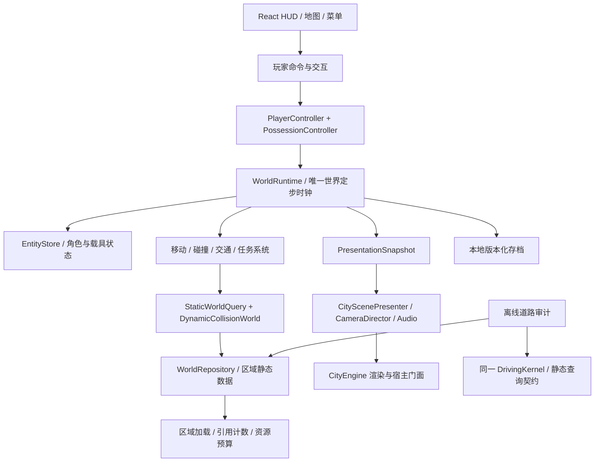

# Agent City 开放世界架构调整方案

2026-10-17，架构建议，尚未实施。以当前分支实际调用关系为依据。补充阅读：`CITY_VEHICLE_RUNTIME_ARCHITECTURE_REVIEW.md`。

状态更新：已落地共同 GameRuntime、时钟、输入和环境的第一阶段，见 `CITY_SHARED_VEHICLE_RUNTIME_NOTES.md`；本方案其余开放世界模块仍属后续设计。

## 1. 产品与迁移边界

首阶段按“本机单人、有限岛屿、可步行/驾驶/飞行、具有持久世界状态”设计。开放世界不等于无限地图或多人联网；先让当前岛屿成为持续存在、可交互的世界，再决定规模扩展。

项目当前为离线桌面产品，禁止用户数据上传。多人联网、云存档或遥测不属于本方案授权范围；需要独立产品决定及数据政策更新。游戏存档与分析事实库分开，不能为游戏逻辑直接查询 authority DB 或读取 harness 日志。

## 2. 核心判断

当前代码的中心是“进入某种载具会话，退出后归还城市”。开放世界需要改为“世界持续运行，玩家在角色和载具之间切换控制权”。

因此不仅要复用飞机和汽车的生命周期，还要把世界模拟、实体生存期、玩家控制、任务与场景渲染拆开。`GameRuntime + FlightAdapter + CarAdapter` 可以作为过渡，但不是开放世界的最终顶层。

## 3. 当前代码的关键限制

| 现有实现 | 当前用途 | 开放世界的限制 |
| --- | --- | --- |
| CityEngine 约 2,005 行 | 渲染、布局重建、回放、航拍、导出、游戏相机、帧调度 | 继续叠加 NPC/任务/交通会使所有权与更新顺序难以控制 |
| CityParts 约 1,129 行 | 场景装配、缓存、建筑显示和环境动画 | 网格同时承担表现与部分世界事实，难以独立存档和模拟 |
| GameSession 约 611 行 | 飞机输入、物理、碰撞、任务、音频、相机、HUD | 每增加载具/玩法容易复制一套会话编排 |
| captureDrivingWorld / drivingFreezeCount | 保证道路审计与车体碰撞依赖冻结的真实场景 | 持有期间 CityParts.update 直接停止；不能用它让整个 NPC/交通世界长期冻结 |
| 两条载具会话链 | 飞机 GameSession；汽车 GameRuntime | 尚无统一玩家 Actor、控制权切换和跨载具任务 |
| FlightWorld 与汽车固体源 | 分别推导飞行保守盒、冻结真实结构/建筑/代理 | 同一场景存在两种固体事实推导，地图变化容易分歧 |
| 全城模型/布局替换 | applyModel 重建 CityParts 并使快照失效 | 数据刷新可能破坏玩家支撑、实体位置和存档身份 |
| 环境车辆动画 | 表现城市生命感 | 不能直接当作有避障、路权、碰撞与持久状态的交通实体 |

当前已有价值的部分应保留：实际路面编译/区域索引/portal、连续碰撞与坡度动力学、DrivingKernel 与审计共核、确定性规划、实例化渲染与资源缓存、低频 HUD、飞机物理与任务回归。

## 4. 目标分层



依赖方向：纯世界/模拟代码不依赖 React、DOM、Three 或 Tauri。渲染只消费状态；输入、存储和宿主行为通过边界适配。CityEngine 保留兼容门面，逐项委托，避免一次性重写。

## 5. 六个必须调整的边界

### 5.1 世界生命周期与玩家控制权分开

- **WorldRuntime**：拥有世界实体和定步系统，暂停/恢复世界，发布呈现快照。
- **EntityStore**：存 Transform、速度、Motor、Collider、车辆座位等状态；实体身份独立于 THREE.Object3D。
- **PossessionController**：玩家当前控制角色、汽车或飞机中的哪一个。切换只转移输入/相机权限。
- **ActivityController**：自由探索、穿环竞赛、送达任务等活动；活动结束不销毁玩家和世界。
- **CameraDirector**：观察、步行、汽车、飞机、过场等相机策略之间的唯一授权切换。

当前汽车 `exit()` 会销毁车模，飞机 `exit()` 会清会话对象；开放世界中“下车”应把车辆保留在原位并转回角色。只有显式 despawn、区域卸载或退出整个世界才释放实体。

步行需要新的 CharacterMotor 和安全上下车流程，不能只加一个人物模型：座位占用、车速限制、角色落脚点/碰撞体校验、失败保持原控制权、事务提交和取消都必须有明确结果。

### 5.2 一个世界时钟，多种 Motor

最终由 WorldRuntime 持有一个 FixedStepClock。初始沿用 60 Hz；任何修改都用记录输入与压力用例验证。

```text
接收命令/已完成的区域构建（tick 边界提交）
→ 取得本 tick 一致的静态区域与动态状态
→ 玩家输入 + NPC/交通决策
→ 各 Motor 生成运动提案
→ 集中碰撞检测与响应
→ 一次提交实体状态和世界事件
→ 活动/任务消费事件
→ 发布 previous/current 呈现快照
```

- CarMotor 包装既有 DrivingKernel；FlightMotor 包装既有 stepFlight/飞行碰撞；CharacterMotor 后续实现。
- NPC 与玩家驾驶同一种车时应共用 Motor，只更换输入来源。
- 不能让每辆车各建一个 GameRuntime、定步时钟和 rAF。否则碰撞结果依赖实体更新顺序，暂停和存档也失去统一边界。
- 飞机/汽车的遥测、物理状态和碰撞形状继续独立，不构造充满可选字段的统一 VehicleState。
- 离线道路审计保留显式 tick 驱动同一汽车内核，完全不依赖屏幕帧率或 DOM。

迁移过渡期可先让两种载具共用会话时钟；WorldRuntime 接管时必须移除会话内部的时钟，不能同时叠加两个 authoritative fixed loop。

### 5.3 静态区域读取、动态世界和审计快照分开

现有冻结契约对审计是必要的，应保留。调整冻结的对象与范围：

| 能力 | 生命周期 | 是否停止 NPC/交通 |
| --- | --- | --- |
| 玩家控制/相机租约 | possession 或交互活动期间 | 否 |
| 静态区域读取/资源 pin | 正在使用的地面、道路、建筑片段 | 否 |
| 每 tick 动态查询视图 | 一个世界 tick | 否，提交后进入下一版 |
| 离线审计快照 | 一次审计任务的固定内容与 key | 运行在隔离快照，不冻结正在玩的世界 |

短期先实现既有 GameScenePort，兼容当前冻结玩法；长期通过明确版本迁移拆分上述能力，不另外并存一批含义重叠的 acquire/lease 入口。

动态车辆/行人不是把位置写进现有静态障碍数组就能正确支持。现有汽车连续碰撞基于静态索引；移动体需要同 tick 的相对运动扫掠、初始接触、成对响应和提交顺序契约。是否引入专门物理求解器应形成独立 ADR，先做验证场景，再迁移 Motor；不把现有静态 TOI 当成已完成多刚体动力学。

### 5.4 世界身份与游戏状态分开

建议划分以下身份：

- WorldId：一个本地游戏世界。
- StaticContentRevision：种子、生成器版本、数据投影快照及编辑补丁构成的静态内容版本。
- RegionId + RegionRevision：分区内容与相关邻区接缝版本。
- EntityId：稳定世界实体身份，不能使用 mesh.uuid、数组下标或临时投影 handle。
- SimulationTick：动态状态的逻辑时间。
- SaveSchemaVersion：存档迁移版本。

静态建筑/路面变更才使相关道路证据失效；一辆 NPC 汽车驶过不应令全城 static key 失效。反过来，静态道路审核通过也不代表此刻没有行人或车辆占道。应分别表达“静态可通行证据”和“当前动态占用/可行动作”。

现有 AuditKey 与 ReleasedDrivingGraph 不能直接弱化或静默复用。区域化 key 必须版本化，并覆盖跨区道路、桥梁与 portal 的依赖闭包；边界未加载/未验证保持 unknown，不能当作空地。修改前补 key 失效和跨区负例，再生成新版本证据。

City 数据继续通过已注册的本地投影进入。游戏采用固定投影快照构建静态世界；新数据可以提示稍后应用，或通过安全的 tick 边界事务更新受影响区域。更新前必须验证玩家与实体的支撑、碰撞及位置迁移，不能在玩家脚下直接重建地面。

### 5.5 分区先做加载管理，再考虑无限生成

第一步：完整生成当前有限岛屿，再把表现/查询数据空间分区。这样保留已验证的全局道路规划、桥梁关系和边界一致性。

- 近区：完整碰撞和高精度模拟；中区：简化表现与受控低频 AI；远区：摘要/休眠状态。
- 可见性、物理活动区、AI 活动区和审计依赖区分别管理。看不见的桥墩仍可能参与玩家碰撞；即将高速进入的区域必须提前加载。
- 玩家/载具占用的区域及制动/运动包络涉及的相邻区域必须 pin；未就绪时受控停止或拒绝移动，不能穿过未知区域。
- 跨区实体只有一个权威 EntityId 和所有者，交接在 tick 边界完成；避免边界复制车辆和触发器。
- 区域卸载通过资源引用计数释放，不让共享纹理、实例材质或读快照被提前 dispose。
- 空间预算按活动区域/查询窗口控制，不能仅不断调大全城数组上限。

现有 layoutCity 是整城规划流程，分块渲染不等于分块生成。无限生成后续还需固定边界种子、跨区路网协议、河流/桥梁连续性、稳定内容身份和坐标精度方案。有限岛屿阶段无需提前引入浮动原点；地图扩大到需要时，再引入全局坐标与渲染局部原点，存档/路网/审计坐标语义必须同时迁移。

### 5.6 交通、任务、存档消费世界事件

- TrafficSystem 使用路网语义/路权/信号及感知规划，输出与玩家同类的 Motor 输入；环境动画车迁为实体后才参与碰撞，不把装饰动画当交通 AI。
- InteractionSystem 处理可交互距离、目标、座位/门/触发器；行为返回有结构的失败原因。
- ActivitySystem 消费 VehicleEntered、CheckpointCrossed、Collision、RegionEntered 等版本化事件，任务代码不直接操作 mesh 或读取全局 DOM。
- SaveRepository 只保存本地世界状态增量：角色/车辆位置、任务状态、世界编辑、内容版本；不复制大型 GPU 缓冲或整个运行时对象图。
- 保存发生在一致 tick 边界；异步磁盘写入使用不可变快照与原子替换，加载要校验版本、缺失区域和实体引用。不得反向改写分析事实表。
- 音频和 HUD 消费实体遥测/事件；统一生命周期和低频通知，具体发动机声、载具读数与任务界面分开。

## 6. 建议代码落点

下列是迁移目标，不表示应一次创建空壳目录或立即安装 ECS 框架。

```text
src/game/
  world/
    WorldRuntime.ts           # 唯一世界 tick 与暂停边界
    WorldRepository.ts        # 静态区域内容与版本
    WorldContentCompiler.ts   # City 投影/种子/补丁 → 世界内容
    RegionStreamer.ts         # 预取、pin、卸载与预算
    WorldEvents.ts            # 有序事件与 tick 标识
  entities/
    EntityStore.ts            # 状态、稳定 ID、组件查询
  player/
    PlayerController.ts
    PossessionController.ts   # 角色/汽车/飞机控制权切换
  input/
    ActionInput.ts            # 焦点/输入法/设备/生命周期
  vehicles/
    CarMotor.ts               # 复用 DrivingKernel
    FlightMotor.ts            # 复用 FlightSimulation
    VehiclePresentation.ts
  systems/
    CollisionSystem.ts        # 静态 + 动态运动提案/响应
    TrafficSystem.ts
    InteractionSystem.ts
    ActivitySystem.ts
  presentation/
    CameraDirector.ts
    CarCamera.ts
    CityScenePresenter.ts
  persistence/
    SaveRepository.ts
    saveContracts.ts
```

保留现有纯逻辑模块路径和守卫，先由新模块包装，随后按已迁出的职责缩小 GameSession/CityEngine/CityParts。初期普通 EntityStore + 明确系统顺序即可；遇到具体性能和查询需求再决定是否采用完整 ECS。

## 7. 分阶段交付

| 阶段 | 主要改动 | 可验证的完成标志 |
| --- | --- | --- |
| P0：统一当前两种载具 | 实现 GameScenePort、消除时钟/输入重复、FlightAdapter、相机门面只应用 pose | 两种载具交替 20 次，无残留对象/监听/租约；飞机比赛及汽车审计回归通过 |
| P1：世界与控制权分离 | WorldRuntime、EntityStore、PossessionController；单一世界时钟接管 | 同一世界里角色上车/下车/驾驶/换乘；离开车辆仍停在原位；取消/失败不丢控制权 |
| P2：静态/动态查询分离 | 静态区域读能力、动态 tick 视图、集中碰撞、少量交通实体 | 玩家驾驶时交通继续运行；两辆运动中的车有可复现的接触结果；未知区域不穿越 |
| P3：区域与本地持久化 | 有限岛屿分区、区域依赖、预算/卸载、存档迁移 | 跨边界不断路/不复制实体；多次旅行内存趋稳；读档恢复同一世界与车辆 |
| P4：开放世界玩法 | 角色移动、互动、交通路权、跨载具任务、事件驱动音频/HUD | 一条“步行→上车→行驶→下车→飞行”的完整任务和存档恢复验收 |

P1 中上下车的角色 Motor 可先做最小受控实现，P4 再扩展完整角色交互；不能用无碰撞的自由相机替代角色安全验收。

## 8. 迁移守卫

- 维持同一宿主 renderer/rAF；每个物理系统只在一个世界 tick 中提交一次。
- 明确 fixed-step 积压/长帧语义；30/60/120 Hz 录入相同动作并比对逻辑状态。
- 玩家、AI、审计使用同一 CarMotor/DrivingKernel 的静态支撑与运动规则。
- 同 tick 的运动体碰撞结果不依赖 EntityStore 遍历顺序；处理高速、双墙角、多车初始重叠与卸载边界。
- 世界/区域重建、取消准备、迟到加载结果、失焦/挂起、context lost、重复退出都能正确清理。
- 最终在原生 `.app` 测实际帧时、tick 超时、区域预取、内存峰值及往返稳定性，单独记录渲染/物理/AI 成本。预算由测量锁定，不预先宣称能支持多少 NPC 或地图面积。

## 9. 当前最优先的架构动作

先完成 **P0 的真实共享宿主租约与通用生命周期**，同时定义 **P1 的 WorldRuntime / PossessionController 边界**。不要继续在 CityEngine 中添加新的载具状态机，也不要每个新玩法再建一个带 rAF/时钟的会话。

本方案是面向后续实现的设计；当前 UAT 可试驾、接口已声明或守卫通过，都不能当作开放世界架构已经完成。
