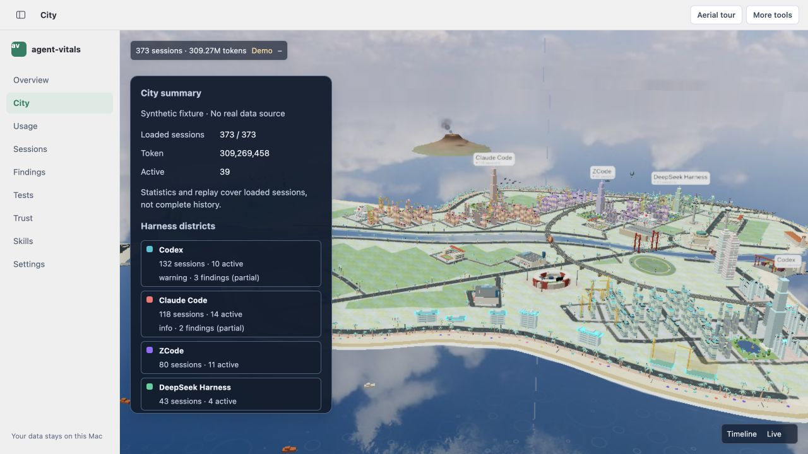
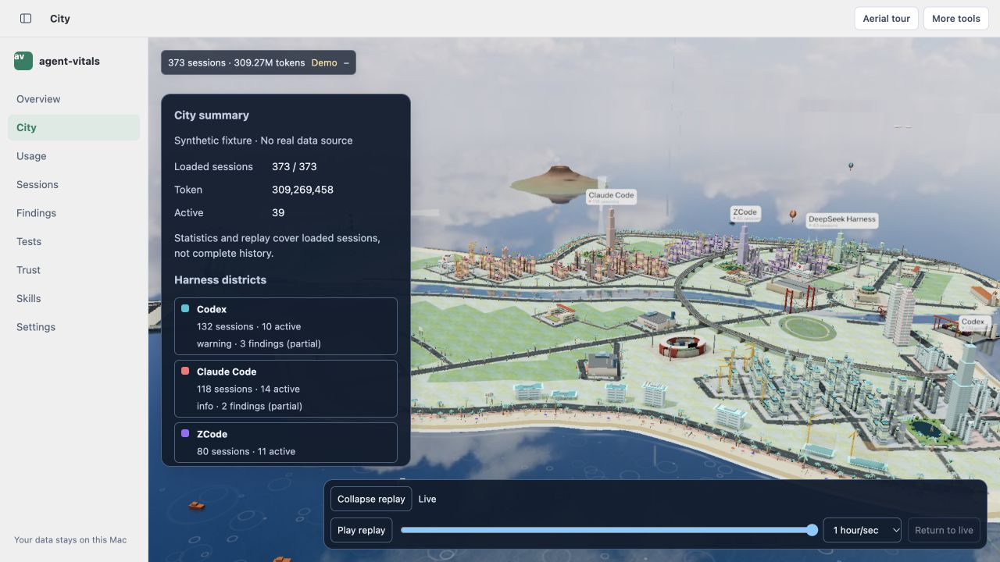
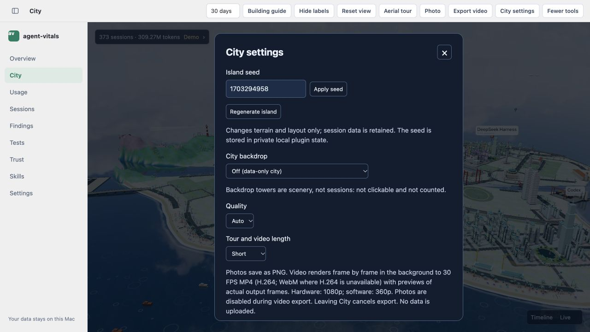
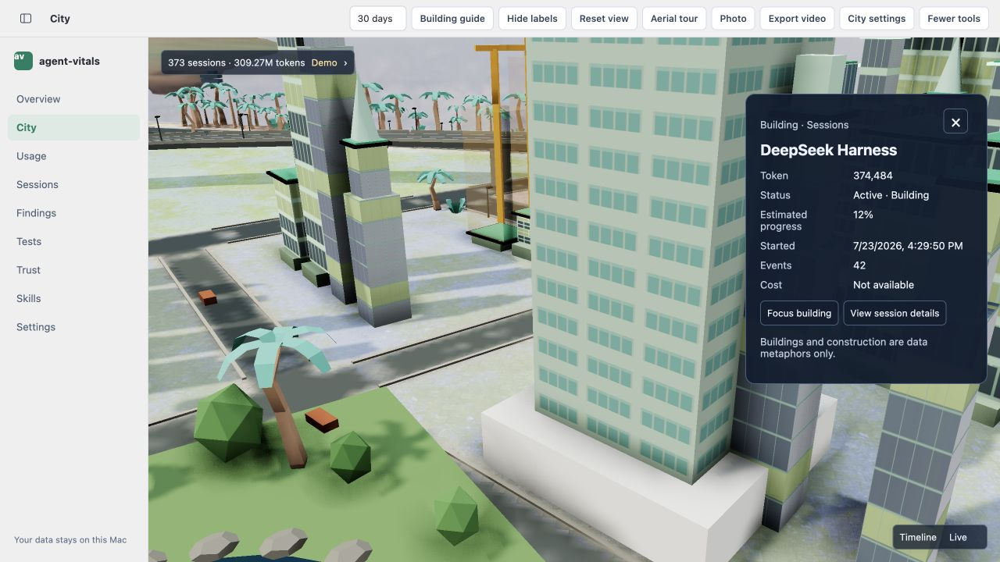
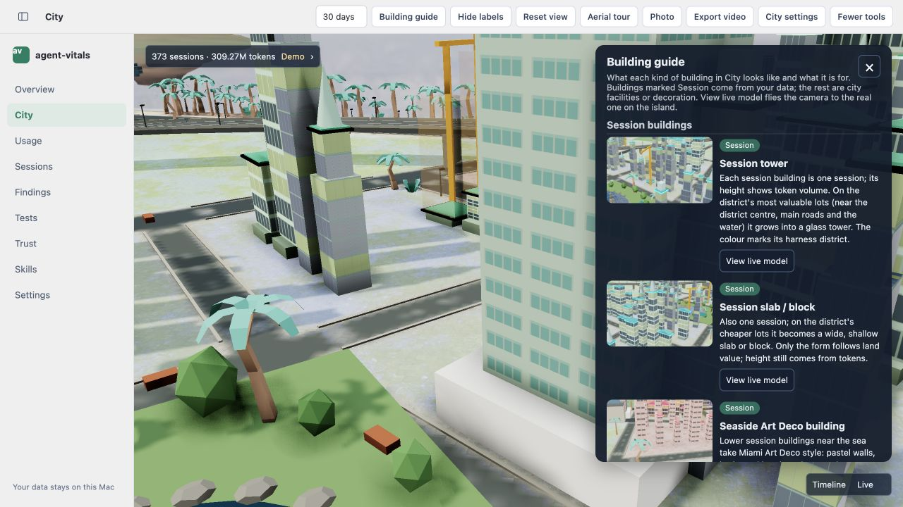
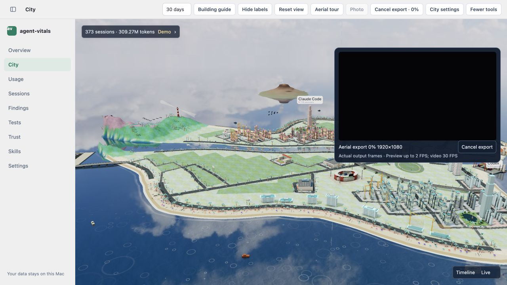
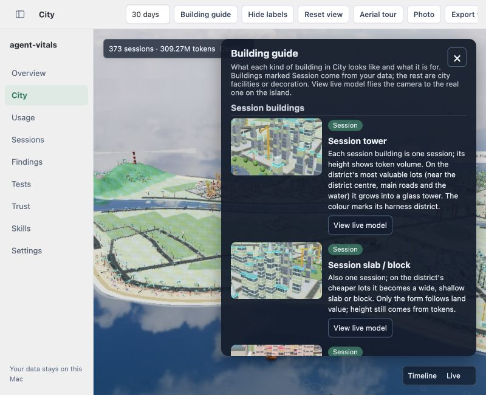
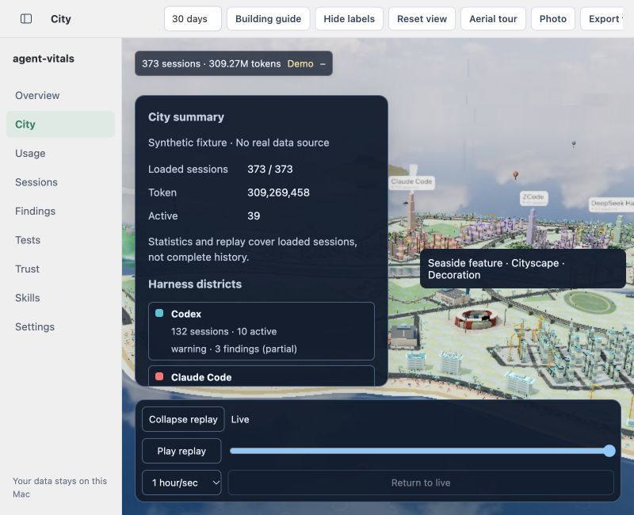
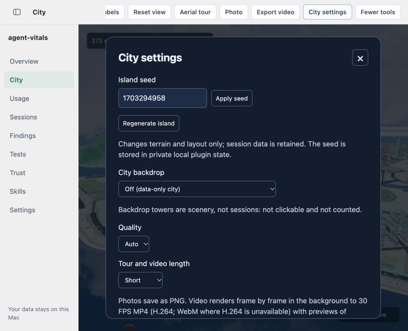

# City 面板 UI 点击与截图评估

日期：2026-10-08。分支：`codex/city-ui-ux`。

后续状态：下文为调整前的点击评估，表单尺寸不一致、整块模态滚动与长导出说明挤压字段已在后续迭代中修改；最新截图和实测见 [本轮验收记录](CITY_UI_UAT_2026-10-08.md) 的“模态固定标题与正文滚动”小节。指南避让与其他问题尚未由此修复。

## 范围与结论

浏览器地址 `http://127.0.0.1:5183/#city`，英文界面，synthetic fixture。检查 1280×720 桌面及 800×650 窄窗口。实际点击摘要、回放、更多工具、城市设置、会话选择、建筑指南和视频导出入口，并截图观察；未修改界面代码、未安装原生 App。

结论：**按钮模板已基本统一，面板模板仍需收尾**。当前布局总体可用；本次没有观察到宿主导航被面板覆盖。静态截图不能验证闪白/黑闪，也不能代表原生 WebView 验收。

## 各面板评估

| 面板 | 当前表现 | 待优化 |
| --- | --- | --- |
| 摘要 | 标题、数字、城区分层明确；按钮字号 12px | 说明文字占据较多高度，城区列表首屏不完整；建议简化首屏说明、把补充解释折叠 |
| 回放 | 播放、游标、速度和回到实时可见；按钮 32px/12px | 800px 窗口下成为三行，禁用的回到实时占整行；可统一为紧凑工具行 |
| 城市设置 | 可以打开、关闭，并通过会话选择进入建筑详情 | 种子输入框 39px/14px，按钮 32px/12px；下拉框宽度约 61、87、309、397px，不属于同一表单布局 |
| 建筑详情 | 右侧信息列表清晰；动作按钮紧凑；关闭可用 | Estimated progress 标签两行，而其他标签单行；可统一标签栏宽度与分组 |
| 建筑指南 | 图片、类别、文字、定位操作俱全，面板内部滚动 | 150px 图片占掉不少宽度，英文正文栏较窄；800px 窗口时面板覆盖摘要入口 |
| 导出预览 | 进度、分辨率、预览、取消按钮可见，取消操作成功 | 说明文字与其他面板有不同的字号层级；顶部与面板各有一个取消入口，需明确主次 |

展开面板保留较实背景是阅读场景的设计选择，不应为了统一而把说明正文也做成高度透明。统一应包括控件、排版和避让规则，而不是所有面板使用相同宽度或完全相同透明度。

## 有证据的尺寸与边界

- 设置对话框：种子输入 `39px` 高、`14px` 字号；普通按钮 `32px` 高、`12px` 字号。
- 桌面设置面板可视高度 `622px`，内容高度 `709px`；窄窗口可视高度 `552px`，内容高度 `709px`。会话选择入口在首屏下方，不是数据缺失。
- 摘要与展开回放在窄窗口中：摘要底边为插件局部 `440px`，回放顶边 `456px`，间隔 `16px`。二者各自 `scrollWidth == clientWidth`，未发现横向溢出。
- 建筑指南在窄窗口中：可视宽度和内容宽度均 `420px`，可视高度 `522px`，内容高度 `5591px`。滚动是正常行为，但正文密度偏高。
- 导出仅检查面板开启与取消，未完成编码，不对成片格式、颜色、质量或稳定性作通过结论。截图时 0% 的偏暗预览不能单独证明导出异常。
- 窄窗口操作曾出现选择器等待超时；刷新可见状态后重试设置入口成功。不能仅据此判定产品点击丢失；水平滚动工具栏的快速点击稳定性仍需单独复查。

## 优先级

1. **重要：表单控件模板未统一。** 把设置 input/select/button 的高度、字号和字段宽度集中定义，说明文字单独保持阅读字号。
2. **重要：窄窗口指南覆盖摘要入口。** 指南顶部避开摘要，或打开指南时明确收起/隐藏摘要；不能留下被遮住但仍处于开启状态的入口。
3. **重要：说明文字挤压主要操作。** 摘要与设置首屏保留关键统计/字段，把重复范围说明、完整导出技术解释移入可展开帮助区。
4. **细节：面板模板参数分散。** 统一标题、正文/辅助字号、字段间距、关闭按钮、圆角、边框、内边距 tokens；不同类型允许不同宽度。
5. **细节：回放窄窗口与指南正文密度。** 调整回放按钮分组、缩小指南缩略图，减少频繁换行。

## 五维设计评估（主观评分）

总体 **7.0/10**，可用但还不是统一模板的最终状态。

- 方向一致性：7/10。默认入口轻量，但设置/指南仍偏重。
- 信息层级：7/10。标题清晰，辅助说明占比过高。
- 制作一致性：6/10。按钮已统一，输入框、字段宽度和面板参数仍不一致。
- 功能性：8/10。主要面板可打开关闭，回放与摘要避让正常。
- 独特性：7/10。城市场景是主体，浮层未完全摆脱传统工具面板感。

保留：32px 紧凑按钮、单层回放入口、摘要按需展开、宿主导航始终可见。

三个优先小改动：统一设置输入框；折叠长技术说明；给指南与摘要增加明确的避让规则。

## 实际截图

### 摘要（1280×720）

### 摘要与回放（1280×720）

### 设置（1280×720）

### 建筑详情（1280×720）

### 建筑指南（1280×720）

### 导出预览（1280×720）

### 窄窗口指南（800×650）

### 窄窗口摘要与回放（800×650）

### 窄窗口设置（800×650）

