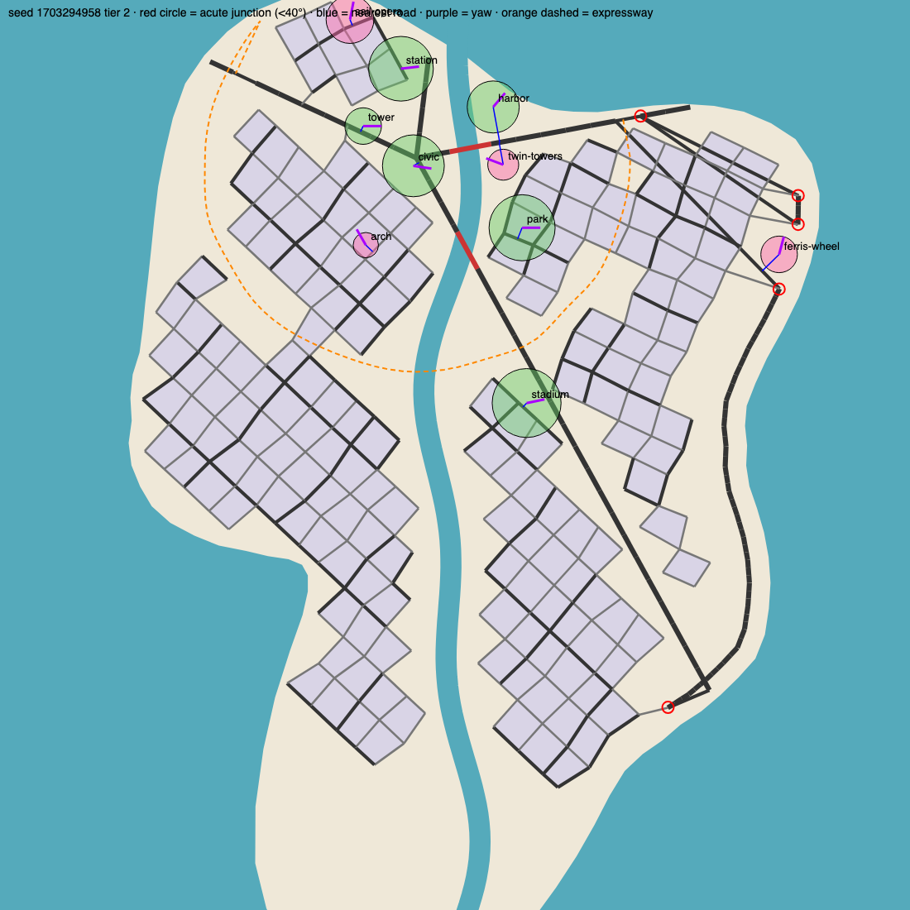

# City 道路与用地规划审计（2026-10-06）

真机反馈：「道路很混乱，没有有机生长和规划的感觉；地标和公共建筑胡乱摆放，门前没有道路，或者方向不对。」
本文取证（用户种子 `1703294958`，2 档岛）、定位根因，并给出参照开源算法的重写方案。

图例：紫灰 = 街区；深灰 = 主干道；浅灰 = 支路；红线 = 桥；橙虚线 = 环线高架；
绿圈 = 公共用地、粉圈 = 地标（圈 = 预留半径）；蓝线 = 到最近道路；紫线 = 朝向（yaw）；红圈 = 锐角路口（<40°）。

## 1. 取证数据

| 对象 | 预留半径 | 中心→最近道路 | 结论 |
|---|---:|---:|---|
| 车站 station | 46 | **0** | 主干道从站房正中穿过 |
| 市政 civic | 44 | 9 | 主干道 + 桥头穿过广场 |
| 体育场 stadium | 49 | 8 | 主干道斜穿球场 |
| 公园 park | 47 | 17 | 支路穿过公园 |
| 观景塔 tower | 26 | 9 | 主干道擦过塔基 |
| 港口 harbor | 37 | 51 | 离路 14，**无进港道路** |
| 双子塔 | 22 | 32 | 空地中央，**门前无路** |
| 摩天轮 | 26 | 34 | 岸边空地，**门前无路** |
| 帆形歌剧院 | 34 | 9 | 道路穿过 |
| 凯旋门 | 18 | 14 | 嵌在街区角上 |

- **朝向**：10 个对象相对最近道路的轴向误差全部在 16°–38°，没有一个和门前道路对齐。
- **路网**：546 条边、213 个路口，其中 **5 个锐角路口**（最尖 8°），3 个断头路。
- **主干道拥挤**：**53 对**主干道段彼此 <25 单位、夹角 <15°（截图里西岸那束交叉成 X 的大路）。
- **街网朝向**：各扇区街网都在 20°–60° 之间各转各的，街区成锯齿状孤岛，和主干道之间留 10–20 单位空地带。

## 2. 根因（`cityPlan.ts` L2 骨架）

1. **街道不是被「规划」出来的，而是网格格子的边。** 每个扇区铺一张旋转网格（`cityPlan.ts:513` 起）；
   离主干道 10、离环线 9、碰到海滨带或预留地的格子整格丢弃，剩下格子的四条边就是街道。
   所以街区边缘是锯齿、街道不会一直通到主干道，主干道两侧是一圈空地。
2. **孤岛靠「连通补丁」接回去。** 并查集找出不含核心的连通分量，每个分量拉一条最近的连接路（`cityPlan.ts:600` 附近），
   海滨大道两端也各拉一条（≤260 的「最近合法节点」）。这些补丁路不看角度、不看已有道路——
   截图里的长斜线、X 形交叉和 8° 锐角路口都来自这里。
3. **主干道先画、用地后放，二者互不避让。** 主干道是从核心放射到海边的直线；公共用地与地标只要求
   「街区格子避开它们」，主干道本身穿过预留地不受任何约束（车站中心到路 = 0）。
4. **朝向与道路无关。** 公共用地和地标的 yaw 来自岸线方向或种子（如摩天轮 = 岸线法向 + 90°），
   不是「面向门前道路」；也没有任何「给它修一条入口路」的步骤。
5. **没有生长顺序。** 整张网在最大档一次铺满，档位变化只是缩放；没有「从核心沿主干道向外长」的过程，
   所以看不出有机生长。

## 3. 开源参照（GitHub）

| 项目 | 方法 | 可借鉴点 |
|---|---|---|
| [ProbableTrain/MapGenerator](https://github.com/probabletrain/mapgenerator)（TypeScript） | 张量场 + 流线 | 网格场 + 径向场混合、按岸线/河流加边界场；主干→支路分级积分；**同语言可直接参考实现** |
| [TheJanusStream/symbios-tensor](https://github.com/TheJanusStream/symbios-tensor) | 张量场，RK2 积分 | 主干道沿等高线、支路沿坡度；地块从路网面生成 |
| [transfix/libcvc PR #568](https://github.com/transfix/libcvc/pull/568) | 网格场 × 地形场按坡度加权 | 场的混合方式 |
| [phiresky/procedural-cities](https://github.com/phiresky/procedural-cities/blob/master/paper.md) | Parish & Müller 扩展 L-system | `localConstraints`：交叉切成 T 路口、端点吸附到近节点、拒绝锐角/过近平行段 |
| [piwell/TNM084-Procedural-Roads](https://github.com/piwell/TNM084-Procedural-Roads)、[Yatoom/city-generator](https://github.com/Yatoom/city-generator) | 同上，优先队列逐段生长 | **按时间顺序生长**：天然支持「随会话增长」 |
| [watabou TownGeneratorOS](https://github.com/palikhov/watabou-TownGeneratorOS) | Voronoi 分区（ward） | 先分区再在区内布局；广场/地标作为特殊 ward，四周是街道 |
| Chen et al. 2008 [Interactive Procedural Street Modeling](https://www.sci.utah.edu/~chengu/street_sig08/street_sig08.pdf) | 张量场街道建模论文 | 理论基础 |

## 4. 重写方案（建议分 4 步，每步有守卫）

**R1 · 局部约束（先止血，改动小）**：在现有骨架上加 Parish–Müller 式 `localConstraints`，作用于所有补丁路与海滨大道连接：
交叉处切成 T 路口；端点 15 内吸附到已有节点；拒绝 <60° 的路口和 <25 的近平行段；连接路改成「垂直接到最近道路」而不是「直连最近节点」。
守卫：锐角路口 = 0、近平行主干道对 = 0。

**R2 · 用地先于路网、路网绕开用地**：主干道生成时把公共用地/地标当障碍（绕行或切到边缘），
每个用地选一条门前道路：yaw = 面向该路，并生成一条入口支路（港口 → 进港路）。
守卫：用地中心到道路 ≥ 半径；门前道路距离 ≤ 半径 + 12；朝向误差 < 5°。

**R3 · 张量场街网替换「格子边」**：参照 MapGenerator：网格场（每个城区一个主方向）+ 核心径向场 + 岸线/河流边界场混合，
先积分主干流线（间距 ~120），再积分支路（间距 ~45）；街区 = 路网平面图的面（face extraction），地块由面内递归切分。
街道连续、一直通到主干道，扇区之间平滑过渡，岸边街道顺着海岸弯。守卫：无孤岛、街区面积分布、地块全部临街。

**R4 · 生长顺序**：路段带「出生时间」（优先队列按离核心的路网距离展开），按会话时间轴揭示——
回放时城市从核心沿主干道向外长；保留现有确定性与档位缩放稳定性守卫。

R1 与 R2 可以在现有代码上直接做，预计 1–2 轮；R3 是骨架替换，需要先出一版对比图再决定是否推进。
