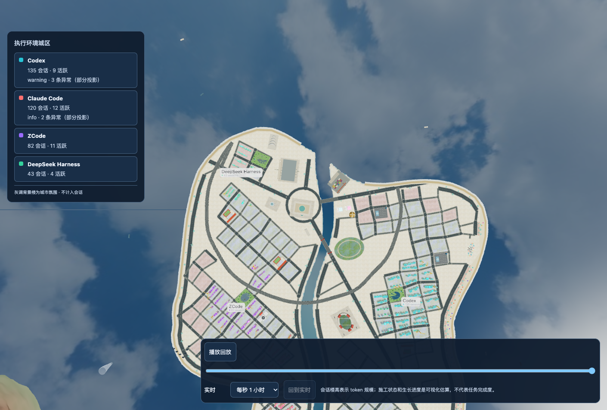
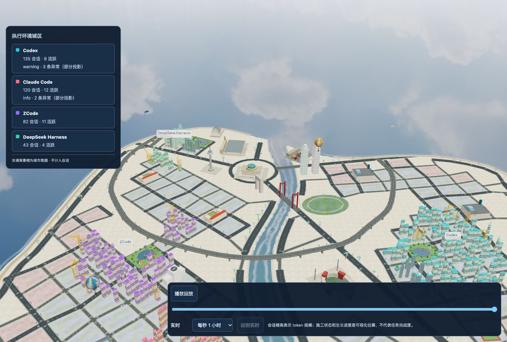
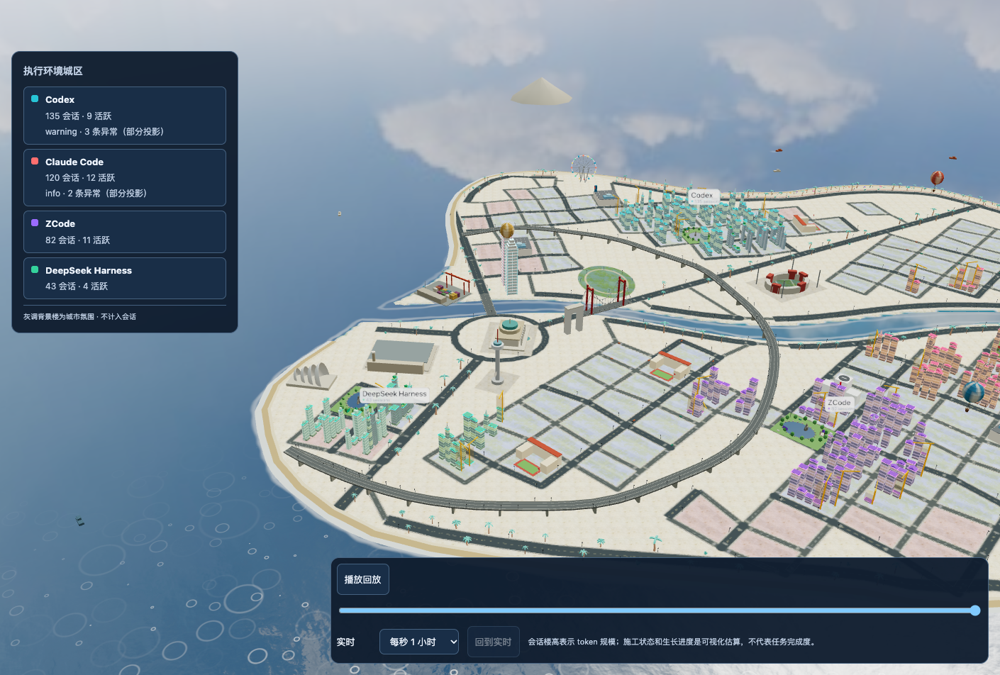
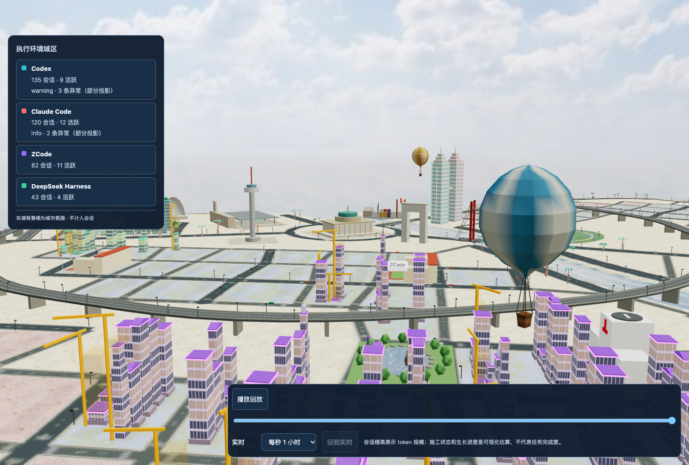
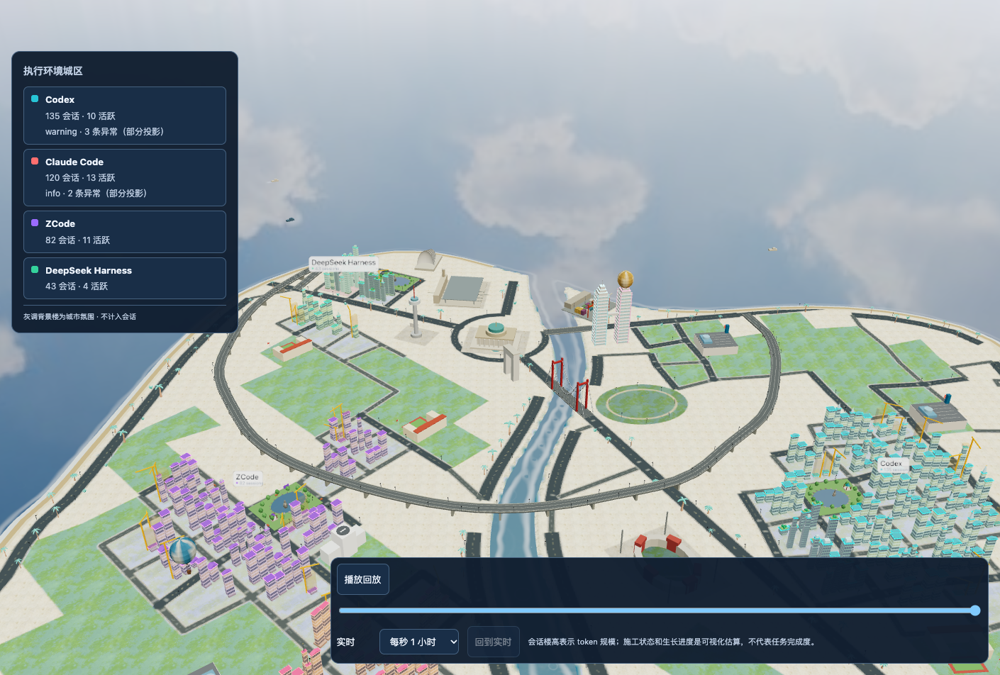
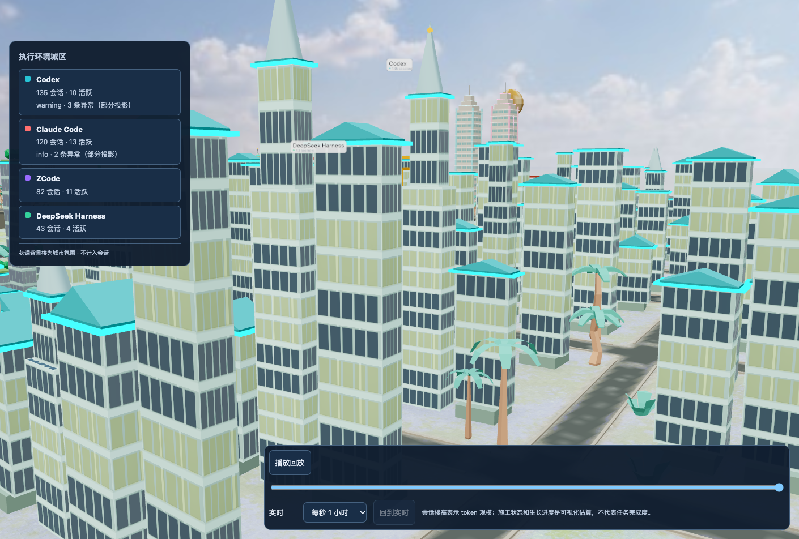
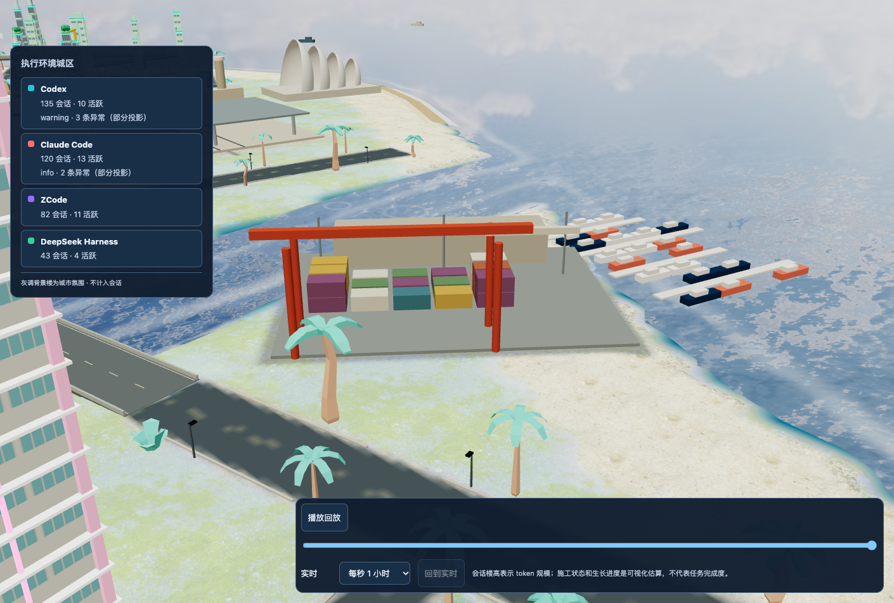
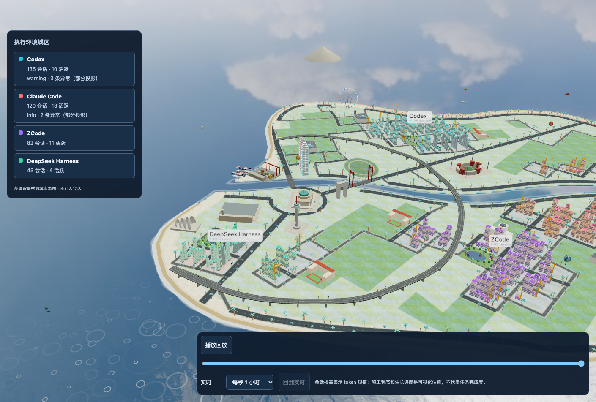
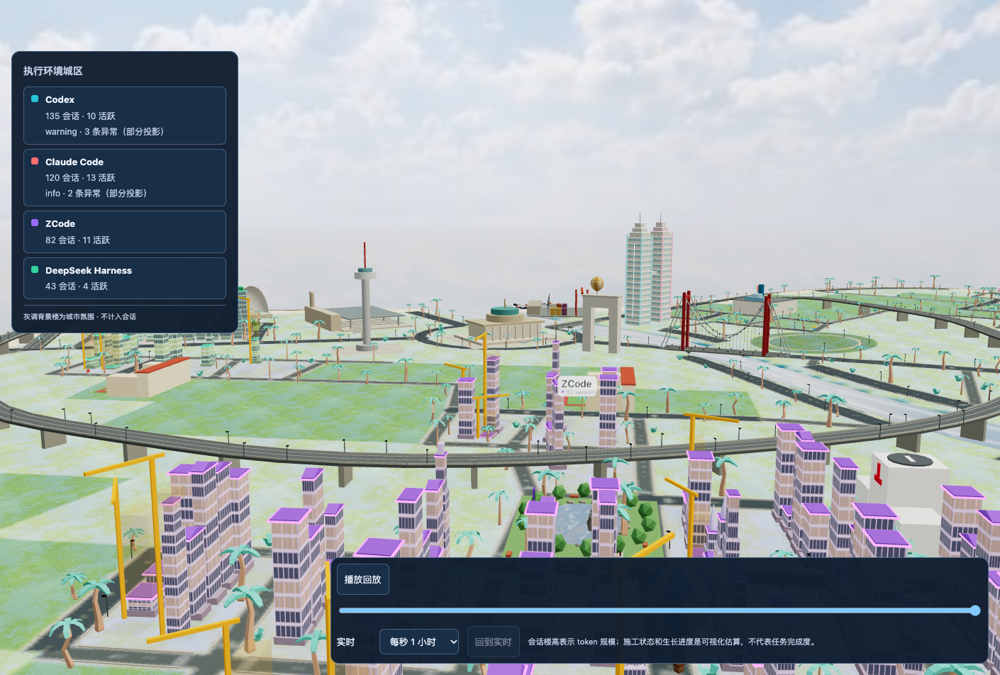

# Miami City「城市感」多视角评估（2026-10-06）

取景：浏览器预览（700 条模拟会话、30 天窗口、用户种子 1703294958、背景楼关闭），本机 Chrome + Metal 真 GPU 渲染
（无 SwiftShader 黑色三角伪影）。7 个视角：卫星正俯、四向明信片斜俯、低空天际线、街道层。

| 卫星 | 南向明信片 | 西向明信片 |
|---|---|---|
|  |  |  |

| 低空天际线 | 街道层（Codex 区） |
|---|---|
|  |  |

## 已经成立的（R1–S2 的成果）

- **骨架可读**：核心环岛广场 → 放射主干道 → 环线高架 → 环岛滨海路，Lynch 的「路径 / 节点 / 边界」三要素从卫星图一眼可辨。
- **水是城市的边界**：河两岸有路、悬索桥跨河、沙滩环岛，岛的轮廓被道路「描」出来了。
- **区有身份色**：四个 harness 城区颜色一致、彼此分得开；地标（双子塔、帆形歌剧院、凯旋门、电视塔、摩天轮）都在且不再压路。

## 城市感的主要问题（按影响排序）

1. **「规划了但没建」——七成街区是空地块。** 30 天只有 ~380 栋会话楼，却铺满了 2 档岛的街网。卫星与明信片视角里大片灰/粉色空地块像停车场或一张分地图，
   城市密度来自楼，而楼只占少数街区。真实城市是「建到哪里、路修到哪里」——**街区应随建成量生长**，或空地块要有低层肌理/绿地填充。
2. **同区楼宇千篇一律。** 街道层（Codex 区）同一种板楼 + 同一种青色四坡顶 + 同一种窗格、高度区间也接近——像同一个模型复制了 135 次。
   这正是用户提出的「地价决定形态」：高地价（区中心、临水、临主干道）→ 塔楼/裙楼，低地价 → 板楼/低层；同区共享配色与细部，但体量要变。
3. **没有 CBD / 天际线层级。** 核心广场周围是空地和公共设施，最高的楼是地标而不是城市中心；各城区的楼高度差不多，低空天际线看不出「中心更高」。
   迈阿密的天际线来自 Brickell/Downtown 的玻璃塔群——需要一个由地价场驱动的高度峰。
4. **城区远离水、海滨缺「城市」。** 会话楼集中在内陆街区，海岸一圈只有沙滩和路；迈阿密的灵魂是 Ocean Drive 临海的粉彩 Art Deco 低层排楼 + 霓虹 +
   临水高层。海滨景观带只在一段（S3 待做），其余海岸「有路无城」。
5. **地面像沙漠，不像热带。** 地形与空地块都是米黄/沙色，街区内无绿化，只有零星棕榈；主干道没有行道树。热带城市应是「绿 + 白 + 粉彩」：
   主干道两侧棕榈、街区内草坪与树、公园更多。
6. **路面主导画面。** 深色宽路 + 浅色空地块，对比最强的是道路网格本身；断头路仍多（~386/30 岛）。楼少的时候路显得更重。
7. **尺度与细节不一致。** 热气球比楼还大、摩天轮在远景里很小；城区标签很小且会重叠。
8. **水上缺活动。** 港口很小、几乎没有码头/游艇/渡轮；没有跨海堤道到小岛——迈阿密很重要的「水上城市」意象缺失。

## 建议的迭代顺序（并入规划总纲）

| 轮次 | 做什么 | 对应问题 |
|---|---|---|
| **G1** | **街区随建成量生长**：只给「已有楼 + 下一圈预留」的街区铺街网，其余保持自然地面/绿地；空地块铺低层肌理或草坪 | 1、6 |
| **G2** | **热带绿化**：主干道/滨海路行道棕榈、街区内草坪、空地块绿化；地面主色从沙色转向「白 + 绿」 | 5 |
| **S3** | 区内地价场 + 海滨景观带随用地走（临海住宅/商业的岸段都有沙滩—步道—大道—酒店排） | 4 |
| **S5** | 地价驱动建筑形态（塔楼/板楼/低层）+ CBD 高度峰 + 每区地标 | 2、3 |
| **G3** | 水上活动：码头、游艇、渡轮、小岛堤道；尺度统一（热气球缩小、摩天轮放大）、标签防重叠 | 7、8 |

G1 是投入产出比最高的一步：城市立刻从「分地图」变成「有密度的城市」，并且天然实现「城市地块不够用了再扩展」。

## G1–G3 结果（2026-10-06，每轮真 GPU 截图验收）

| G1 街区随建成量生长 | G2 热带绿化 |
|---|---|
|  |  |

| G3 码头 | G3 西向明信片（标签、码头、摩天轮） | G3 低空天际线（热气球尺度） |
|---|---|---|
|  |  |  |

- **G1**：无楼街区画成自然绿地，服务它们的支路/次干道不修（骨架保留；仍有活动的分量只沿一条最短路径接回，空碎片删除）。
  第一版留 75 的预留圈 + 整圈回填，截图里街网几乎没变——两次收紧后空置地连成片、街道只围着城区。
- **G2**：行道棕榈沿整条路按弧长种植、按路幅分档留净空（曾因短路段与统一净空几乎种不上）；内陆地面改为偏草坪色，沙只留在海岸 30 内。
- **G3**：热气球整体缩到 0.55、飞行高度下调；摩天轮半径 20 → 26；城区标签放大并在彼此靠近时错层；港口朝开阔水面伸出 4 条栈桥、
  泊船（第一版每 6 一条挤成一块，改为每 8 一个泊位、约四成空位、带舱室）。顺带把 `engine/cityDecor.ts` 纳入 i18n 目录守卫
  （海滨说明文案改了两轮、英文目录没跟上，守卫此前不扫这个文件）。

仍待做（并入规划总纲）：S3 区内地价场 + 海滨景观带随用地走；S5 地价驱动建筑形态 + CBD 高度峰 + 每区地标（问题 2、3、4）。
