# City UI 第一轮实现与截图验收

日期：2026-10-08。分支：`codex/city-ui-ux`，基线 `51ae860c`。

## 范围与设计取舍

沿用已确认的设计图和 CITY_UX_SPEC：场景为主，宿主导航保持不变，默认 HUD 只显示摘要入口和回放入口。16px 边缘留白、系统字体、深色高对比浮层；不更改三维美术、数据库、真实数据投影或游戏功能。设计图的岛屿与建筑美术不是本轮实现目标。

摘要按需显示精确 token、载入数/总数、活跃数、城区和统计边界。演示与截断标识在折叠状态仍显示。选择建筑或打开建筑说明会收起摘要。回放可独立折叠，折叠不重置游标。面板底边由实际回放条高度计算，不依靠固定的旧高度。

顶部默认只显示航拍和更多工具，导出运行时取消入口提升为常驻。更多工具暂采用宿主工具栏内展开并可横向滚动，而非跨越原生子 WebView 的 DOM 下拉菜单，避免新增遮挡/焦点风险。

## 已执行验收

环境：本 worktree 的 Vite 浏览器预览，`http://127.0.0.1:5183/#city`，Codex 内嵌浏览器。预览使用合成数据（30 天窗口 374 个会话），未读取真实数据库。

| 检查 | 结果 |
| --- | --- |
| 默认只保留摘要与回放入口 | 通过 |
| 摘要展开，准确数字/范围/城区可读 | 通过 |
| Esc 收起摘要并返回摘要入口焦点 | 通过 |
| 回放折叠后再展开 | 游标值保持 `1` |
| City → Overview → City | 回放面板展开状态和游标值 `1` 保留 |
| 返回实时 | 显示 Live/实时 |
| 更多工具与城市设置 | 可展开并打开设置对话框 |
| 宿主切换 English | 新 HUD 与摘要说明均为英文，数据名称不被误翻译 |
| 800×650 窄窗口 | 无插件横向溢出；摘要底边 400、回放顶边 416，间隔 16px，面板内可滚动 |

验收发现浏览器适配器未实现 `plugin_set_bounds`，缩放后触发 `plugin_layout_failed` 并残留旧 iframe 边界。本轮补齐该方法及有限值/实例/序号校验，重新加载后缩放复测通过；增加单元测试覆盖尺寸更新、过期序号、失效实例、非法尺寸及恢复后的序号。

浏览器 `harness_display_names` mock 缺失也已补齐。设置页仍有 `fx_status`、`watcher_health` 等原有 mock 缺口，不将本轮验收宣称为整个工作台无控制台错误。

## 构建与测试

- City `npm run typecheck`：通过。
- 宿主 `npx tsc -p react/tsconfig.json --noEmit`：通过。
- `npm run build:browser`：通过；保留现有大 chunk 提示。
- `node scripts/verify-browser-plugin-host.mjs`：通过，包含新增 bounds 测试。
- `node scripts/verify-city-locale.mjs`：通过。
- `node scripts/verify-city-frame-surface.mjs`：通过。
- `git diff --check`：通过。
- `verify-react-city-runtime.mjs` 已适配默认折叠的入口，完整自动化场景未在本轮执行。
- 另行尝试 `verify-city-migration.mjs` 在原有行人断言失败：`city-pedestrians` 对象不存在。这一测试与相关三维模块未被本轮 UI 改动修改，未静默刷新测试或宣称全量通过。

## 实际截图

以下均为运行界面截图，不是 AI 设计图：

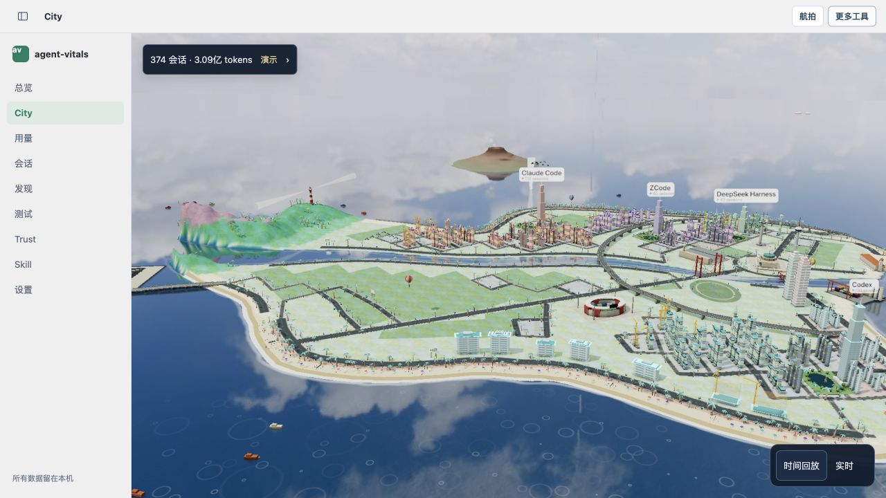
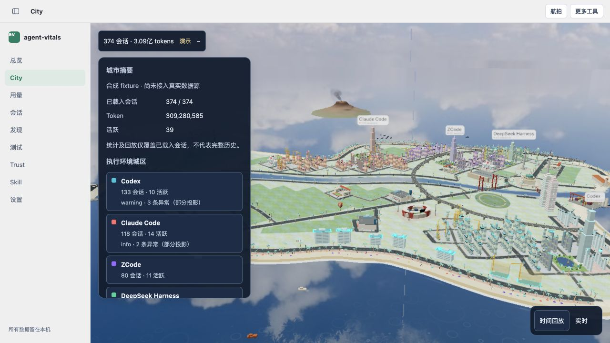
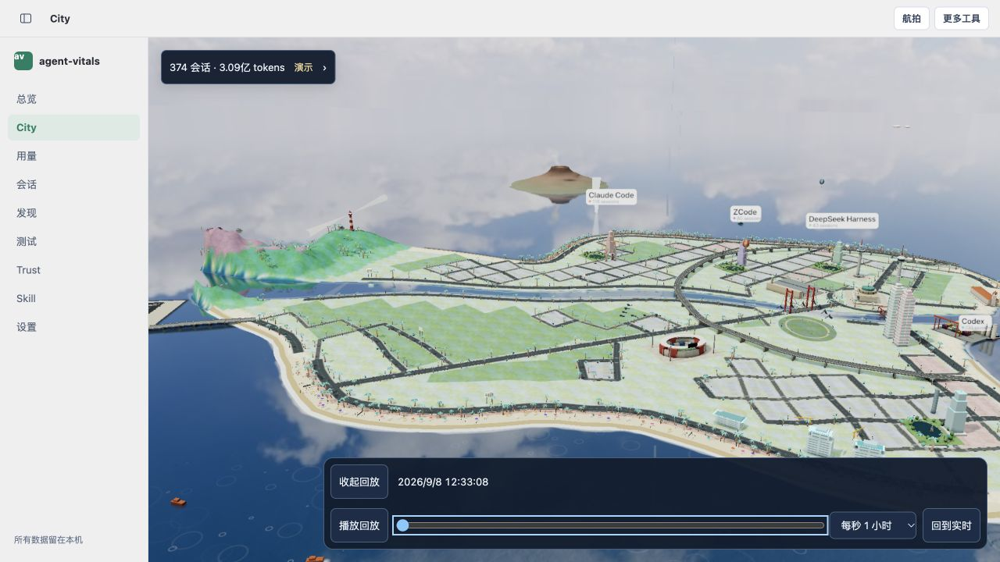

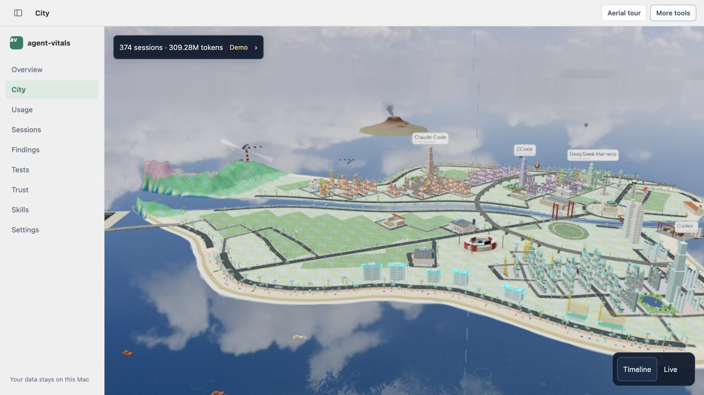
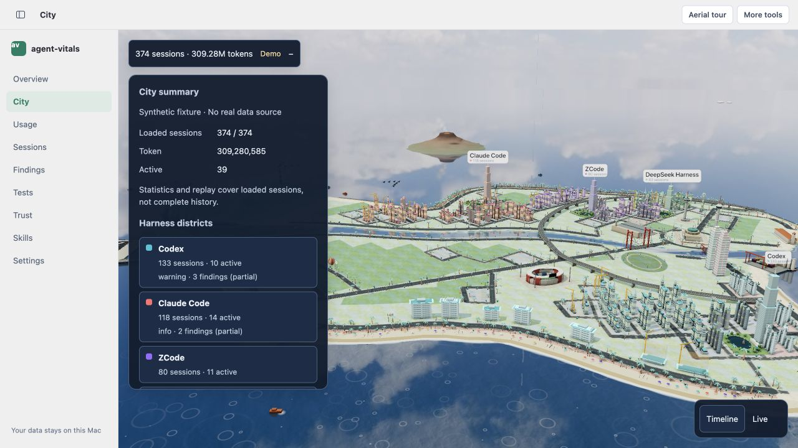
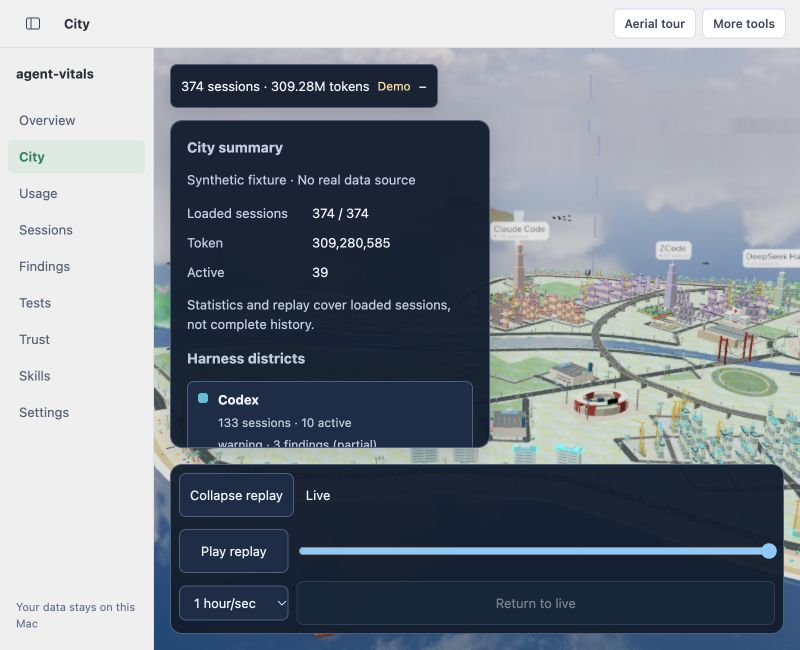

## 默认摘要半透明调整

首轮摘要半透明截图如下；其 hover 加深方案已被后续统一控件规则替代。

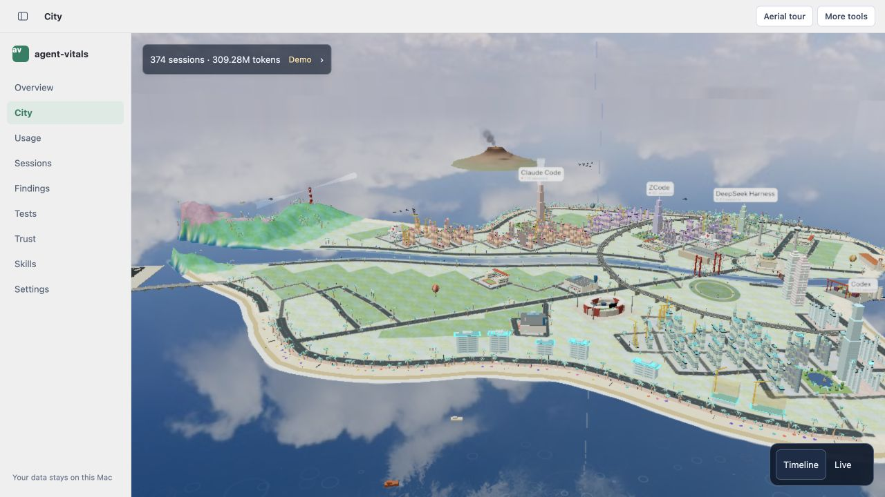

### 统一控件透明度（最新）

City 浮层按钮、摘要入口、城区条目、下拉控件及收起的回放条统一使用背景 alpha `0.76`，hover 降至 `0.66`（更透明，而不是加深），保留文字/图标与焦点描边。不添加模糊滤镜，不改变详情阅读面板或宿主顶部工具栏的底色。浏览器实测摘要入口和城区条目的默认/hover 背景分别为 `0.76`/`0.66`，摘要元素整体 `opacity: 1`；City 构建、`git diff --check` 通过。未重新安装 App。

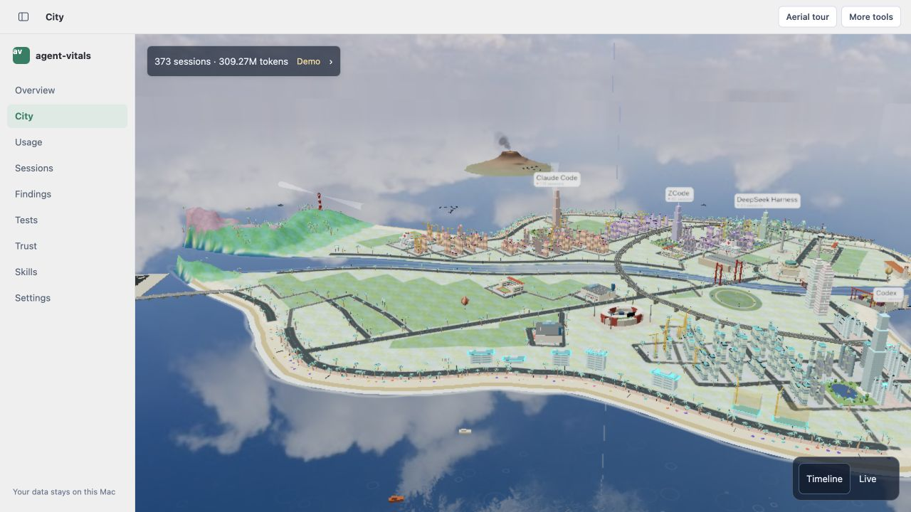

### 回放入口单层底板修正

收起的回放条移除内层按钮底色和边框，外层圆角、阴影与摘要入口一致，避免透明背景叠加后明显变深。浏览器实测默认外层 alpha `0.76`、hover `0.66`，两种状态内层按钮均完全透明、边框 `0px`；展开/收起回放操作通过。City 构建通过，未重新安装 App。

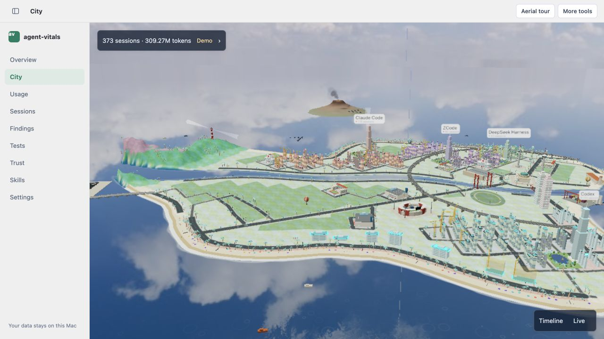

### 紧凑控件模板（最新）

尺寸、字号、圆角、间距和内边距统一为 CSS tokens。浏览器实测摘要/收起回放入口均高 `32px`、字号 `12px`、圆角 `6px`；展开后的播放按钮也为 `32px`/`12px`。摘要内边距为 `5px 8px`。粗指针高度仍为 `44px`，详情正文未缩小。展开/收起回放验证、City 构建、`git diff --check` 通过；原生 App 未重新安装。

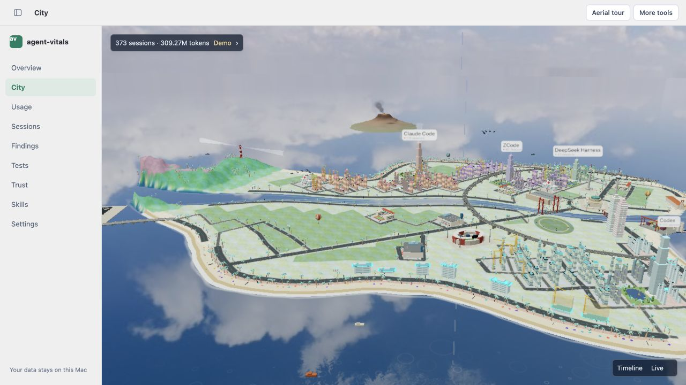

### 回放贴底与视觉弱化（最新）

展开回放改为贴底半透明轻量条，移除浮动卡片圆角与按钮实体边框，轨道为 `2px` 中性细线，滑块 `8px`，实际 range 高度 `24px`。浏览器实测 1280×720 下高度 `41px`、800×650 下高度 `81px`；两者底部间隔均为 `0px`，无横向溢出。点击游标后成功定位并返回实时。City 构建、`git diff --check` 通过；原生 App 未重新安装。

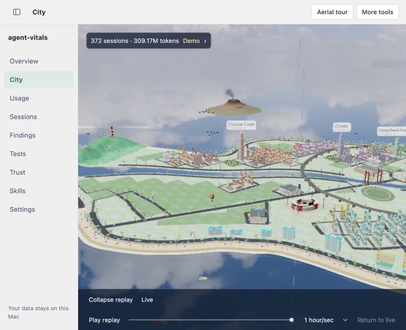

### 默认更透明、hover 加深（最新）

根据最新反馈反转共享透明度规则：默认 alpha `0.66`，hover alpha `0.76`，不改变元素整体 opacity。浏览器实测摘要与展开回放默认均为 `rgba(16, 29, 47, 0.66)`、整体 `opacity: 1`；回放 hover 为 `0.76`。此前“hover 更透明”的记录仅为历史迭代证据，已不代表最新规则。City 构建通过，未重新安装 App。

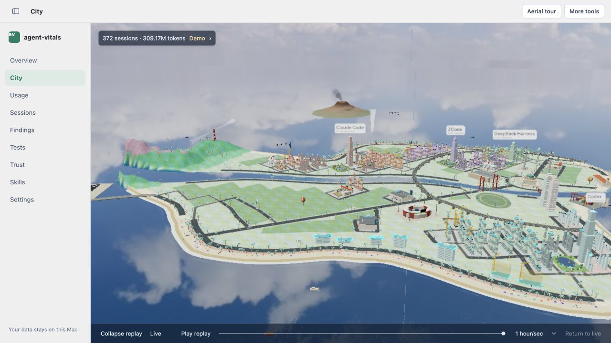
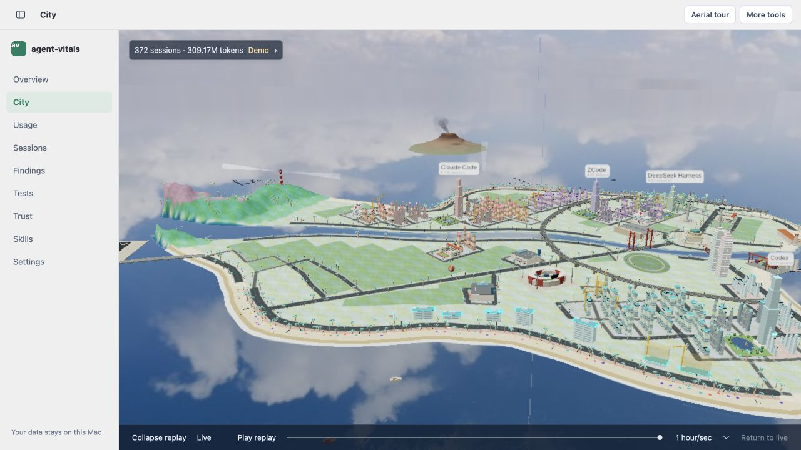

### 模态固定标题与正文滚动（最新）

城市设置与会话详情统一为固定标题/关闭按钮、单一正文滚动区；会话详情的宿主打开操作固定底部。设置即时生效，不新增保存按钮。长导出说明改为默认折叠，并补英文翻译。input 与按钮统一 `32px`/`12px`，设置 select 全宽。摘要、指南、建筑侧栏不受模态模板影响。

- 1280×720：设置高度 `620.5px`，正文高 `554px`、无需滚动；全部常用字段可见。输入高 `32px`、字号 `12px`，四个 select 宽度均 `498px`。
- 800×650、展开导出说明：弹窗上下留白各 `24px`，正文可视高 `487px`、内容高 `646px`。正文滚动到 `158.5px` 后，标题 top 仍为插件局部 `25px`，外层 scrollTop 为 `0`。
- 800×650：会话详情随内容自适应，高 `404.7px`，底部操作区高 `57px`，没有外层滚动；打开关闭成功。预览为 fixture，宿主打开按钮按契约禁用。长真实摘录、原生滚动/焦点行为不由本次测试推定通过。
- City typecheck、构建、locale 检查及 `git diff --check` 通过。未重新安装 App。

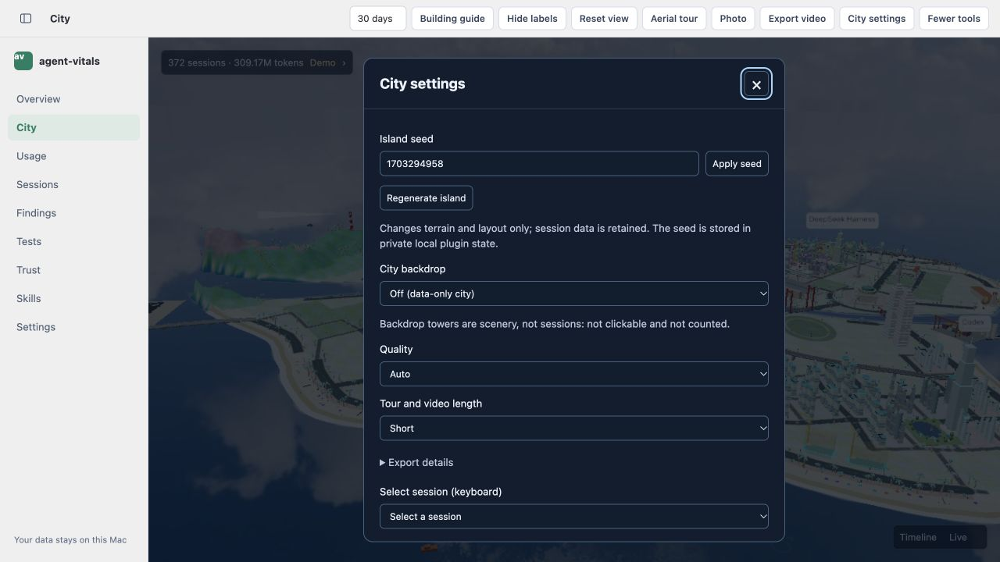
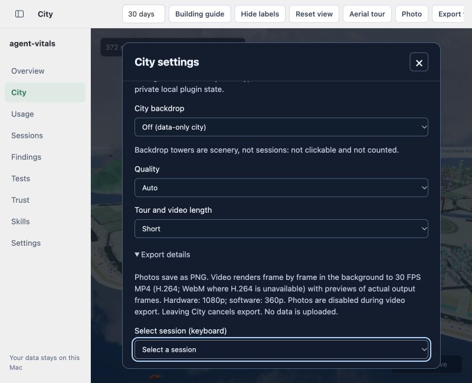
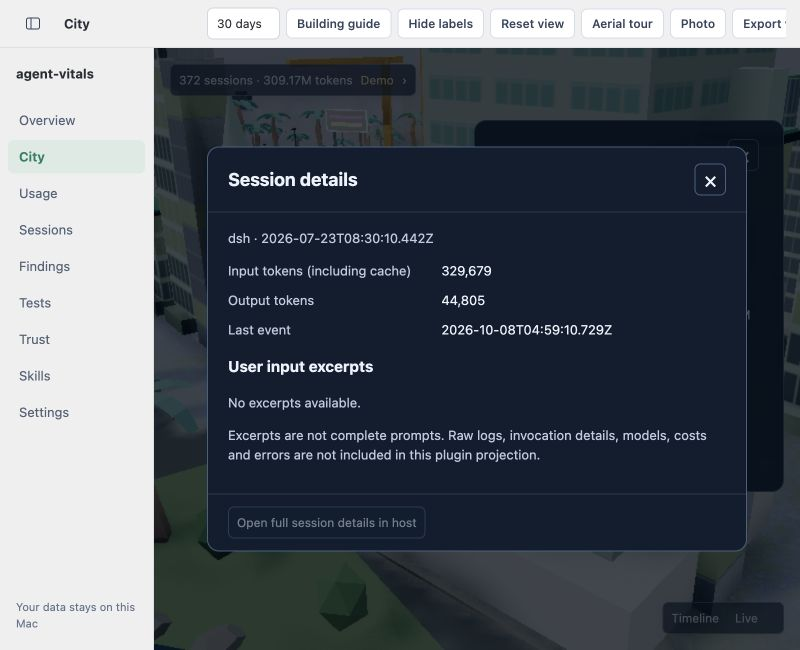

### 建筑环绕/缩放交互（最新）

范围：`codex/city-ui-ux` 工作树、浏览器 `5183/#city`、1280×720、英文、合成 fixture；未访问真实数据库。本轮针对会话建筑，不扩展游戏模式。

- 菜单选择 ZCode / 1,001,932 tokens 建筑后出现锁定提示；真实鼠标拖动环绕、滚轮放大后，所选建筑与锁定状态保留，目标可从另一侧观看。截图中的橙色环为选中建筑的地面标记。
- 点击 Unlock view 后出现自由浏览提示；画布按 F 重新出现锁定按钮；按 Escape 后建筑详情关闭。测试发现并修复了菜单选择仅更新 React、未同步引擎 selectedId/选中环的问题。
- 聚焦输入可打断动画；最大手势位移判定避免拖回起点误选；右/中键、次级触点与长按不选中。此项由回归测试覆盖，右键拖动完整手感尚未进行浏览器实操验收。
- 新增 `node scripts/verify-city-camera-interaction.mjs`：横/竖视口、宽楼、酒店地块覆盖、可见高度、手势判定、锁定中心、打断、解除锁定、菜单选择同步、选择清理与重置动画测试通过。City typecheck、build、locale 和 diff 检查通过；测试 Three CJS 弃用提示、构建大 chunk 提示仍存在。
- 取景包含实际主体矩阵尺寸及海滨地块加宽，使用高位斜俯视与邻域距离起步；有限候选方位/体积/射线检测仅为初始落点改善。**密集街区仍观察到初始局部邻楼遮挡，任意环绕角度无遮挡/完整相机碰撞尚未闭合**；不得把本次锁定操作通过推定为遮挡问题完全解决。
- 未重新编译安装原生 App；未提交或合并。本次截图为操作落点，不证明瞬时闪白消失。

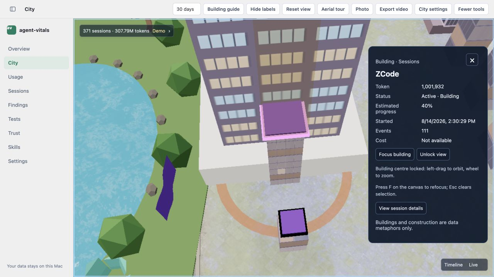

### 点击只锁定、平滑转向（最新规则，覆盖上一轮自动取景）

- 普通场景点击和会话选择入口只锁定目标，不调用自动拉近取景；会话、装饰建筑、市政厅与城区地标共享锁定/解除提示。装饰目标使用实际命中点，尚不宣称为精确几何中心。
- 锁定朝向采用 `360ms` 二次缓入缓出过渡：起终点相机位置一致，仅插值环绕中心。减少动态效果偏好使用不可感知时长；用户输入可以接管。
- 新增测试通过：会话/装饰选择相机位置不变；过渡中间帧 pivot 为中点、相机位置不变；终态正确；空白点击解除；装饰解除后 F 重锁支持。保留上一轮显式取景、动画打断、重置视角测试。
- 浏览器 1280×720 合成 fixture：实际点击火山有介绍和 Unlock view、没有拉近；点击天空关闭介绍并解除；菜单选择 ZCode 会话有锁定提示。落点截图无法证明每帧动画流畅，未进行录像验收。较窄窗口展开工具栏后设置点击出现未打开情况，桌面宽度下通过；此工具栏响应式点击问题仍需单独复查。
- City typecheck/build、camera interaction、locale、diff 检查通过。未安装原生 App、未提交合并。

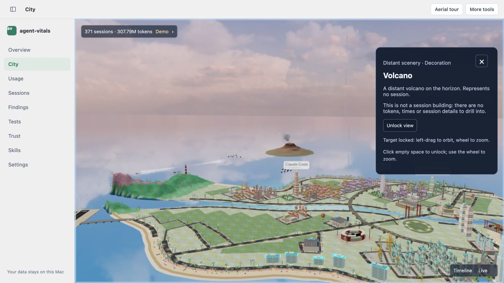

### 点击海滨后纯色 / Reset 无效（根因与修复）

浏览器重现：海滨点击 `(373,748)` 的相机诊断日志显示合法相机位置，但拾取目标 JSON 为 `[null,null,null]`，对应非有限坐标 NaN。无效交点进入锁定插值后污染相机，城市消失仅余背景；从 NaN 起点再次插值无法通过 Reset 恢复。不是正常的选中变色。

- 拾取遍历跳过非有限距离/交点及近裁剪面之前的命中，继续查找真实目标；锁定入口再次检查目标有限性。部分隐藏零缩放/程序化实例可能产生此类无效命中，本次不重写模型渲染。
- Reset 在位置、目标或四元数已损坏时先直接恢复合法 home 状态与距离约束，再处理控制器和重置动画；仅异常恢复输出无数据的本地 warning，临时几何诊断已删除。
- 浏览器在同一海滨点击位置复测：无虚假介绍、城市仍可见；桌面宽度下拖动后点击 Reset view 恢复正常城市画面。
- 回归测试覆盖 NaN 装饰目标拒绝、无效命中跳过后仍能选真实目标、位置/目标/四元数/maxDistance 同时损坏后重置恢复。typecheck、build、locale、diff 检查通过。异常状态恢复由测试验证，未在浏览器注入损坏状态；未安装原生 App。

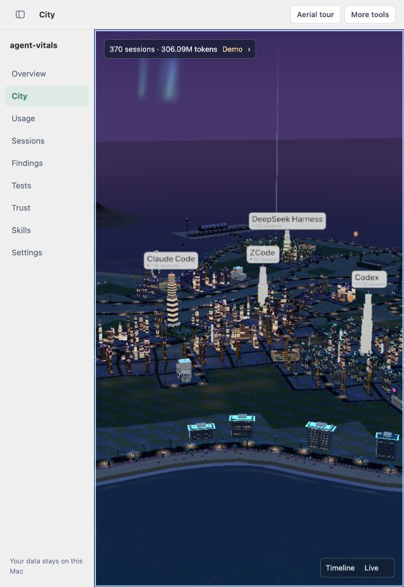

## 尚未闭合

原生 macOS bundle 的布局/焦点/尺寸同步 UAT、瞬时闪白录像验证、导出完整流程、航拍退出相机与选择状态恢复、空/受限数据与极小窗口边界，不由此次浏览器验收推定通过。游戏模式仍延期。未提交、未合并，未替换已安装 App。
