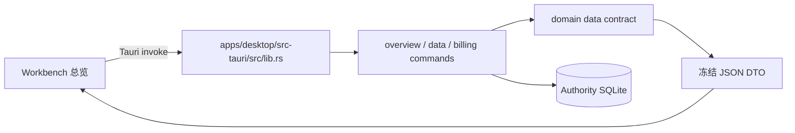

# v1.0.0-beta.1 总览页后端接入规格

**状态：** Draft v2（2026-09-13 按代码核对修订），作为 Beta 1 M1/M2 的实现合同  
**日期：** 2026-09-13  
**关联文档：** [Beta 发布规格](BETA_1_RELEASE_SPEC.md)、[Beta 执行计划](BETA_1_EXECUTION_PLAN.md)、[UI/UX 差距分析](BETA_1_UI_UX_GAP_ANALYSIS.md)、[总览信息架构复核](BETA_1_OVERVIEW_IA_REVIEW.md)、[路线单位成本决策规格](ROUTE_UNIT_COST_DECISION_SPEC.md)（`v1.1` 范围）

## 1. 目标

将当前 `workbench.html` 的“概览”页面从 Vite 演示数据接到桌面应用的 Authority 数据库，使用户在真实 `.app` 中能可靠回答以下问题：

1. 本月花了多少、今天消耗了多少、预算是否临近；
2. 数据是否同步、哪些来源正常或需要检查；
3. 支出中哪些已确认，哪些仍是估算或待补充；
4. 是否存在需要处理的账单确认项；
5. 何时可以基于已读取的 Codex 配额做保守提示。

页面结构、文案层级和当前三张 KPI 卡片是本次接入的 UI 合同。接入工作不得以“方便取数”为理由把订单、价格、保留策略等设置表单重新放回概览页。

## 2. 范围与非目标

### 2.1 本次范围

- 总览首次加载、手动同步后的刷新和从其他标签返回后的刷新；
- 现有 Tauri IPC 命令与 Authority SQLite 数据的连接；
- 总览各区块的真实数据、空态、失败态、部分数据和过期态；
- 把设置相关读取延后到“设置”标签，避免总览加载无关数据；
- 将 Vite mock 改为可验证的接口契约，而非静默兜底的演示数据。

### 2.2 不在本次范围

- 新的价格抓取、重新计算引擎、数据迁移或数据库 schema；
- 线路单位成本、跨提供商实时推荐、Claude/GLM 剩余额度采集和自动切换通知；
- 把 `metered_estimate` 或 `api_equivalent` 当作实际账单；
- 对当前总览的视觉重设计。

`ROUTE_UNIT_COST_DECISION_SPEC.md` 中的决策能力依赖价格快照、配额证据、历史聚合和稳定性规则。Beta 1 只保留当前“现在该用谁”卡片中已有、可验证的 Codex 配额提示；没有足够证据时必须显示不可判断，不能生成跨提供商推荐。

## 3. 运行架构与数据边界



浏览器中的 `http://127.0.0.1:4178/workbench.html` 通过 `tauri-mock.js` 运行，只用于开发与合同测试；它不会写入或读取 Authority 数据库。发布版从 Tauri Webview 的真实 `window.__TAURI__` 调用命令。验收必须在真实桌面应用完成，不能以 Vite 页面能显示数据作为“已接入”的证据。

前端只负责：并发请求、格式化、按状态显示和导航。金额归类、币种、计费依据、覆盖范围和未解决原因必须由 Domain/后端 DTO 给出，不能在 JavaScript 中根据模型名或来源路径推断。

**形状来源纪律**（CLAUDE.md；2026-09-13 已在 mock 上抓出两处）：`tauri-mock.js` 的每个 fixture 必须注明产生方的 Rust 序列化函数与行号；渲染器与 fixture 不得各自手写期望形状互相印证。已修的两例：`sync.at` 曾用 `toISOString()`（UTC）而生产是 `overview.rs SyncStatus::ok → clock::local_timestamp_text`，格式 `"YYYY-MM-DD HH:MM:SS"`（统计时区本地时间，前端 `slice(11,16)` 取 HH:MM）；`total_actual_spend` 曾漏掉订阅月费，而 domain `data_contract.rs::total_actual_spend` 按币种把 `fixed_subscription + metered_actual + harness_billed` 求和。

**性能形状**（CLAUDE.md 2026-09-05 tab 卡顿事故）：总览一次渲染并发发起月/日/日历三个命令，每个都会折叠 Codex rollout；它们能不卡完全依赖 `runtime::summary::codex_merged_cached` 的进程级 60s memo（Arc 命中，锁内不深拷贝）。`data_codex_quota` 同样有 60s 缓存。**任何新增数据面（含 §6.3 的 `overview_bootstrap` 备选）必须走同一 memo**，自建枚举 + fold 管线就是事故复刻。

## 4. 总览 UI 与后端数据合同

总览首次进入时先读取统计时区，再以该时区计算 `date=YYYY-MM-DD` 和 `month=YYYY-MM`。同一次渲染中使用相同的日期范围，避免“今日”和“本月”按不同时区计算。

| 页面区块 | 主数据命令 | 使用的后端字段 | 成功态 | 空态或异常态 |
|---|---|---|---|---|
| 顶部范围、最近同步 | `read_overview` | `sync{ok, stage, at, message}`（`at` 为统计时区本地 `"YYYY-MM-DD HH:MM:SS"`）、`fx{usd_cny, as_of}` | 显示「本月 · 已更新 HH:MM」 | 读取失败时显示“暂无法读取同步状态”；不阻塞其他区块 |
| 顶部来源摘要 | `data_source_status` | 每个来源的启用、读取、健康/错误状态 | `n 个来源正常，m 个需检查`，点击进入设置的数据来源区 | 无已启用来源时显示“尚未连接数据来源”；状态未知不计作正常 |
| “本月支出”卡 | `data_monthly_summary({ month })` | `actual_spend_by_basis{fixed_subscription\|metered_actual\|harness_billed → {币种: 金额}}`（**既有 DTO 字段，本批次复用**，`data_contract.rs::actual_spend_by_basis`，各栏之和恒等于 `total_actual_spend`）、`by_provider`（名义）、`has_unresolved` | 按量费用 / 订阅月费分币分行，按官方价折算作脚注 | 无实际账单时该行显示「无数据」，不以 `0` 代替未知 |
| “今日消耗”卡 | `data_daily_summary({ date })` | `tokens_by_harness[h].{total, uncached_input, cache_read, cache_write, output}`（前端 `tokensSum` 求和，**DTO 无 `total_tokens`**）、`actual_spend_by_basis`、`freshness` | 展示今日 Token、按量费用及说明 | 当天无记录显示“今天还没有用量记录”；日期数据失败时单卡降级 |
| “预算”卡 | `read_overview` | `budget{source, level, month_ratio, month_cost, monthly_cny, effective_daily_budget, generated_at, snoozed_until, reasons}` | 只展示已配置预算的进度与金额 | **未配置整卡隐藏**（UI/UX 差距分析 §4 第 80 行「仅配置后出现摘要卡；未配置不显示 0%」），入口 `设置预算 ›` 落在「本月已处理」行；不在总览展开编辑表单 |
| “现在该用谁” | `data_codex_quota` + 月汇总 | `{plan_type, limits.primary{used_percent, resets_at}, observed_at}`；月汇总 `by_provider` 里的订阅月费 | 仅在新鲜、可解释的配额证据下显示保守提示 | 配额不可读、过期或其他提供商无证据时显示“暂无法给出建议” |
| 本月使用情况 | `data_monthly_summary({ month })` | `tokens_by_harness`（求和 + 日均） | 展示总 Token | 无记录显示零状态说明，不能暗示未采集数据为零 |
| 数据可信度 | `data_status` + 月汇总 | `data.{health, unresolved_tokens, unpriced_tokens, pricing.stale}`（**键名以此为准**） | 两条状态行：用量归属 / 价格齐全；颜色来自 `health` 而非百分比 | 数据状态读取失败时显示“读不到数据状态，无法确认这些数字是否完整” |
| 待确认账单 | `billing_import_candidates`、`billing_declarations`、`billing_recalculation_jobs` | 候选项、声明版本、计算任务状态 | 显示待处理数量和影响范围，操作进入待处理/设置 | 无候选时不显示打扰性提示；读取失败不得假称“无需处理” |
| 支出明细 | `data_monthly_summary({ month })` | `by_harness`、`by_provider`、`actual_spend_by_basis` | 显示有明确数据依据的拆分 | 无可拆分金额时显示解释，不伪造占比 |
| 最近几天 | `read_calendar_month({ month })` | 每日 Token、金额、完整性/状态 | 按当前月份展示最近有记录的日期 | 日历为空显示“本月还没有可展示的日记录” |

### 4.1 现有命令足以完成的首轮接入

首轮不新增聚合接口。下列已有 IPC 命令是唯一的首轮数据来源：

```text
read_overview
data_monthly_summary({ month })
data_daily_summary({ date })
read_calendar_month({ month })
data_source_status
data_status
data_codex_quota
billing_import_candidates
billing_declarations
billing_recalculation_jobs
```

`statistics_timezone_config` 是日期计算前的配置读取；`budget_config`、价格目录、保留策略、诊断信息和来源根目录属于设置页，不能继续作为 `renderOverview()` 的必经请求。

若真实 DTO 与表中字段名称不同，**更新本规格与 mock 合同**，不在 IPC 边界为对齐文档再加映射层；不能让组件直接依赖内部 SQLite 行或扫描日志结果。日期唯一来源：`statisticsToday()` / `statisticsMonth()`（文件头统一按统计时区计算），总览取数、`查看今天 ›` 跳日历、预算卡剩余天数都只用这两个函数。

## 5. 金额、计费依据与可信度规则

1. `fixed_subscription`、`metered_actual` 与 `harness_billed` 才能计入已确认实际支出；汇总必须使用后端的 `total_actual_spend` 和 `actual_spend_by_basis`。
2. `metered_estimate` 和 `api_equivalent` 仅可作为估算/参考显示，必须带明确标签，不能混入“本月支出”主金额。
3. 未知计费依据、未知币种、缺价格或路由证据冲突必须保留为未解决状态。前端不得将其归零、归为订阅，或按模型名称猜测提供商。
4. 不同币种只能在后端有冻结汇率、明确换算范围和不确定性说明时合并展示；否则按币种拆分或显示无法合并。
5. “今天还没有记录”只表示当前查询窗口内无可用事实，不表示主机没有使用。页面需同时呈现同步/来源状态，避免把采集失败误解为零用量。
6. `sourcesBrief(monthly)` 不能继续以 `monthly.by_harness` 推断来源健康度。月内有历史记录不代表来源当前可读；顶部来源摘要必须以 `data_source_status` 为准。

## 6. 加载、刷新与降级行为

### 6.1 请求时序

1. 读取 `statistics_timezone_config`，计算统计日/月；配置不可读时使用应用声明的默认时区，并在诊断中保留原因。
2. 并发读取总览所需的十个命令（`Promise.allSettled`）。一个请求失败不得取消其余请求。
3. 先渲染页面骨架和已完成区块，再填充慢区块；不得为了等待账单候选项而阻塞 KPI。
4. 用户点击“立即同步”后，现有实现是轮询 `read_overview` 直到 `sync.at` 变化（最多 10 × 1s），期间 `manualSyncPolling` 压住事件桥；保持这一机制，不另起一套。
5. **不新增 `renderGeneration`。** 现有 `wbPull`（`makePullMerger`）已把 focus / 可见性恢复 / `usage-fold-updated` / `sync-status-updated` / 手动刷新合并成串行的 `refreshActiveTab()`，同一入口下不存在旧响应覆盖新响应的问题。真正的漏洞是**绕过合并器的 `invoke`**：`renderDecideCard` 自己异步拉 `data_codex_quota`、六个设置渲染各自 `invoke`。修法是把所有取数收进 §8.1 的数据访问层、由 `renderOverview` 一次拿齐，而不是再加一层 generation 计数。

### 6.2 状态优先级

每个区块按下列优先级选择展示：

1. **错误**：命令失败或 DTO 不合法，显示可重试说明，保留其余区块；
2. **未配置/未连接**：引导到对应设置位置；
3. **无记录**：说明统计窗口内无可展示记录；
4. **部分或过期**：展示已知值，并同时显示不完整原因或更新时间；
5. **成功**：展示真实值及必要的上下文。

所有“查看详情”“去设置”“处理账单”操作只传递导航目标，不携带金额、来源文件路径、原始日志或可变计算结果。

### 6.3 刷新策略

- 刷新触发源（现有，全部经 `wbPull` 合并）：进入总览 / 切回 tab、`usage-fold-updated` 事件桥（后端 fold 完成，**主路径**）、`sync-status-updated` 事件桥、窗口 focus 与 `visibilitychange(visible)`、手动「刷新」与「立即同步」、设置保存后；
- `data_codex_quota` 可在一次前台会话中短暂缓存，但缓存必须标注读取时间；预算和月/日统计不得使用过期缓存覆盖同步后的结果；
- 若性能数据显示首次并发请求不可接受，才评估新增只读 `overview_bootstrap` 聚合命令。该命令必须复用现有 DTO 语义，并通过契约测试后才能替换独立调用。

## 7. “现在该用谁”卡片的 Beta 边界

当前卡片可以使用 `data_codex_quota` 读取到的真实 Codex 配额，并显示读取时间、剩余比例及“额度紧张”的保守状态。它不能执行以下推理：

- 没有 Claude/GLM 等提供商的真实剩余配额时，不能推荐它们作为替代；
- 没有冻结价格和计费证据时，不能计算“单位成本最低”；
- 未知配额不能按边际成本为零处理；
- 单日异常或未稳定的统计不能触发切换建议。

因此，当 Codex 配额低于阈值但没有其他可靠证据时，提示应为“Codex 额度较低；请在用量或设置中确认可用线路”，而不是指名推荐 Claude、GLM 或任何具体路线。完整线路决策在后续版本按 `ROUTE_UNIT_COST_DECISION_SPEC.md` 的数据和稳定性前置条件实现。

## 8. 前端实现要求

### 8.1 数据访问层

在 `workbench.js` 中建立一个总览数据访问层，负责：

- 集中声明命令名、参数、DTO 校验和错误归一化；
- 以 `Promise.allSettled` 并发获取彼此独立的数据；
- 将 UI 所需的格式化模型与原始 IPC 结果分开；
- 只把经 DTO 验证的值传给渲染函数；
- 对金额、Token、日期和错误原因使用一致格式。

渲染函数不得自行 `invoke`，也不得以未定义字段的默认 `0` 作为金额或用量。

### 8.1.1 B1-M1.1 冻结边界

- `OVERVIEW_REQUESTS` 是第 4 节十个命令与区块的可执行映射；`loadOverviewData()` 在统计时区读取后捕获一次日/月，使用 `Promise.allSettled` 返回 `{ window, data, errors }`。`data` 只包含通过校验的原始 DTO 或 `null`，`errors` 沿用 `normErr` / `ERR_TEXT`；金额和 Token 格式化继续由现有展示函数负责。
- `renderDecideCard(monthly, quota)` 与无记录提示只消费传入数据。配额每轮通过数据层请求，复用后端既有 memo，不再保留渲染函数上的缓存。手动同步仍使用原来的 10 × 1s 轮询和 `manualSyncPolling`。
- 六个设置读取由 `loadSettingsData()` 在进入设置（内部 tab 名 `sources`）时启动。总览不再调用这些设置渲染；唯一允许的配置前置读取是 `statistics_timezone_config`。
- 浏览器合同检查为 `scripts/verify-workbench-overview-contract.mjs`，已纳入 `npm --prefix apps/desktop/ui-dev run verify`，覆盖十个显式 fixture、Rust 形状出处、未知命令失败、坏 DTO、独立失败、并发请求及设置延迟读取。
- 本批次只冻结合同与取数边界；来源摘要的健康判定、KPI 分状态接入、账单错误呈现和决策降级文案仍分别属于 B1-M1.2–M1.4。浏览器验证不代表真实 `.app` 验收。

### 8.2 需要修正的当前接入点

1. 顶部来源摘要改用 `data_source_status`，并将“正常/需检查/未连接”的判定集中定义；
2. 总览渲染移除价格目录、保留策略、诊断、来源根目录等设置数据的预加载，切换到设置标签时再读取；
3. `renderDecideCard` 移除无实证的跨提供商推荐——当前 <15% 时的文案「建议先切到 Claude Code 或 GLM」违反第 7 节，改为「Codex 额度较低；请在用量或设置中确认可用线路」；MiniMax 等用户声明月费的订阅行只显示「值回月费倍数」，不作推荐；`data_codex_quota` 的 `invoke` 移出渲染函数；
4. 预算卡只读 `read_overview` 的预算摘要，未配置整卡隐藏（入口在用量行），已配置时 `调整预算 ›` 进入设置页预算区并聚焦月额输入框；
5. 账单候选项、声明和重算任务失败时显示“待确认状态暂不可读”，不能隐藏整个区域；
6. 模拟器对未知命令必须抛出明确错误——当前 `tauri-mock.js:363` 的 `default: return ok({status:"ok", browser_mock:true})` 是静默兜底，漏接命令永远绿。每个被总览调用的命令都必须有与真实 DTO 对齐、注明形状出处的 fixture。

### 8.3 后端实现要求

- 保持 `apps/desktop/src-tauri/src/lib.rs` 中现有命令名称和参数兼容；
- 从 Authority Repository/Domain DTO 返回 JSON，不允许前端读取数据库文件、执行环境日志或本机路径；
- 错误响应使用可行动、无敏感路径的错误码/原因。**沿用现有 `ERR_TEXT` 词表**（`workbench.js:180`：`database_missing / database_unreadable / schema_too_new / source-unavailable / not-found / stale-revision / schema-mismatch / permission`），新码只往这张表加，不另起第三套命名（现有已是下划线与连字符并存，先统一再扩）；
- DTO 增加字段时保证旧字段语义不变；删除或改义字段须先更新 mock、前端合同测试和本规格。

## 9. 实施拆分

| 批次 | 交付内容 | 完成条件 |
|---|---|---|
| B1-M1.1：合同收口 | 冻结区块—命令映射；更新 mock fixture（注明形状出处）；未知命令报错；**建立 §8.1 数据访问层，把 `renderDecideCard` 的 `invoke` 与 6 个设置渲染（harness bills / 保留期 / 统计时区 / 价格目录 / 关于诊断 / 预算设置）移出 `renderOverview`** | Vite 中所有总览命令有显式 fixture，合同测试可发现漏接命令；`renderOverview` 内无 `invoke` 以外的取数、无设置类渲染——不先立起这一层，M1.2–M1.4 每批都会再往里塞 |
| B1-M1.2：KPI 接入 | 月支出、今日消耗、预算、本月使用、最近几天接真实 IPC | 在真实 `.app` 以受控数据验证成功、空记录、失败三种状态 |
| B1-M1.3：可信度与来源 | 顶部来源摘要、同步状态、可信度提示接真实状态命令 | 来源异常不会被显示为“正常”，不完整数据不会显示成零 |
| B1-M1.4：账单与决策降级 | 待确认账单接入；配额卡按证据降级 | 无账单和账单读取失败可区分；无替代路线证据时不推荐具体提供商 |
| B1-M2：设置按需加载 | 设置请求从总览渲染链路移出；概览跳转到对应设置锚点 | 总览首次请求不包含设置专用命令，设置保存后相关概览区块刷新 |
| Beta 验收 | 原生应用回归、合同测试、领域测试和人工审查 | 第 10 节全部通过 |

## 10. 验收标准

### 10.1 功能验收

- [ ] 在有完整数据的 Authority DB 中，三张 KPI、月度使用、支出明细和最近几天与同一统计时区下的后端返回一致（待真实 `.app` 验收）；
- [x] 今日、月度和日历使用同一时区计算边界（loader 捕获窗口 + 契约测试覆盖）；
- [x] 已确认实际支出不包含估算/API 等价金额；估算或未解决数据有可见说明（KPI 回归覆盖 `harness_billed`/`metered_actual` 与估算隔离）；
- [x] 来源状态来自 `data_source_status`，断开或错误的来源不会被计为正常（来源状态映射测试 + 浏览器 UAT）；
- [x] 无来源、无记录、预算未配置、账单读取失败、配额不可读和数据过期都具有不同且准确的界面状态（隔离/空态/失败态契约测试）；
- [x] 总览不会读取或展示用户的本机文件路径、原始会话内容、令牌或密钥（可见性与文本审计通过）；
- [x] 无可靠替代线路证据时，决定卡不指名推荐其他提供商（低额度与无配额证据回归通过）；
- [x] 从总览进入设置、待处理、用量页面时，导航目标正确且不携带过期的金额快照（设置分区浏览器 UAT + 窗口捕获测试）。

#### Authority MCP 对拍说明

该项可以通过本机只读 MCP 完成后端侧对拍。使用 `agent-vitals data-mcp serve` 的 `control_plane` 工具依次读取 `dashboard_snapshot`、`daily_summary`、`monthly_summary` 和 `calendar_month`，并以 envelope 中的同一 `timezone`、`authority_revision` 和统计窗口核对结果。当前已在本机 Authority DB 成功调用，返回 `authority_state=enabled`、`timezone=Asia/Shanghai`；但 Vite 页面使用浏览器 mock，尚未证明真实 `.app` UI 与这些 MCP 返回逐字段一致，因此第 1 项仍保持未勾选。

2026-09-14 真机 MCP 冒烟：19 项 `EXACT`、4 项 `PARTIAL`、2 项 `BLOCKED`。Q01–Q05、Q11–Q13、Q15 以及 S4/M07/M12/M18/S5/S6 对拍通过；`dsh` 与 `workbuddy` 仍处于 stale/partial 覆盖，Q08/Q09 仍无可用 skill 证据，故本次结论为“后端预验收通过，功能验收未闭环”。

### 10.2 自动化与人工验证

- [x] `npm --prefix apps/desktop/ui-dev run verify` 通过；
- [x] `node scripts/verify-workbench-kpi-decide.mjs` 覆盖决定卡的可用、不可读和额度紧张降级；
- [x] `node scripts/verify-workbench-visibility.mjs`（无头 Chrome 真实 DOM；已并入 `npm run verify`）覆盖每个必须可见的 id、`display:none` 规则不命中首屏元素、可见文本无内部词表、预算已用 == 本月按量费用——M1.2 的空态/失败态最容易被 CSS 藏掉而 vm 测试看不见；
- [x] 新增或更新 mock 合同测试，覆盖本规格第 4 节列出的每一个命令以及未知命令失败；
- [x] 受影响 Rust crate 的测试通过；发布前执行 `cargo test --release` 与 `cargo clippy --release --all-targets -- -D warnings`；
- [ ] 在真实桌面 `.app` 中以至少一组有数据和一组空/异常数据完成截图级人工验收；
- [x] `git diff --check` 无空白错误，且不引入未审查的格式化改动。

## 11. 发布判定

当第 10 节完成后，总览可以作为 `v1.0.0-beta.1` 的真实数据页面发布。它提供的是可审计的“使用、支出、预算和数据可信度”概览，不承诺跨提供商最优线路决策。后者必须在其数据前置条件和独立验收完成后另行发布。

### B1-M1.2–M1.4 实现核对（2026-09-13）

- KPI、逐日记录、可信度与三类账单读取失败分别显示不可读状态；只有成功的空 DTO 才表示无记录。预算坏字段不补零，未配置预算仍隐藏。
- 今日/月汇总参数、月用量日均和预算剩余天数使用 loader 捕获的同一统计窗口。按量已确认支出为 `metered_actual + harness_billed`，订阅单列，估算不得混入。
- 配额卡保持中性；超过 24 小时、未来时间或已到重置时刻的快照不用于当前余量提示，无证据显示“暂无法给出建议”。这只是保守展示门槛，不实现线路决策。
- 浏览器合同与 KPI 回归不替代真实 `.app` 的 Authority 受控数据验收；原生成功/空记录/失败验收仍待执行。
