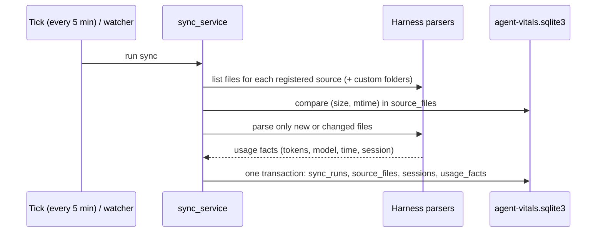
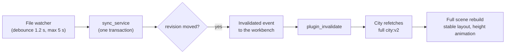

Oh Agent's data pipeline has four steps: **discover** each agent's log files, **diff** them against what was already imported, **parse** new events into usage facts, and **write** those facts to a local SQLite database in one transaction. A sync runs every 5 minutes; on the desktop app, a file watcher can start it early when logs change.

## Key facts

- **Sources** come from one registry, in this order: `claude-code` → `codex` → `dsh` → `workbuddy`.
- **Only changed files are parsed.** Each file's size and modification time are remembered in a `source_files` table.
- **Every fact has a stable ID**, so re-importing a file creates duplicates that are dropped, not double counts.
- **One sync batch = one SQLite transaction**, so the database is never half-written.
- **Default sync interval:** 300 seconds. The file watcher wakes the sync about 1.2 seconds after a log changes (at most 5 seconds while it keeps growing); it never writes to the database itself.
- **City refreshes itself** after each sync that changes data, by reloading the full projection.
- **The database stores counts and anchors, not transcripts.** Raw text stays in the agents' own log files.

<!-- source: crates/agent-vitals-harnesses/src/sources/session_harnesses.rs (SESSION_HARNESSES order, "顺序即契约") -->
<!-- source: crates/agent-vitals-ingest/src/ingest/sync_service.rs (source_files fingerprint (size, mtime_ns); "fact_id exactly-once 全部 Duplicate，账目零影响") -->
<!-- source: crates/agent-vitals-ingest/src/ingest/sql_sync.rs (sync_runs → source_files → sessions → usage_facts in one with_immediate_txn) -->
<!-- source: crates/agent-vitals-ingest/src/ingest/scheduler.rs (tick_period: Duration::from_secs(300)); crates/agent-vitals-ingest/src/ingest/watch.rs (watcher only wakes the tick, "不直接 mark_dirty、不碰 DB") -->
<!-- source: AGENTS.md policy item 4 ("Raw text lives in the harnesses' logs, not in the authority DB") -->

## Which folders are read?

| Source | Harness id | Files read |
| --- | --- | --- |
| Claude Code | `claude-code` | `~/.claude/projects/**/*.jsonl` |
| Codex | `codex` | `~/.codex/sessions/**/rollout-*.jsonl` and `~/.codex/archived_sessions/**/rollout-*.jsonl` |
| DeepSeek Harness | `dsh` | `$DSH_HOME/sessions/**/session.jsonl` (or `.jsonl.zstd`); `DSH_HOME` defaults to `~/.dsh` |
| WorkBuddy | `workbuddy` | `trace_*.json` under `~/.workbuddy/traces/` |
| Local manifest sources | `harness:<slug>` | Whatever the manifest in `harnesses.d/<slug>/manifest.json` declares |

You can also add extra folders for Claude Code, Codex and DSH in Settings. See [Custom folders and manifest sources](/docs/integrations/custom-sources-and-manifests).

<!-- source: session_harnesses.rs (usage_source_roots: .claude/projects, .codex/sessions, .codex/archived_sessions, workbuddy_root, dsh_home/sessions) -->
<!-- source: harnesses/claude_code/sources/mod.rs (claude_project_files_with_errors: .claude/projects, extension jsonl); harnesses/codex/sources/mod.rs (codex_rollout_files_with_errors: starts_with "rollout-" && ends_with ".jsonl") -->
<!-- source: harnesses/dsh/sources/discovery.rs (dsh_session_files_with_errors: n == "session.jsonl" || "session.jsonl.zstd"); crates/agent-vitals-query/src/sessions/discovery.rs (DSH_HOME env → default ~/.dsh) -->
<!-- source: harnesses/workbuddy/sources/mod.rs (home.join(".workbuddy")); harnesses/workbuddy/sources/traces.rs (workbuddy_traces_root → root.join("traces"); trace_*.json) -->
<!-- source: crates/agent-vitals-query/src/sources/harness_registry.rs (data_home.join("harnesses.d")); crates/agent-vitals-query/src/sources/source_controls.rs (format!("harness:{slug}")) -->

## What happens in one sync?

<!-- TBD: same mermaid rendering note as on the overview page. -->

1. **Discover.** For each source in the registry, list its files under the default folder and under any custom folders you added.
2. **Diff.** Skip files whose size and modification time match the last import. A lost fingerprint only causes a re-parse; duplicates are dropped by fact ID.
3. **Parse.** The source's parser turns log lines into usage facts: input tokens (uncached, cache read, cache write), output tokens, model, timestamps and session.
4. **Write.** All facts of one batch, plus file fingerprints and session rows, are committed in a single immediate transaction.
5. **Enrich.** Session titles are read from side indexes where the agent keeps them, and behaviour findings are evaluated for Claude Code, Codex and DSH.

<!-- source: sync_service.rs (lines ~640–665: registry loop + custom_sources loop); sql_sync.rs module doc -->

## How does Agent City update when new sessions arrive?

City refreshes on its own a few seconds after an agent writes to its log. It isn't an incremental, Vite-style hot patch yet: each refresh reloads the whole projection and rebuilds the city scene.

1. **Watch.** The file watcher waits 1.2 seconds after the last write, or at most 5 seconds while a log keeps growing, then wakes the sync. The 5-minute tick is the fallback.
2. **Sync.** New facts are committed in one transaction, which moves the database revision forward.
3. **Invalidate.** The desktop app emits one `Invalidated` event per new revision. A repeated revision is swallowed, so there's no time-based debounce here.
4. **Notify City.** The workbench calls `plugin_invalidate`, which fires `__AV_PLUGIN_INVALIDATED__` in City's WebView. A City tab that was hidden gets the same call when you switch back.
5. **Refetch.** City asks for the full `city:v2` projection again (up to 4,000 sessions). It doesn't fetch only the changed sessions.
6. **Rebuild.** If the data changed, City throws away the scene and builds it again. The previous layout is reused, so within one island tier existing buildings keep their lots. Buildings you already saw keep their height; new ones grow from the ground.

- **Opt-in paging:** with `?cityData=v3`, the same refresh reads `city:v3` page by page from one snapshot. A data change during loading restarts the read instead of mixing two versions.
- **Not implemented:** incremental diffs (only changed sessions) and patching single buildings. **TBD:** whether this is planned; see the [Roadmap](/docs/integrations#roadmap--规划中).

<!-- source: crates/agent-vitals-ingest/src/ingest/watch.rs (DEBOUNCE = 1_200 ms; MAX_DEBOUNCE = 5 s; "正确性仍由 tick 指纹对账保证") -->
<!-- source: apps/desktop/src-tauri/src/lib.rs (InvalidationPublisher: "权威 revision 严格前进才向 webview 发 Invalidated … 取代了 FoldCompleted + 200ms 去抖"; publish_invalidation) -->
<!-- source: apps/desktop/ui-dev/react/src/app/plugins/usePlugin.tsx (listenAppEvents: Invalidated | SourceDataDeleted → plugin_invalidate; resume → plugin_invalidate); apps/desktop/src-tauri/src/plugin_host.rs (plugin_invalidate → __AV_PLUGIN_INVALIDATED__) -->
<!-- source: apps/agent-city/ui/src/CityApp.tsx (listener → setRefresh → getProjection; signature compare; engine.applyModel); apps/agent-city/ui/src/engine/CityEngine.ts (parts.dispose + new CityParts; layoutCity(model, previous…); displaySnapshot "回访的楼保持高度…新到的楼从 0 长入"); apps/agent-city/ui/src/engine/cityLayout.ts ("档位内刷新/分页不改地图") -->
<!-- source: apps/agent-city/ui/src/data/provider.ts (cityData !== "v3" → v2; v3 revision_changed retry); dev bf7196a -->

## Where do session titles come from?

| Source | Title source |
| --- | --- |
| Codex | `~/.codex/session_index.jsonl` (`thread_name`) |
| Claude Code | the AI-generated title inside the session log |
| DSH | `<DSH_HOME>/storages/workspace.json` (workspace title) |
| WorkBuddy | not wired yet |

Titles are scrubbed and length-bounded before they reach the City view.

<!-- source: session_harnesses.rs (title_index doc: codex session_index.jsonl, DSH storages/workspace.json, claude-code title in log, workbuddy "暂未接"); apps/agent-city/ui/src/cityModel.ts (title_source: codex_thread_name | claude_ai_title | dsh_workspace_title) -->

## How are costs kept honest?

Costs are estimated separately from the city. When the provider or route of a request can't be proven, usage is kept and marked as a **metered estimate** with `has_unresolved = true`, never silently dropped or counted as zero. City shows each session's estimated cost and its status (estimated, subscription, unpriced or unavailable), but cost never changes a building's height.

<!-- source: AGENTS.md (Billing fallback rule; Data Integrity Watchlist); dev: crates/agent-vitals-query/src/query/app_local.rs (cost_minor / cost_status per session); apps/agent-city/ui/src/CityExperience.tsx (costLabel) -->

## What is never stored?

- Credentials and API keys. They are never written to anything Oh Agent owns.
- Full transcripts. The database keeps source anchors and short, scrubbed excerpts; full text is read from the original log only when you view it locally.
- If an agent deletes or rotates its log, Oh Agent shows that the source has expired instead of inventing data.

<!-- source: AGENTS.md policy items 3 and 4 -->

## Where is the data folder?

`~/.agent-vitals/` by default, or the folder in `AGENT_VITALS_HOME`. The database is `agent-vitals.sqlite3` inside it. Plugin state such as the City seed lives in `state/plugins/city.json`. Custom folders are listed in `state/custom-sources.json`.

<!-- source: crates/agent-vitals-runtime-core/src/core/home.rs; crates/agent-vitals-data/src/authority.rs; docs/CITY_LOCAL_DATA_PROJECTION.md (state/plugins/city.json); crates/agent-vitals-query/src/sources/custom_sources.rs (state/custom-sources.json) -->

**How long is data kept?** 13 months by default; you can set 1 to 60 months in Settings. **TBD:** confirm in the UI that pruning also removes old sessions from the City window (366 days fits inside the default).

<!-- source: crates/agent-vitals-runtime-core/src/core/retention.rs (DEFAULT_RETENTION_MONTHS = 13, MIN 1, MAX 60, retention-config.json); apps/desktop/src-tauri/src/lib.rs (retention_config / save_retention_config IPC) -->

## Related

- [Architecture overview](/docs/architecture/overview)
- [City model: how sessions become buildings](/docs/architecture/city-model)
- [Claude Code data source](/docs/data-sources/claude-code) · [Codex data source](/docs/data-sources/codex)
- [Add a new data source](/docs/contributing/adding-a-data-source)
