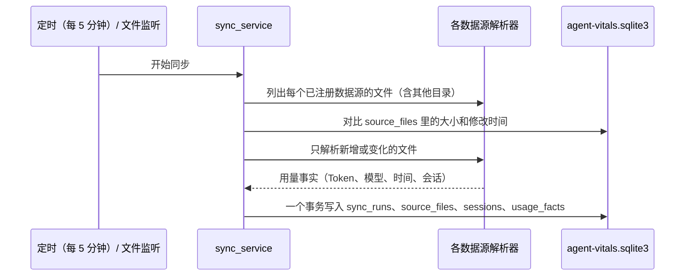
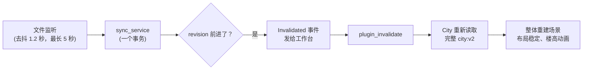

Oh Agent 的数据管线分四步：**发现**各 Agent 的日志文件，和已导入的记录**对比**，把新事件**解析**成用量事实，再在一个事务里**写入**本机 SQLite 数据库。每 5 分钟同步一次；桌面版还有文件监听，日志一变就能提前触发同步。

## 关键事实

- **数据源**来自同一张注册表，顺序固定：`claude-code` → `codex` → `dsh` → `workbuddy`。
- **只解析有变化的文件**：每个文件的大小和修改时间记在 `source_files` 表里。
- **每条事实都有稳定 ID**：同一个文件重复导入，只会产生被丢弃的重复项，不会重复计数。
- **一个同步批次 = 一个 SQLite 事务**，数据库不会出现写了一半的状态。
- **默认同步间隔** 300 秒。日志变化后约 1.2 秒（持续增长时最长 5 秒），文件监听会唤醒同步；它自己从不写数据库。
- **City 会自动刷新**：每次同步让数据有变化后，City 重新读取完整投影。
- **数据库存计数和锚点，不存对话原文**。原文留在各 Agent 自己的日志里。

<!-- source: crates/agent-vitals-harnesses/src/sources/session_harnesses.rs (SESSION_HARNESSES order); crates/agent-vitals-ingest/src/ingest/sync_service.rs (source_files fingerprint, fact_id exactly-once); sql_sync.rs (one with_immediate_txn); scheduler.rs (tick_period 300 s); watch.rs (watcher only wakes the tick); AGENTS.md policy item 4 -->

## 读哪些目录？

| 来源 | harness id | 读取的文件 |
| --- | --- | --- |
| Claude Code | `claude-code` | `~/.claude/projects/**/*.jsonl` |
| Codex | `codex` | `~/.codex/sessions/**/rollout-*.jsonl` 和 `~/.codex/archived_sessions/**/rollout-*.jsonl` |
| DeepSeek Harness | `dsh` | `$DSH_HOME/sessions/**/session.jsonl`（或 `.jsonl.zstd`）；`DSH_HOME` 默认是 `~/.dsh` |
| WorkBuddy | `workbuddy` | `~/.workbuddy/traces/` 下的 `trace_*.json` |
| 本地 manifest 数据源 | `harness:<slug>` | `harnesses.d/<slug>/manifest.json` 里声明的文件 |

Claude Code、Codex 和 DSH 还可以在设置里添加其他目录，见[添加其他目录和 manifest 数据源](/docs/zh/integrations/custom-sources-and-manifests)。

<!-- source: session_harnesses.rs (usage_source_roots); claude_code/sources/mod.rs; codex/sources/mod.rs; dsh/sources/discovery.rs; crates/agent-vitals-query/src/sessions/discovery.rs (DSH_HOME → ~/.dsh); workbuddy/sources/mod.rs, traces.rs; harness_registry.rs (harnesses.d); source_controls.rs (harness:{slug}) -->

## 一次同步发生了什么？

<!-- 待确认：mermaid 渲染同架构总览页的说明。 -->

1. **发现**：按注册表逐个列出数据源在默认目录和你添加的目录下的文件。
2. **对比**：大小和修改时间都没变的文件直接跳过。指纹丢了最多导致重新解析，重复项会按事实 ID 丢弃。
3. **解析**：解析器把日志行变成用量事实：输入 Token（未缓存、缓存读、缓存写）、输出 Token、模型、时间和会话。
4. **写入**：一个批次的事实、文件指纹和会话行，在一个立即事务里一起提交。
5. **补充**：从 Agent 自己的索引里读会话标题，并对 Claude Code、Codex 和 DSH 评估行为发现。

<!-- source: sync_service.rs (registry loop + custom_sources loop); sql_sync.rs -->

## 有新会话时 Agent City 怎么更新？

Agent 写入日志后几秒，City 会自己刷新。但这还不是 Vite 那样的增量热更新：每次刷新都会重新读取整份投影，并重建整个城市场景。

1. **监听**：最后一次写入后等 1.2 秒；日志持续增长时最长等 5 秒，然后唤醒同步。5 分钟一次的 tick 兜底。
2. **同步**：新事实在一个事务里提交，数据库 revision 前进。
3. **失效通知**：每个新 revision，桌面应用只发一次 `Invalidated` 事件，同一 revision 重复出现会被吞掉，这一步不靠时间去抖。
4. **通知 City**：工作台调用 `plugin_invalidate`，在 City 的 WebView 里触发 `__AV_PLUGIN_INVALIDATED__`。如果 City 标签页之前被隐藏，切回来时也会收到同样的调用。
5. **重新读取**：City 请求 `city:v3` 总览和第一页，再从同一快照追加后续页（最多 4000 个会话）。落地页宿主仍提供 `city:v2`。不是只取变化的会话。
6. **重建**：地理信息变了才丢掉旧场景重新构建。上一次的布局会被复用，所以在同一岛屿档位内，已有的楼保持在原来的地块上。分页追加和载入中途的 revision 变化会保留当前城市。看过的楼保持原高度，新楼从地面长出来。

- **默认分页**：`city:v3` 从同一快照逐页读取。载入过程中数据变了会保留已显示的城市并重新读取未完成的页，而不是把两个版本拼在一起。`?cityData=v2` 强制走兼容投影。
- **尚未实现**：增量差异（只传变化的会话）和单栋楼的局部更新。**待确认**：是否在计划中，见 [Roadmap](/docs/zh/integrations#roadmap--规划中)。

<!-- source: crates/agent-vitals-ingest/src/ingest/watch.rs（DEBOUNCE = 1_200 ms；MAX_DEBOUNCE = 5 s）；apps/desktop/src-tauri/src/lib.rs（InvalidationPublisher：revision 严格前进才发 Invalidated）；apps/desktop/ui-dev/react/src/app/plugins/usePlugin.tsx；apps/desktop/src-tauri/src/plugin_host.rs（plugin_invalidate）；apps/agent-city/ui/src/CityApp.tsx；apps/agent-city/ui/src/engine/CityEngine.ts（displaySnapshot）；engine/cityLayout.ts（档位内刷新不改地图）；data/provider.ts；dev bf7196a -->

## 会话标题从哪来？

| 来源 | 标题来源 |
| --- | --- |
| Codex | `~/.codex/session_index.jsonl`（`thread_name`） |
| Claude Code | 会话日志里 AI 生成的标题 |
| DSH | `<DSH_HOME>/storages/workspace.json`（工作区标题） |
| WorkBuddy | 暂未接入 |

标题在进入 City 之前会脱敏并截断长度。

<!-- source: session_harnesses.rs (title_index); apps/agent-city/ui/src/cityModel.ts (title_source) -->

## 费用怎么保证诚实？

费用估算和城市是分开的。如果一条请求的服务商或线路无法证实，用量会保留下来，标成**按量估算**（`metered_estimate`）并带 `has_unresolved = true`，绝不悄悄丢掉或算成零。City 会显示每个会话的估算费用和状态（估算、订阅、未定价或不可用），但费用不会改变楼高。

<!-- source: AGENTS.md (Billing fallback rule); dev：app_local.rs（每个会话的 cost_minor / cost_status）；apps/agent-city/ui/src/CityExperience.tsx（costLabel） -->

## 哪些东西永远不存？

- 凭据和 API Key，不会写进 Oh Agent 的任何文件。
- 完整对话。数据库只存来源锚点和简短的脱敏摘录；只有你在本机查看时，才会从原始日志里读全文。
- Agent 删除或轮换了日志时，Oh Agent 会显示“源已过期”，不会编造数据。

<!-- source: AGENTS.md policy items 3 and 4 -->

## 数据目录在哪？

默认是 `~/.agent-vitals/`，也可以用 `AGENT_VITALS_HOME` 指定。数据库文件是里面的 `agent-vitals.sqlite3`。City 种子等插件状态在 `state/plugins/city.json`，其他目录的列表在 `state/custom-sources.json`。

<!-- source: crates/agent-vitals-runtime-core/src/core/home.rs; crates/agent-vitals-data/src/authority.rs; docs/CITY_LOCAL_DATA_PROJECTION.md; custom_sources.rs -->

**数据保留多久？** 默认 13 个月，可以在设置里改成 1 到 60 个月。**待确认**：在界面上核实清理旧数据后，City 时间窗里的旧会话也会一起消失（366 天在默认保留期之内）。

<!-- source: crates/agent-vitals-runtime-core/src/core/retention.rs (DEFAULT_RETENTION_MONTHS = 13, MIN 1, MAX 60) -->

## 相关

- [架构总览](/docs/zh/architecture/overview)
- [城市模型：会话怎么变成楼](/docs/zh/architecture/city-model)
- [Claude Code 数据来源](/docs/zh/data-sources/claude-code) · [Codex 数据来源](/docs/zh/data-sources/codex)
- [添加新的数据源](/docs/zh/contributing/adding-a-data-source)
